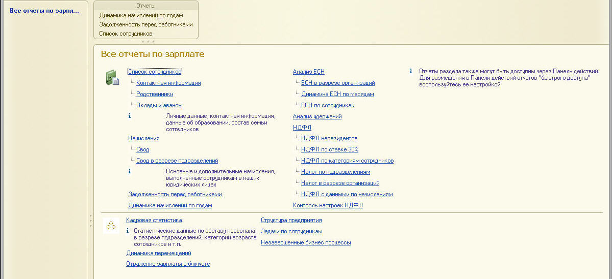

# #std401 Размещение большого количества команд в основном окне приложения

> Область применения: управляемое приложение.
>
> Раздел ИТС: Проектирование интерфейсов для 8.2
>
> Источник: https://its.1c.ru/db/v8std/content/401/hdoc
>
> Проверено по источнику: 2026-10-07

В конфигурациях может возникнуть проблема размещения большого числа команд в панели действия. Как правило, это касается команд формирования отчетов. Использование для большого числа команд панели действий не оптимально. Для решения данной проблемы предлагается следующая методика. <br>

<br>

Выполняется анализ всех команд отчетов, отнесенных к определенной подсистеме (с вложенными подсистемами);

- Для большинства из них снимается видимость по умолчанию;

- Для некоторых, наиболее востребованных отчетов, видимость по умолчанию оставляется;

- При необходимости, настройка видимости команд по умолчанию выполняется «по ролям», но для самого «полноправного» пользователя число команд, видимых по умолчанию в панели действий, не должно превышать 6-9 команд.

Для подсистемы верхнего уровня реализуется общая форма с названием, включающим в той или иной форме имя подсистемы, например, «Все отчеты по зарплате». В такой форме размещаются все команды той или иной подсистемы;

- В форме все команды реализуются как гиперссылки;

- В такой форме может быть реализована «отсылка» к настойке панели действий;

- Большой размер рабочей области позволяет разместить также команды смежных областей, т.е. реализовать подобие раздела «см. также».

Реализуется общая команда, например, **ВсеОтчетыПоЗарплате**:

- Код команды представляет собой просто открытие общей формы

> ```bsl
> ОткрытьФорму("ОбщаяФорма.ВсеОтчетыПоЗарплате", ,
> ПараметрыВыполненияКоманды.Источник,
> ПараметрыВыполненияКоманды.Уникальность,
> ПараметрыВыполненияКоманды.Окно)
> ```

- Название такой команды подчеркивает то, что она охватывает все отчеты. Например, «Все отчеты по зарплате».

- Команда включается в состав нашей подсистемы верхнего уровня.

- Команда относится к одной из групп Панели навигации

На рисунке ниже приведен пример внешнего вида основного окна приложения при выполнении такой команды как «Все отчеты по зарплате»


