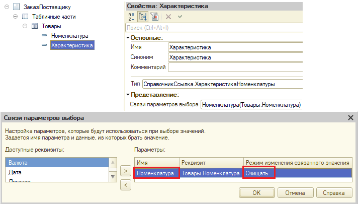
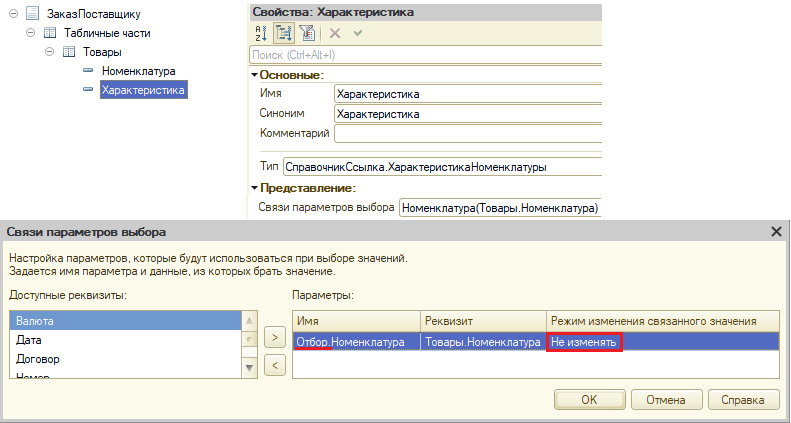
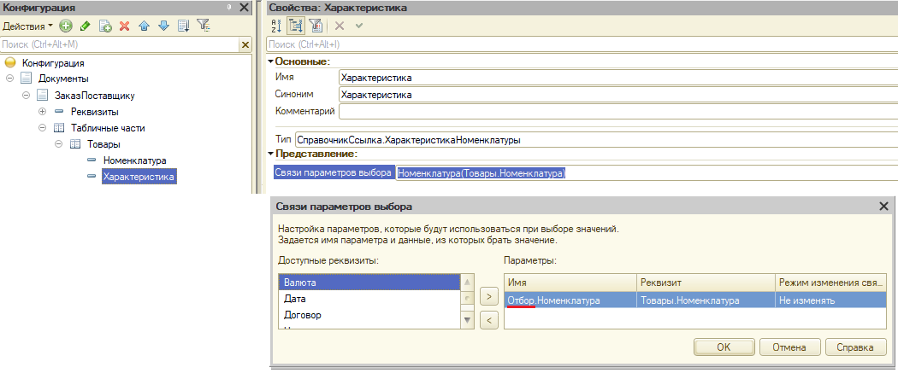

# #std411 Установка параметров выбора и связей параметров выбора для объектов метаданных

> Область применения: управляемое приложение, мобильное приложение, обычное приложение.
>
> Раздел ИТС: Соглашения при написании кода / Использование прикладных объектов и универсальных коллекций значений
>
> Источник: https://its.1c.ru/db/v8std/content/411/hdoc
>
> Проверено по источнику: 2026-10-07

<a id="1"></a>1\. Как правило, такие ограничения бизнес-логики как ограничения выбора, должны быть одинаковыми для всех форм, в которых редактируется тот или иной объект. Поэтому задавать параметры выбора и связи параметров выбора (между зависимым и ведущими реквизитами) рекомендуется в свойствах объектов метаданных - в реквизитах справочников, документов и т.п. <br>

<br>

2\. Однако могут встречаться случаи, когда ограничения выбора могут зависеть от конкретного сценария работы. В таких случаях параметры выбора могут быть уточнены по месту, в конкретной форме. <br>

<br>

Например, в конфигурации имеются

- справочник **Сотрудники**, в котором есть реквизиты **Организация** и **ВидСотрудника** (перечисление со значениями **Основной**/**Совместитель**);

- документ **ПриказОПриеме**, в котором есть реквизит **Организация** и **Сотрудник**; при этом для реквизита **Сотрудник** документа **ПриказОПриеме** задана связь параметра выбора **Отбор.Организация** с реквизитом **Организация**, в результате чего реквизит **Сотрудник** становится зависимым от ведущего реквизита **Организация**.

Требуется реализовать возможность выбора только основных сотрудников в зависимости от значения функциональной опции **ВыбратьТолькоИзОсновыхСотрудников**. Для этого необходимо

- в форме документа **ПриказОПриеме** добавить реквизит формы **ВидыСотрудников**, т.к. в документе нет реквизита **ВидСотрудника**.

- после чего, если функциональная опция **ВыбратьТолькоИзОсновныхСотрудников** включена, то для поля формы зависимого реквизита **Сотрудник** нужно программно установить связь параметра выбора **Отбор.ВидСотрудника** с ведущим реквизитом формы **ВидыСотрудников**, который предварительно заполнить видами сотрудников соответствующими значению функциональной опции.

Тогда установка связи для параметра **Отбор.Организация** в свойствах реквизита **Сотрудник** документа **ПриказОПриеме** и связи для параметра **Отбор.ВидСотрудника** в поле формы документа **ПриказОПриеме** приведет к тому, что в режиме **1С:Предприятия** будут работать обе связи параметра выбора. Таким образом, при выборе сотрудника в форме приказа о приеме отбор в списке сотрудников будет установлен как по организации, заполненной в документе, так и по виду сотрудника, который будет определен на основании функциональной опции.

<a id="3"></a>3\. Параметры выбора, указанные в метаданных объектов, учитываются при выборе значений в отборах отчетов и динамических списков. Поэтому их рекомендуется задавать и для объектов, которые не редактируются интерактивно.

Например, в конфигурации имеются

- справочник **Номенклатура** с реквизитом **ТипНоменклатуры** (перечисление со значениями **Товар**/**Услуга**);

- регистр накопления **ТоварыНаСкладе** с измерением **Номенклатура**;

- отчет по регистру **ТоварыНаСкладе** с быстрым отбором по измерению **Номенклатура**.

Тогда установка параметра **Отбор.ТипНоменклатуры** со значением **Товар** в свойствах измерения **Номенклатура** регистра **ТоварыНаСкладе** сократит список доступных значений в отборе отчета, не позволив выбрать номенклатуру с типом **Услуга**, которая не может храниться на складе.

<a id="4"></a>4\. Не рекомендуется указывать в связях параметров выбора **Режим изменения связанного значения** = **Очищать**. Вместо этого необходимо написать программный код, выполняющий условную очистку зависимого значения при несоответствии новым значениям ведущих реквизитов.

При безусловной очистке возможны следующие проблемы:

- При повторном выборе ведущего значения (без реального изменения) зависимый реквизит будет очищен.

- Если значение зависимого реквизита может соответствовать нескольким значениям ведущего реквизита, то ранее выбранное значение зависимого реквизита будет очищено, даже если оно останется допустимым.

Например, в конфигурации имеются

- Справочник **Номенклатура** с реквизитом **ВидНоменклатуры**

- Справочник **ХарактеристикиНоменклатуры** с реквизитом **Владелец (Справочник.ВидыНоменклатуры)**

- Документ **ЗаказПоставщику** с табличной частью **Товары** с двумя реквизитами: **Номенклатура** и **Характеристика (Справочник.ХарактеристикиНоменклатуры)**

**Владелец Характеристики** должен соответствовать реквизиту **ВидНоменклатуры** из справочника **Номенклатура**.

Неправильно:



<br>

Правильно:<br>



<br>

Пример условной очистки:

```bsl
&НаКлиенте
Процедура ТоварыНоменклатураПриИзменении(Элемент)
    ТекущаяСтрока = Элементы.Товары.ТекущиеДанные;
    ТекущаяСтрока.Характеристика = ХарактеристикаПоУмолчанию(ТекущаяСтрока.Номенклатура, ТекущаяСтрока.Характеристика);
КонецПроцедуры

// Возвращает характеристику по умолчанию для номенклатуры.
//
// Параметры:
//  Номенклатура    - СправочникСсылка.Номенклатура - номенклатура, для которой необходимо получить характеристику.
//  ТекущееЗначение - СправочникСсылка.ХарактеристикиНоменклатуры - текущее значение характеристики.
//
// Возвращаемое значение:
//  СправочникСсылка.ХарактеристикиНоменклатуры - подобранное значение:
//     1. Если текущее значение удовлетворяет условиям, то возвращается текущее значение.
//     2. Если найдено только одно значение, соответствующее условиям, то возвращается оно.
//     3. Если нет подходящих значений, либо значений несколько, то возвращается пустая ссылка.
//
&НаСервереБезКонтекста
Функция ХарактеристикаПоУмолчанию(Номенклатура, ТекущееЗначение)

    Запрос = Новый Запрос;
    Запрос.Текст =
        "ВЫБРАТЬ ПЕРВЫЕ 2
        |   ХарактеристикаНоменклатуры.Ссылка КАК Ссылка,
        |   ХарактеристикаНоменклатуры.Ссылка = &ТекущееЗначение КАК ЭтоТекущееЗначение
        |ИЗ
        |   Справочник.Номенклатура КАК Номенклатура
        |       ВНУТРЕННЕЕ СОЕДИНЕНИЕ Справочник.ХарактеристикаНоменклатуры КАК ХарактеристикаНоменклатуры
        |       ПО Номенклатура.ВидНоменклатуры = ХарактеристикаНоменклатуры.Владелец
        |ГДЕ
        |   Номенклатура.Ссылка = &Номенклатура
        |
        |УПОРЯДОЧИТЬ ПО
        |   ЭтоТекущееЗначение УБЫВ";

    Запрос.УстановитьПараметр("Номенклатура", Номенклатура);
    Запрос.УстановитьПараметр("ТекущееЗначение", ТекущееЗначение);

    Выборка = Запрос.Выполнить().Выбрать();

    Если Не Выборка.Следующий() Тогда
        // Ни одно значение не подходит
        Возврат Справочники.ХарактеристикаНоменклатуры.ПустаяСсылка();
    ИначеЕсли Выборка.ЭтоТекущееЗначение Или Выборка.Количество() = 1 Тогда
        // Текущее значение подходит или найдено единственное подходящее
        Возврат Выборка.Ссылка;
    Иначе // Значений несколько, невозможно выбрать значение "по умолчанию"
        Возврат Справочники.ХарактеристикаНоменклатуры.ПустаяСсылка();
    КонецЕсли;

КонецФункции
```

<a id="4.1"></a>4.1. Если повторный выбор значения ведущего реквизита без его фактического изменения невозможен, а также если каждому значению зависимого реквизита соответствует не более одного значения ведущего реквизита, то допустима безусловная очистка (**Режим изменения связанного значения = Очищать**) связанного реквизита при изменении ведущего реквизита.

Например, в конфигурации имеются

- справочник **ВидыЦен**, в котором есть реквизит **ЦенаВключаетНДС** (**Булево**);

- документ **ЗаказПоставщику**, в котором есть реквизиты **ЦенаВключаетНДС** и **ВидЦены**. На форму документа для реквизита **ЦенаВключаетНДС** выведено поле, где **Вид = Поле флажка**.

Значение флага **ЦенаВключаетНДС** элемента справочника «**ВидыЦен**», выбираемого в зависимом реквизите «**ВидЦен**» документа «**ЗаказПоставщику**», должно быть равно значению ведущего реквизита «**ЦенаВключаетНДС**» документа, так как:

- для поля с **Видом = Поле флажка** невозможно повторно установить текущее значение. Например, нельзя установить значение **Истина**, если флаг уже взведен.

- **ВидЦены** всегда соответствует только одному ведущему значению флага **ЦенаВключаетНДС**

В этом случае, безусловная очистка зависимого реквизита **ВидЦены** при изменении ведущего флага **ЦенаВключаетНДС** в документе является допустимой.

<a id="5"></a>5\. Для заполнения реквизитов нового объекта, который создается из поля выбора или формы выбора с установленными отборами, рекомендуется добавлять необходимые параметры выбора в структуру Отбор, так как ее свойства и значения передаются в параметр **ДанныеЗаполнения** процедуры события **ОбработкаЗаполнения**.

Для этого перед именем параметра нужно добавить префикс **«Отбор.»**.



```bsl
Процедура ОбработкаЗаполнения(ДанныеЗаполнения, ТекстЗаполнения, СтандартнаяОбработка)

    Если ТипЗнч(ДанныеЗаполнения) = Тип("Структура")
        И ДанныеЗаполнения.Свойство("Номенклатура") Тогда
        Владелец = ОбщегоНазначения.ЗначениеРеквизитаОбъекта(ДанныеЗаполнения.Номенклатура, "ВидНоменклатуры");
    КонецЕсли;

КонецПроцедуры
```
