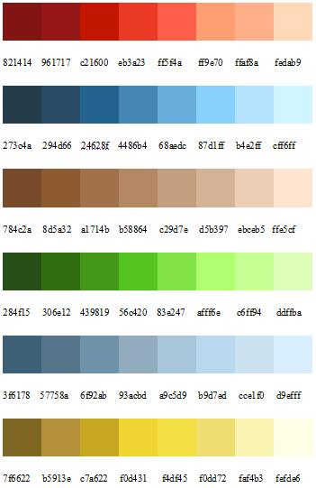
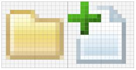
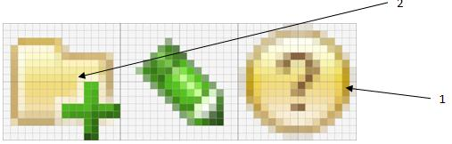

# #std423 Правила создания иконок командных панелей

> Область применения: управляемое приложение.
>
> Раздел ИТС: Проектирование интерфейсов для 8.2
>
> Источник: https://its.1c.ru/db/v8std/content/423/hdoc
>
> Проверено по источнику: 2026-10-07

Руководство по созданию иконок командных панелей. Данное руководство рассчитано на использование с продуктами **Adobe Photoshop** и **Axialis IconWorkshop**.

#### Палитра

 

Палитра предполагает использование серого от **#4D4D4D** до **#FFFFFF**, а также цветов смешения между указанными цветами.

#### Проекция

Для лучшей разборчивости элементы маленьких иконок отображаются во фронтальной проекции, без перспективы.

#### Размер

Иконки командной панели имеют размер 16?16. Но изображение не должно непременно занимать всё доступное пространство. Главное, чтобы иконки имели примерно одинаковый визуальный вес и чтобы их центр тяжести располагался на одной горизонтальной линии.

**Элементы стиля**

1\. **Обводка.** Элементы имеют обводку толщиной 1 пиксель, с закругленными углами. Технически обводка реализуется растушевкой с альфа - каналом. Прозрачность от 10 до 50%. На углах прозрачный пиксель от 5 до 15% прозрачности.  

 

2\. **Контур.** Для придания объектам читаемости, от модификатора идет внешний дополнительный контур на объект, шириной 1 пиксель. Подсветка может располагаться снизу, справа - внизу или по всему периметру: на усмотрение художника. Интенсивность подсветки подбирается индивидуально.  

 

3\. **Тени.** Собственные и падающие тени отсутствуют.  

 

4\. **Модификаторы.** Имеют основной зеленый и синий цвет. Исключение составляют модификаторы «опасности».  

#### Направление света

Источник света считается расположенным вверху. Поэтому обводка закрашивается вертикальным градиентом (обычно от 2-го до 5-го цвета из палитры). На лицевой стороне объектов допускается как вертикальный градиент, так и градиент, направленный из верхнего левого угла в нижний правый (на усмотрение художника).
