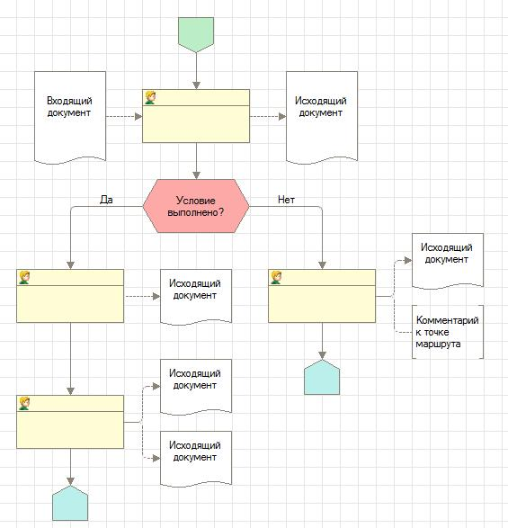
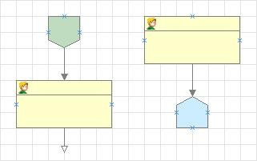
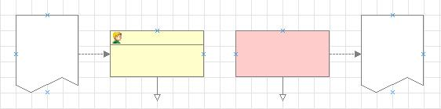
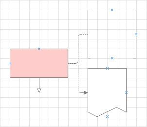
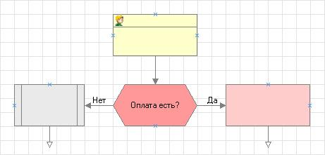

# #std480 Оформление карты маршрута бизнес-процесса

> Область применения: управляемое приложение, обычное приложение.
>
> Раздел ИТС: Создание и изменение объектов метаданных / Организация работы конфигурации
>
> Источник: https://its.1c.ru/db/v8std/content/480/hdoc
>
> Проверено по источнику: 2026-10-07

Пример оформления бизнес-процесса: 

**1\. Общие рекомендации** 

 

**1.1** Бизнес-процессы рисуются **сверху - вниз**. Другая ориентация (например, слева направо) допустима, если позволяет изобразить бизнес-процесс наилучшим образом.  

 

**1.2** Используется стандартная **сетка** – шаг 20 точек, нарисованная линиями.  

 

**1.3** Не используются жирные и разноцветные **шрифты**.  

 

**1.4** Количество **изгибов** соединительных линий должно быть минимальным. Если можно соединить две точки, изогнув соединительную линию один раз, то нужно стараться сделать именно так, подгоняя размеры и положение точек.  

 

**1.5** При размещении декораций и точек маршрута рекомендуется соблюдать отступ в одну клетку от левого и верхнего края карты маршрута.  

 

**1.6 Ширину** точек маршрута нужно делать равной четному количеству клеток. Это необходимо для того, чтобы соединительные линии сходились без дополнительных изгибов. **Размеры** точек и декораций нужно стремиться приближать к пропорциям спичечного коробка (например, 3х6 клеток). Следует избегать вытянутых по вертикали или горизонтали точек – они мешают восприятию схем.  

 

**1.7 Выравнивание текста** в точках маршрута и декорациях следует делать по центру (по умолчанию), за исключением комментариев – их лучше делать выровненными влево, как обычный текст.  

 

**1.8** Рекомендуется размещать декорации и точки маршрута так, чтобы они не пересекали границы печатного листа (меню Графическая схема - Режим просмотра страниц).  

 

**2\. Рекомендации по оформлению отдельных элементов** 

 

**2.1** Точки **Старт** и **Завершение** устанавливаются размером 2х2 клетки, без наименования. Количество точек старта и завершения неограниченно и определяется логикой бизнес-процесса. Отступ от точки старта или завершения до другой точки бизнес-процесса рекомендуется устанавливать в две клетки:  

 

 

**2.2** Точки "**Действие**", "**Автоматическая обработка**", "**Вложенный бизнес-процесс**" должны иметь размер сообразно размещаемому в них тексту. Текст должен носить характер короткой директивы и отвечать на вопрос "Что нужно сделать?" (например "Выписать счет", а не "Выписка счета"). Слева от этих точек нужно располагать декорации, описывающие исходные или входящие данные, требуемые для выполнения действий, предусмотренных данной точкой. Справа от точки нужно располагать декорации, описывающие результирующие или исходящие данные, которые получаются в результате выполнения действий, предусмотренных данной точкой.  

 

**2.3** Изображения **входящих документов**, служащих основой для выполнения действий, предусмотренных в точках маршрута нужно располагать слева от точки на расстоянии двух клеток и соединять пунктирной линией со стрелкой. **Исходящие документы**, являющие результатом выполнения действий, предусмотренных точкой маршрута, нужно располагать справа от точки на расстоянии двух клеток и соединять пунктирной линией со стрелкой. Документы оформляются фигурой вида Документ:  

 

 

Пропорции декорации, изображающей документ должны по возможности приближаться к формату А4 (например, 4х5 или 3х4 клетки стандартной сетки). 

 

**2.4 Комментарии** к точкам маршрута нужно изображать на расстоянии двух клеток слева от точки маршрута, если они относятся к входящему документу, или справа от точки маршрута, если к исходящему документу. Комментарий оформляется в виде фигуры "Скобки вертикальные" или "Скобки горизонтальные" и соединяется с левой или правой гранью точки маршрута пунктирной линией без стрелки:  

 

**2.5 Точки условного перехода** включают в себя короткий текст вопроса, заканчивающийся знаком вопроса. Вопрос нужно формулировать так, чтобы на него можно было ответить только **Да** или **Нет** (например, **Счет есть?**, **Отгрузка разрешена?**, **ОК?**). Точки условия нужно стремиться сделать как можно более компактными, но не в ущерб наглядности. Это связано с тем, что, точки условия являются точками перехода, а не точками действия, и поэтому для участников бизнес-процесса второстепенны. Соединительные линии точек условия (как входящие, так и исходящие) должны иметь суммарную длину не менее двух клеток для того, чтобы надписи **Да** и **Нет** читались нормально, например:

