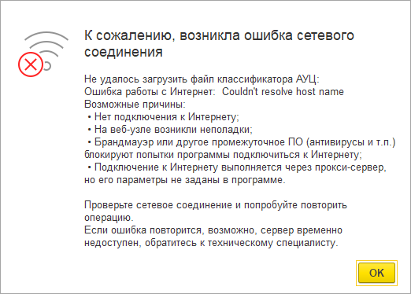

# #std499 Перехват исключений в коде

> Область применения: управляемое приложение, мобильное приложение, обычное приложение.
>
> Раздел ИТС: Соглашения при написании кода / Использование конструкций встроенного языка
>
> Источник: https://its.1c.ru/db/v8std/content/499/hdoc
>
> Проверено по источнику: 2026-10-07

1\. Не следует перехватывать исключения, кроме случаев ниже. Необработанное исключение выводится пользователю, записывается в журнал регистрации для администратора и при необходимости отправляется в сервис регистрации ошибок средствами платформы 1С:Предприятие. Для распространенных исключений в платформе 1С:Предприятие предусмотрены категории ошибок и шаблоны с соответствующими сообщениями и рекомендациями. В сервис регистрации отправляются ошибки программного кода, такие как "Значение не является значением объектного типа", "Поле объекта не обнаружено", "Слишком много фактических параметров", "Ошибка при вызове метода контекста" и многие другие.

2\. В ряде случаев технологический текст исключения непонятен, поэтому его нужно дополнить прикладной, понятной пользователю информацией, типовыми причинами или рекомендациями по устранению возникшей проблемы. К этой категории проблем относятся, как правило, недоступность внешних ресурсов и каналов связи, некорректная работа внешних сервисов, некорректные входные данные и некорректные настройки используемых внешних приложений. Например, это проблемы взаимодействия с почтовыми серверами, веб-сервисами, принтерами, криптопровайдерами.

2.1. В таком случае допустимо перехватить и пробросить исключение без потери исходного содержания с необходимым уточнением.

При этом не следует открывать большие блоки **Попытки-Исключение**, а расставлять их локально на конкретные потенциально проблемные места, вызовы конкретных методов платформы, чтобы исключить перехват других несвязанных ошибок, например, ошибок соседнего программного кода.

Для проверки вывода исключений пользователю рекомендуется запускать 1С:Предприятие без отладки и без режима технического специалиста, т.к. в зависимости от этого в платформе 1С:Предприятие внешний вид и поведение окна исключения различается.

2.2. В особых случаях может быть предусмотрена собственная обработка исключений с расширенной диагностикой проблем, как например в обработчиках обновления информационной базы.

В таких случаях исключение не перевызывается, а обрабатывается. При этом следует:

- фильтровать и отправлять ошибки программного кода в сервис регистрации ошибок - см. **ИнформацияОбОшибке**.**ЯвляетсяОшибкойКатегории** и **ОтчетОбОшибке**.**Отправить**;

- фиксировать причину ошибки в журнале регистрации для того, чтобы системный администратор имел возможность выполнить диагностику проблемы и при необходимости передать информацию об ошибке в службу технической поддержки;

- записывать в журнал регистрации подробное представление исключения, а сообщение об ошибке для пользователя добавлять в текст сообщения - см. **ОбработкаОшибок**.**ПодробноеПредставлениеОшибки** и **ОбработкаОшибок**.**СообщениеОбОшибкеДляПользователя**, соответственно.

При этом не следует:

- использовать функцию **ОписаниеОшибки** вместо функции **ОбработкаОшибок**.**ПодробноеПредставлениеОшибки**, т.к. она неинформативна для разработчика, потому что не возвращает стек в тексте ошибки;

- использовать функцию **ОбработкаОшибок**.**КраткоеПредставлениеОшибки** вместо функции **ОбработкаОшибок**.**СообщениеОбОшибкеДляПользователя**, так как она не возвращает уточнений, добавленных при пробросе исключения.

3\. Частные случаи некорректного перехвата исключений.

 

<table><tbody><tr><td> <blockquote dir="ltr"> 
<em>Область применения (уточнение): управляемое приложение, обычное приложение.</em>
</blockquote> 
3.1. Не следует анализировать текст исключений с целью интерпретации причины ошибки. Текст исключения может меняться в зависимости от локализации версий платформы и конфигурации. Следует выдавать пользователю тексты исключений «как есть». Для понятности, текст можно уточнить описанием прикладной операции, а также дополнить пояснением возможных причин, если для категории ошибки в платформе не предусмотрено стандартное пояснение или его недостаточно. 
 
Например:
 <pre data-code-id="code-0001">Попытка&#10;    ЗагрузитьФайлИзИнтернета(...);&#10;Исключение&#10;    ИнформацияОбОшибке = ИнформацияОбОшибке();&#10;    ТекстСообщения = ОбработкаОшибок.СообщениеОбОшибкеДляПользователя(ИнформацияОбОшибке);&#10;    ТекстСообщения = НСтр("ru = 'Не удалось загрузить файл классификатора АУЦ:'")&#10;       + Символы.ПС + ТекстСообщения&#10;       + Символы.ПС + НСтр("ru = 'Возможные причины:&#10;       | • Нет подключения к Интернету;&#10;       | • На веб-узле возникли неполадки;&#10;       | • Брандмауэр или другое промежуточное ПО (антивирусы и т.п.) блокируют попытки программы подключиться к Интернету;&#10;       | • Подключение к Интернету выполняется через прокси-сервер, но его параметры не заданы в программе.'");&#10;    ДляАдминистратора = ДиагностикаСоединенияСИнтернет(); // В подробное представление ошибки для журнала регистрации.&#10;    ВызватьИсключение(ТекстСообщения,,, ДляАдминистратора, ИнформацияОбОшибке);&#10;КонецПопытки;</pre> 
При использовании в конфигурации <b>Библиотеки стандартных подсистем</b> (БСП), следует применять функцию <b>ОбщегоНазначенияКлиентСервер</b>.<b>УточнениеИсключения</b>:
 <pre data-code-id="code-0002">Попытка&#10;    ЗагрузитьФайлИзИнтернета(...);&#10;Исключение&#10;    ИнформацияОбОшибке = ИнформацияОбОшибке();&#10;    Уточнение = ОбщегоНазначенияКлиентСервер.УточнениеИсключения(ИнформацияОбОшибке,&#10;       НСтр("ru = 'Не удалось загрузить файл классификатора АУЦ:'"));&#10;    Уточнение.Текст = Уточнение.Текст + Символы.ПС + НСтр("ru = 'Возможные причины:&#10;       | • Нет подключения к Интернету;&#10;       | • На веб-узле возникли неполадки;&#10;       | • Брандмауэр или другое промежуточное ПО (антивирусы и т.п.) блокируют попытки программы подключиться к Интернету;&#10;       | • Подключение к Интернету выполняется через прокси-сервер, но его параметры не заданы в программе.'");&#10;    ДляАдминистратора = ДиагностикаСоединенияСИнтернет(); // В подробное представление ошибки для журнала регистрации.&#10;    ВызватьИсключение(Уточнение.Текст, Уточнение.Категория,, ДляАдминистратора, ИнформацияОбОшибке);</pre> <pre data-code-id="code-0003">КонецПопытки;</pre> 

 
3.2. Недопустимо перехватывать любые исключения, бесследно для системного администратора:
 <pre data-code-id="code-0004">Попытка&#10;    // код, приводящий к вызову исключения&#10;    ....&#10;Исключение // перехват любых исключений&#10;КонецПопытки;</pre> 
Как правило, подобная конструкция скрывает реальную проблему, которую впоследствии невозможно диагностировать.  Правильно:
 <pre data-code-id="code-0005">Попытка&#10;    // код, приводящий к вызову исключения&#10;    ....&#10;Исключение&#10;    // Пояснение причин перехвата всех исключений "незаметно" от пользователя.&#10;    // ....&#10;    // И запись события в журнал регистрации для системного администратора.&#10;    ЗаписьЖурналаРегистрации(НСтр("ru = 'Выполнение операции'"),&#10;       УровеньЖурналаРегистрации.Ошибка,,,&#10;       ОбработкаОшибок.ПодробноеПредставлениеОшибки(ИнформацияОбОшибке()));&#10;КонецПопытки;</pre> 
См. также <a href="https://its.1c.ru/db/v8std/content/542/hdoc">Доступ к файловой системе из кода конфигурации</a>, удаление временных файлов.
</td></tr></tbody></table>

4\. Порядок обработки исключений при использовании транзакций описан в стандарте [Транзакции: правила использования](<https://its.1c.ru/db/v8std/content/783/hdoc>).

 
