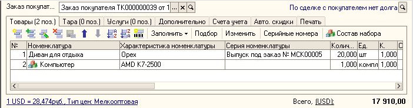

# #std516 Кнопки

> Область применения: обычное приложение.
>
> Раздел ИТС: Разработка пользовательских интерфейсов (обычное приложение) / Реализация работы формы
>
> Источник: https://its.1c.ru/db/v8std/content/516/hdoc
>
> Проверено по источнику: 2026-10-07

*Обычное приложение* 

Кнопки размещаются вне командных панелей. Минимальный размер кнопок: 60х19. Шарина кнопки может увеличиваться в зависимости от длины строки заголовка кнопки. Надпись на кнопке должна занимать одну строку.

## Оформление кнопок с часто употребимыми действиями (частотных кнопок)

Для оформления кнопок с часто употребимыми действиями (частотных кнопок) рекомендуется использовать текст совместно с картинкой.

Иконка, размещенная на кнопке, также может использоваться в строке табличной части для дополнительной идентификации типа данных, к которому применима данная команда.

Пример: Форма реализации товаров и услуг, кнопка **Состав набора** ("Редактировать состава набора комплекта").

