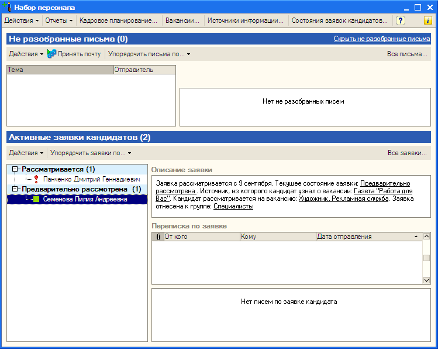
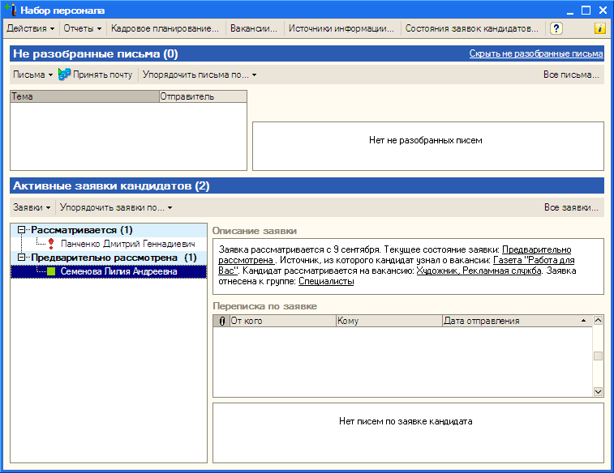

# #std526 Ограничения по использованию одинаковых текстов на элементах управление в форме

> Область применения: обычное приложение.
>
> Раздел ИТС: Разработка пользовательских интерфейсов (обычное приложение) / Реализация работы формы
>
> Источник: https://its.1c.ru/db/v8std/content/526/hdoc
>
> Проверено по источнику: 2026-10-07

*Обычное приложение* 

Рекомендуется воздерживаться от размещения в форме элементов управления с одинаковым текстом. Например, два подменю **Действие**: в табличной части и в самой форме. Совпадение текстов элементов одного типа на форме создает путаницу в действиях пользователя, затрудняет чтение и написание справки, а также может привести к неопределенности при объяснении пользователем своих действий в форме другим пользователям или специалистам.

В качестве примера приведем форму по обработке набора персонала, где изначально размещено три подменю **Действия** \- для формы и для каждого из табличных полей.

И вариант этой же формы, где осталось подменю **Действие** только для формы вцелом.  

