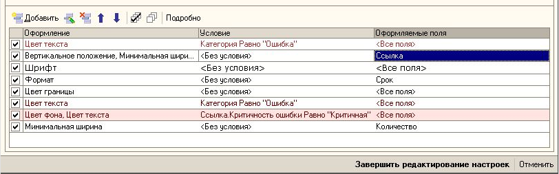
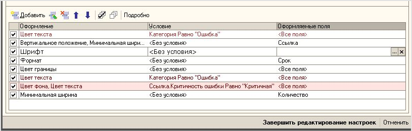

# #std527 Использование пояснений в полях ввода и выбора

> Область применения: обычное приложение.
>
> Раздел ИТС: Разработка пользовательских интерфейсов (обычное приложение) / Реализация работы формы
>
> Источник: https://its.1c.ru/db/v8std/content/527/hdoc
>
> Проверено по источнику: 2026-10-07

*Обычное приложение* 

Рекомендуется в полях ввода или выбора, в случае, если они еще не заполнены, показывать пользователю значение по умолчанию или трактовку пустого значения в этом поле.

Пример:

