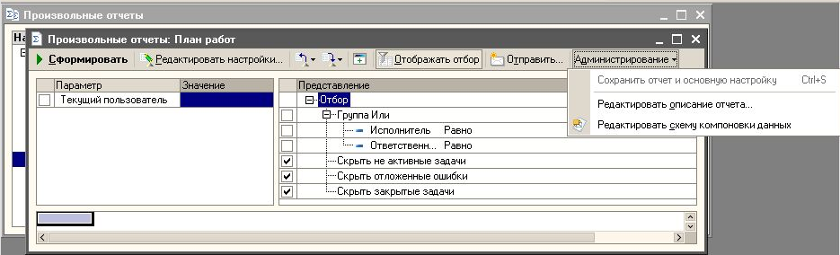

# #std528 Особенности размещения в командных панелях пунктов меню, не предназначенные для решения основных задач

> Область применения: обычное приложение.
>
> Раздел ИТС: Разработка пользовательских интерфейсов (обычное приложение) / Реализация работы формы
>
> Источник: https://its.1c.ru/db/v8std/content/528/hdoc
>
> Проверено по источнику: 2026-10-07

*Обычное приложение* 

Рекомендуется пункты меню, не предназначенные для решения основных задач, а исполняющих команды, предназначенные для специализированных целей или особой группы пользователей, помещать в подменю.

