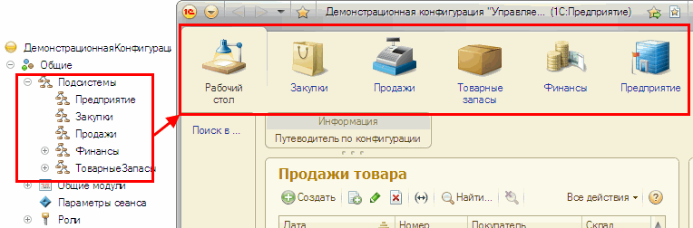

# #std543 Использование подсистем

> Область применения: управляемое приложение, обычное приложение.
>
> Раздел ИТС: Создание и изменение объектов метаданных / Организация работы конфигурации
>
> Источник: https://its.1c.ru/db/v8std/content/543/hdoc
>
> Проверено по источнику: 2026-10-07

*Методическая рекомендация (полезный совет)*

1.1. С помощью подсистем решаются две методические задачи:

- Сформировать глобальный командный интерфейс основного окна приложения, которое дает пользователю представление о функциональности приложения в целом.

- Сгруппировать объекты метаданных по функциональному признаку для удобства разработки.

В простейшем случае, получившаяся для обеих задач структура подсистем конфигурации может совпадать.

Например, видимые для пользователей разделы командного интерфейса «Закупки», «Продажи» и пр. могут использоваться одновременно и при разработке: для быстрого отбора объектов в окне метаданных Конфигуратора, при переносе объектов в другие конфигурации, для задания ограничений области поиска при глобальном поиске по конфигурации и т.д.

У таких подсистем должен быть установлен флажок **Включать в командный интерфейс**.

1.2. В общем случае, подсистема, логически объединяющая некоторый набор объектов метаданных, может не совпадать с одним разделом командного интерфейса приложения. Для логического объединения набора объектов метаданных по функциональному признаку рекомендуется заводить в конфигурации отдельную иерархию подсистем, не включенных в командный интерфейс. У таких «функциональных» подсистем флажок **Включать в командный интерфейс** должен быть снят.

Примеры:

- справочник **Номенклатура** логически относится к одной «функциональной» подсистеме «Нормативно-справочная информация», но доступен в командном интерфейсе одновременно в двух разделах – «Нормативно-справочная информация» и «Маркетинг»

- в раздел командного интерфейса «Настройка и администрирование» помещаются команды открытия списков объектов, логически относящихся к тем «функциональным» подсистемам конфигурации, которые предоставляют возможность настройки для администратора системы.

1.3. При этом, общие модули, регламентные задания, константы, подписки на события и прочие объекты, не имеющие визуального представления в командном интерфейсе, рекомендуется включать только в состав «функциональных» подсистем.

### См. также

- [Панель разделов](<https://its.1c.ru/db/v8std/content/567/hdoc>)
