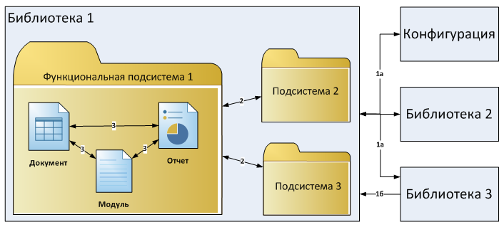

# #std551 Разработка конфигураций с повторным использованием общего кода и объектов метаданных

> Область применения: управляемое приложение, мобильное приложение, обычное приложение.
>
> Раздел ИТС: Разработка и использование библиотек
>
> Источник: https://its.1c.ru/db/v8std/content/551/hdoc
>
> Проверено по источнику: 2026-10-07

*Методическая рекомендация (полезный совет)*

1\. В условиях разработки нескольких конфигураций (например, линейки продуктов) возникает задача повторного использования общего кода и объектов конфигурации. Эту задачу рекомендуется решать с использованием вспомогательных конфигураций – библиотек.

**Библиотечная конфигурация (библиотека)** – это конфигурация, которая в отличие от «обычных» прикладных решений не предназначена для использования конечными пользователями, а служит только для поддержки конфигураций, пользующихся ее функциональностью. В них размещается функциональность, общая для прикладных решений.

Библиотечный подход к разработке общей функциональности прикладных решений позволяет:

- вести разработку общей функциональности централизованно (а не в каждом прикладном решении «по месту»);

- выпускать версии общей функциональности в виде продукта (дистрибутива или файла поставки библиотеки);

- повторно использовать код и объекты библиотеки в конфигурациях с помощью механизма постановки на поддержку платформы **1С:Предприятия**;

- унифицировать конфигурации по набору общих объектов метаданных и функциональных подсистем.

2\. В свою очередь, библиотека может стоять на поддержке у другой библиотеки, образуя таким образом **иерархию библиотек**. Библиотечная конфигурация, которая стоит на поддержке у другой библиотеки (**библиотеки-родителя**), называется **библиотекой-наследником**.

Как правило, библиотеки не являются самостоятельным предметом разработки, а предназначены только для создания прикладных решений. Таким образом, прикладные решения являются конечными конфигурациями-потребителями в иерархии библиотек.

3\. При взаимодействии конфигураций, библиотек и внешних потребителей следует выделять следующие области видимости программного кода:

> 1\. **Программный интерфейс** содержит экспортные процедуры и функции, предназначенные для использования сторонними потребителями. Программный интерфейс можно разделить на две категории:
>
>
>
> > а) Программный интерфейс для использования любыми внешними потребителями предназначен для вызова из произвольного места в коде конфигурации. Потребителями такого программного интерфейса чаще всего выступают расширения конфигурации, сторонние доработки конфигурации или другие программы.
> >
> >
> >
> > б) Программный интерфейс для конкретных потребителей должен располагаться в определенном месте в коде конфигурации, определенном в документации, и может быть вызван только определенным потребителем. Такой программный интерфейс рекомендуется размещать в отдельном подразделе **Для вызова из других подсистем**. Подробнее см. стандарт [Обеспечение обратной совместимости библиотек](<https://its.1c.ru/db/v8std/content/644/hdoc>).
>
>
>
> 2\. **Служебный программный интерфейс** предназначен для экспортных процедур и функций, которые допустимо вызывать только из других функциональных подсистем этой же библиотеки (конфигурации). 
>
> 3\. **Служебные процедуры и функции** содержат внутреннюю реализацию функциональной подсистемы. Экспортные процедуры и функции, расположенные в этом разделе, предназначены только для вызова из других объектов этой же подсистемы.
>
>
>
> 

### См. также

- [Использование дублирующего кода](<https://its.1c.ru/db/v8std/content/440/hdoc>)

- [Переопределяемые и поставляемые объекты библиотеки](<https://its.1c.ru/db/v8std/content/553/hdoc>)

- [Обеспечение обратной совместимости библиотек](<https://its.1c.ru/db/v8std/content/644/hdoc>)
