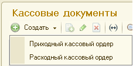

# #std582 Команда "Создать" в журналах документов

> Область применения: управляемое приложение.
>
> Раздел ИТС: Проектирование интерфейсов для 8.2 / Оформление форм списков
>
> Источник: https://its.1c.ru/db/v8std/content/582/hdoc
>
> Проверено по источнику: 2026-10-07

1\. Для создания документов в некоторых журналах рекомендуется использовать подменю «Создать» вместо стандартной команды «Создать». 

Вариант создания через подменю подходит, если:

- в журнале отражается небольшое количество видов документов (до 6)

- журнал часто используется в работе

2\. В подменю размещаются команды для открытия конкретных типов документов.

3\. Картинку

 следует добавлять только для подменю «Создать», для каждого типа команды в подменю ее использовать нет необходимости.

*Например, в журнале «Кассовые документы» доступны команды создания «Приходного кассового ордера», «Расходного кассового ордера» и т.д.*

4\. В подменю «Создать» рекомендуется сортировать команды по частоте использования, а не в алфавитном порядке.

5\. При использовании подменю «Создать» поведение клавиши Insert не меняется – при нажатии на нее открывается стандартная форма «Выбор типа документа».
