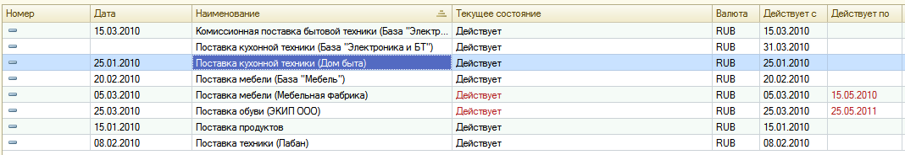

# #std584 Акцентирование внимания на просроченных или критичных состояниях

> Область применения: управляемое приложение.
>
> Раздел ИТС: Проектирование интерфейсов для 8.2 / Оформление форм списков
>
> Источник: https://its.1c.ru/db/v8std/content/584/hdoc
>
> Проверено по источнику: 2026-10-07

 

При необходимости привлечь внимание, например к истекающему состоянию, сроку выполнения операции и т.п., рекомендуется выделять только тот элемент, который поможет пользователю понять в чем причина привлечения внимания и что делать дальше.

 

Цвет текста: "ПросроченныеДанные" (RGB 178; 34; 34)

 

Например, в случае если истекает срок действия Соглашения с поставщиком, необходимо выделять только ячейку состояния «действует» и ячейку «действует по».  

