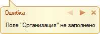
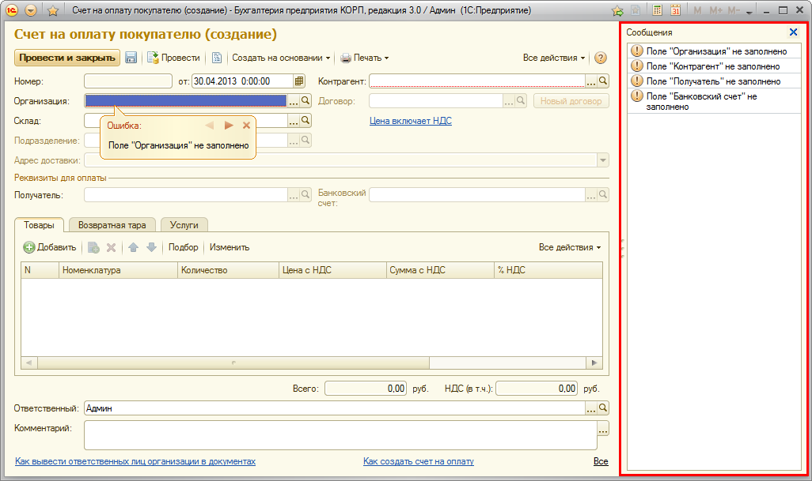
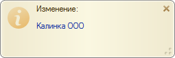
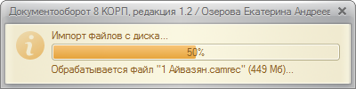
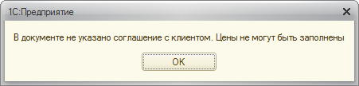
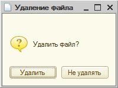
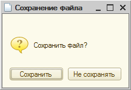

# #std585 Сообщения пользователю

> Область применения: управляемое приложение.
>
> Раздел ИТС: Проектирование интерфейсов для 8.2
>
> Источник: https://its.1c.ru/db/v8std/content/585/hdoc
>
> Проверено по источнику: 2026-10-07

1\. Общие рекомендации

1.1. Сообщения должны быть достаточно информативными и содержательными. Сообщения составляются в форме безличного предложения: не употребляются местоимения "Вы", "Вас" и пр.  

<table><tbody><tr><td style="background-color: transparent; vertical-align: top"> 
Правильно
</td><td style="background-color: transparent; vertical-align: top"> 
Неправильно
</td></tr>

<tr><td style="background-color: transparent; vertical-align: top"> 
"Недостаточно прав для выполнения обработки"
</td><td style="background-color: transparent; vertical-align: top"> 
<i>"У Вас</i> недостаточно прав для выполнения обработки"
</td></tr></tbody></table>

1.2. Сообщения не должны содержать восклицательных знаков и повелительных тонов, за исключением сообщений, предупреждающих об опасных или критических действиях.

<table><tbody><tr><td style="background-color: transparent; vertical-align: top"> 
Правильно
</td><td style="background-color: transparent; vertical-align: top"> 
Неправильно
</td></tr>

<tr><td style="background-color: transparent; vertical-align: top"> 
"Внимание. Загрузка базы может привести к потере всех данных"
 
 
 
 
 
 
 
 
 
"Выберите элемент, а не группу"
 
 
</td><td style="background-color: transparent; vertical-align: top"> 
"Внимание! Загрузка базы может привести к потере всех данных"
 
<i>Это сообщение не акцентирует внимание пользователя на том, что последствия могут критичны</i>
 
 "Выберите элемент, а не группу!"
 
<i>Это сообщение несет негативный настрой, а также заставляет пользователя чувствовать себя глупо</i>
</td></tr></tbody></table>

1.3. Сообщение должно быть написано текстом, понятным пользователю. В частности, оно не должно содержать технической терминологии (терминологии разработчика). Подобную терминологию допускается использовать только в сообщениях, предназначенных для администратора.

*Например, если пользователь указал в качестве кассы отправителя и кассы получателя одно и то же значение, то выводится  сообщение: "Касса отправителя равна кассе получателя".*

*В реальности касса не может быть равна другой – она может быть одной и той же.*

 

<table><tbody><tr><td style="background-color: transparent; vertical-align: top"> 
Правильно
</td><td style="background-color: transparent; vertical-align: top"> 
Неправильно
</td></tr>

<tr><td style="background-color: transparent; vertical-align: top"> 
"Касса отправителя и касса получателя должны различаться"
</td><td style="background-color: transparent; vertical-align: top"> 
"Касса отправителя равна кассе получателя"
</td></tr></tbody></table>

1.4. Сообщения, указывающие на ошибку, должны выводиться в момент возникновения ошибки.

Например, в отчете, сдаваемом в Пенсионный фонд, указываются  регистрационные номера сотрудников. Эти номера заполняются в карточке сотрудника. 

Проверку правильности заполнения этого номера нужно делать в момент его  ввода в карточке, а не в момент формирования отчета.

1.5. В тексте сообщений необходимо избегать двусмысленности. Категорически запрещается постановка вопроса с содержанием частиц "не" и "бы". Подобные вопросы не способны дать однозначного ответа.

<table><tbody><tr><td style="background-color: transparent; vertical-align: top"> 
Правильно
</td><td style="background-color: transparent; vertical-align: top"> 
Неправильно
</td></tr>

<tr><td style="background-color: transparent; vertical-align: top"> 
"Удалить файл?"
</td><td style="background-color: transparent; vertical-align: top"> 
"<i>Не</i> хотели <i>бы</i> вы удалить этот файл?" (Да / Нет) "Переместить <i>или</i> удалить этот файл?" (Да / Нет)
</td></tr></tbody></table>

 

1.6. В текстах сообщений не следует использовать сокращения и аббревиатуры. Исключением являются только общеупотребительные и соответствующие целевой аудитории сокращения и аббревиатуры. 

*Например, сокращения "НДС", "МСФО" понятны пользователям, а "К." (коэффициент) – нет. *

**

1.7. Если текст сообщения занимает несколько строк, рекомендуется составлять его таким образом, чтобы строки оканчивались на логическую паузу или завершались знаком препинания.

<table><tbody><tr><td style="background-color: transparent; vertical-align: top"> 
<strong>Правильно</strong>
</td><td style="background-color: transparent; vertical-align: top"> 
<strong>Неправильно</strong>
</td></tr>

<tr><td style="background-color: transparent; vertical-align: top"> 
Не рекомендуется изменять значение ставки налога, <i>если</i> она уже используется в справочниках или документах.
</td><td style="background-color: transparent; vertical-align: top"> 
Не рекомендуется изменять значение ставки налога, <i>если</i> она уже используется в справочниках или документах.
</td></tr></tbody></table>

1.8. Следует руководствоваться принципом, что в процедурах и функциях, выполняемых в транзакции, нельзя выполнять каких-либо взаимодействий с пользователем – выводить предупреждения и вопросы.

1.9. Сообщения, оповещения, предупреждения или состояние не следует использовать в случае, если нужно вывести протокол, отчет или подробности о результатах выполненной операции. Для этого следует предусмотреть специальную форму. 

2\. Сообщение об ошибках в форме

Сообщения об ошибках в форме выводятся в панели сообщений об ошибках справа:

2.1. В панели сообщений следует выводить только сообщения об ошибках. Сообщения об успешном завершении операции в панели выводить запрещается.

 

2.2. Сообщение об ошибке по возможности должно быть привязано к полю, которое породило ошибку или позволяет исправить ее. Если сообщение нельзя привязать к тому или иному полю, то в тексте сообщения следует явно указать, что пользователю нужно сделать для того, чтобы устранить проблему.

2.3. Сообщения об ошибках должны отвечать на 3 вопроса:

- Что произошло?

- Почему это произошло?

- Что делать дальше?

Ответов на эти вопросы должно хватить пользователю, чтобы принять решение о дальнейших действиях, а также не повторить данной ошибки в будущем.

Например, пользователь пытается изменить статус документа, помеченного на удаление. 

Система выдает сообщение: "Документ "Коммерческое предложение &lt;номер&gt; не проведен. Статус не изменен"

*Сообщение создает новый вопрос для пользователя: почему не изменен статус? В тексте сообщения отсутствует информация о том, что документ помечен на удаление, и что именно это является причиной возникновения ошибки.*

**

<table><tbody><tr><td style="background-color: transparent; vertical-align: top"> 
Правильно
</td><td style="background-color: transparent; vertical-align: top"> 
Неправильно
</td></tr>

<tr><td style="background-color: transparent; vertical-align: top"> 
"Невозможно изменить статус: документ "Коммерческое предложение &lt;номер&gt; помечен на удаление"
</td><td style="background-color: transparent; vertical-align: top"> 
"Документ "Коммерческое предложение &lt;номер&gt; не проведен. Статус не изменен"
</td></tr></tbody></table>

2.4. Следует учитывать, что в панели сообщений текст сообщения автоматически форматируется, а строки переносятся, сохраняя при этом свои пропорции. Поэтому текст таких сообщений не нужно разбивать на строки. 

См. также: [Перенос выражений](<https://its.1c.ru/db/v8std/content/444/hdoc>)

2.5. Сообщение должно быть как можно более кратким и понятным.  

Если же поле заполнено, но неправильно, то сообщение должно быть более подробным. 

*Например, "Указанного количества товара &lt;название товара&gt; нет на складе. Доступно: &lt;количество доступно&gt; &lt;единица измерения&gt;". *

2.6. Текст сообщения об ошибке должен содержать побудительную часть, призывающую пользователя совершить действия по исправлению ошибки.

<table><tbody><tr><td style="background-color: transparent; vertical-align: top"> 
Правильно
</td><td style="background-color: transparent; vertical-align: top"> 
Неправильно
</td></tr>

<tr><td style="background-color: transparent; vertical-align: top"> 
"Укажите хотя бы одну систему налогообложения"
 
<i> </i>
</td><td style="background-color: transparent; vertical-align: top"> 
"Необходимо указать хотя бы одну систему налогообложения" 
</td></tr></tbody></table>

3\. Оповещение

3.1. Рекомендуется использовать оповещение для информирования пользователя о произошедших событиях без прерывания основной работы. Пользователю не обязательно реагировать на оповещение, оно выдается для информации. 

Оповещение сообщает о том, что запрошенная операция (запись элемента справочника или проведение документа) выполнена.

3.2. Оповещения рекомендуется делать с гиперссылками на соответствующие объекты.

3.3. Текст и пояснение оповещения рекомендуется составлять так, чтобы они целиком помещались в окне оповещения с размерами "по умолчанию":

- Текст – 36 знаков;

- Пояснение – около 100 знаков (с учетом переноса на три строки).

4\. Состояние

4.1. Рекомендуется использовать состояние для информирования о выполнении длительных процессов (занимающих более 10 секунд), чтобы у пользователей не сложилось впечатление о том, что программа "зависла". Выводите состояние:

· перед началом выполнения ("Выполняется расчет. Пожалуйста, подождите…")

· в процессе выполнения (если есть возможность)

· при завершении ("Расчет выполнен")

4.2. Состояние используется для длительных операций, состоящих из некоторого числа более мелких операций. 

*Например, при переносе файлов с жесткого диска в информационную базу можно выводить состояние для каждого переносимого файла:*

**

См. также: [Длительные операции](<https://its.1c.ru/db/v8std/content/642/hdoc>), [Запись событий в историю работы пользователя](<https://its.1c.ru/db/v8std/content/497/hdoc>)

5\. Предупреждение

5.1. Предупреждение рекомендуется использовать только в тех случаях, когда необходимо прервать работу пользователя, чтобы он ознакомился с некоторой информацией. При этом для возобновления работы пользователю не нужно принимать решений.

5.2. Не следует использовать предупреждение для информирования о начале выполнения длительных обработок. Такое сообщения следует выдавать непосредственно в форме обработки. 

 

5.3. В тексте предупреждения следует привести законченные пояснения о последующих действиях и их последствиях.

*Например, пользователь пытается заполнить цены товаров в табличной части "Товары" документа «Заказ клиента». Программа выдает предупреждение о невозможности выполнения этого действия:*

**

6\. Вопросы в сообщениях

6.1. Рекомендуется использовать в тех случаях, когда необходимо, чтобы пользователь принял решение, например, о продолжении начатой операции.

6.2. Вопросы рекомендуется выдавать перед выполнением:

· действий, результаты которых отменить потом невозможно

· потенциально опасных для данных пользователя действий

· массовой обработки информационной базы

· длительных процедур

6.3. Ответами на вопрос должны выступать глаголы, обозначающие последующие действия.

Например:

6.4.  В сообщениях-вопросах кнопкой по умолчанию должна являться та кнопка, выбор которой наиболее безопасен для данных пользователя. 

Например, при сохранении файла кнопкой по умолчанию является "Сохранить":

**ВАЖНО:** Чаще всего в ОС Windows кнопкой по умолчанию является первая (самая левая) кнопка. Прибегать к изменению кнопки по умолчанию рекомендуется только в исключительных ситуациях.
