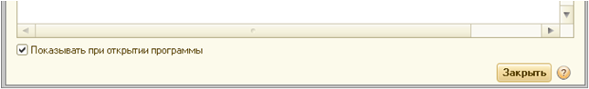

# #std586 Окна на старте

> Область применения: управляемое приложение.
>
> Раздел ИТС: Проектирование интерфейсов для 8.2
>
> Источник: https://its.1c.ru/db/v8std/content/586/hdoc
>
> Проверено по источнику: 2026-10-07

 

Если содержание окна на старте не обязательно для ознакомления пользователям, то необходимо предусмотреть по умолчанию возведенный флаг «Показывать при открытии программы». Флаг рекомендуется располагать под содержанием окна.

