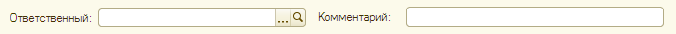
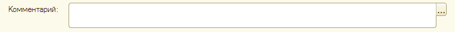
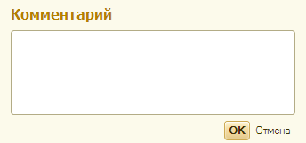
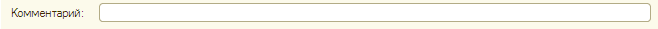
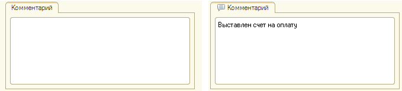

# #std587 Поля "Ответственный" и "Комментарий"

> Область применения: управляемое приложение.
>
> Раздел ИТС: Проектирование интерфейсов для 8.2 / Формы
>
> Источник: https://its.1c.ru/db/v8std/content/587/hdoc
>
> Проверено по источнику: 2026-10-07

См. также: [Поля "Ответственный" и "Комментарий" (8.3)](<https://its.1c.ru/db/v8std/content/719/hdoc>)

 

Поля "Ответственный" и "Комментарий", используемые в формах документов, необходимо располагать и оформлять в соответствии со следующими рекомендациями. 

**1\. Расположение группы полей "Ответственный" и "Комментарий"**

> Группу полей "Ответственный" и "Комментарий" следует располагать в самом низу формы, друг за другом:
>
>
>
> 

**2\. Оформление поля «Ответственный»**

> • Поле не растягивается на всю ширину формы
>
>
>
>  
>
> • Для поля подбирается такая ширина, чтобы в него полностью помещались типичные выбираемые значения. На максимально возможные значения ориентироваться не следует. 
>
>
>
> 

**3\. Оформление поля «Комментарий»**

> • Заголовок располагается слева от поля
>
>
>
>  
>
> • Поле растягивается по горизонтали на всю ширину формы
>
>
>
>  
>
> • Поле не растягивается по вертикали
>
>
>
>
>
>
>
> Как правило, поле "Комментарий" является многострочным (свойство "МногострочныйРежим" = Да). В случае, если в поле "Комментарий" всегда будет вводиться небольшое количество информации, его рекомендуется делать однострочным (свойство "МногострочныйРежим" = Авто). 
>
> Решение о том, каким должно быть поле – однострочным или многострочным – принимается разработчиком исходя из прикладных требований. 

**3.1. Оформление многострочного поля "Комментарий":**

> 
>
>
>
> • Высота поля – две строки 
>
> • Используется кнопка выбора, по которой открывается окно редактора многострочного текста (блокирующее): 
>
>
>
> 

**3.2. Оформление однострочного поля "Комментарий":**

· Высота поля – одна строка

· Кнопка выбора не используется

Если поле «Комментарий» в типовых случаях будет большим, то допускается вынести его на отдельную вкладку

4\. Оформление вкладки «Комментарий» 

> • Заголовок вкладки – «Комментарий»
>
>
>
>  
>
> • На вкладке размещается поле с текстом комментария, которое растягивается по вертикали и по горизонтали. Заголовок поля не отражается
>
>
>
>  
>
> • Если поле с комментарием заполнено, то в заголовке вкладки отражается картинка «Комментарий»  
>
>
>
> 

См. также: [Реквизит "Комментарий" у документов](<https://its.1c.ru/db/v8std/content/531/hdoc>)

 
