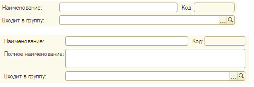

# #std588 Группа полей "Наименование", "Код", "Полное наименование", "Входит в группу"

> Область применения: управляемое приложение.
>
> Раздел ИТС: Проектирование интерфейсов для 8.2 / Формы
>
> Источник: https://its.1c.ru/db/v8std/content/588/hdoc
>
> Проверено по источнику: 2026-10-07

 

Поля, содержащие Наименование объекта (одно или несколько), Код и Группу, в которую входит объект, рекомендуется объединять вместе.

В качестве заголовка для Группы рекомендуется использовать понятный заголовок, например «Входит в группу». Заголовки остальных полей не следует менять без крайней необходимости, чтобы они могли соответствовать синонимам соответствующих реквизитов объектов метаданных.

Расположение полей:

- Группа полей размещается в верхней части формы

- Первыми располагаются поля «Наименование» и «Код» - горизонтально в одну строку. Поле «Код» следует за полем «Наименование»

- При наличии поля «Полное наименование» оно размещается под полями «Наименование» и «Код»

- Поле «Входит в группу» рекомендуется располагать последним 

Рекомендуется пропускать поле «Код» при вводе с клавиатуры.

Примеры расположения полей:

