# #std593 Единицы измерения

> Область применения: управляемое приложение.
>
> Раздел ИТС: Проектирование интерфейсов для 8.2 / Оформление элементов
>
> Источник: https://its.1c.ru/db/v8std/content/593/hdoc
>
> Проверено по источнику: 2026-10-07

## Для полей ввода

1.1. Единицы измерения следует указывать после полей, а не в заголовке:

<table><tbody><tr><td>Хорошо</td><td>Плохо</td></tr>

<tr><td>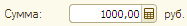</td><td>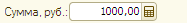</td></tr></tbody></table>

<table><tbody><tr><td>Хорошо</td><td>Плохо</td></tr>

<tr><td>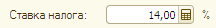</td><td>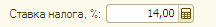</td></tr></tbody></table>

<table style="background-color: #ffffff"><tbody><tr><td>Хорошо</td><td>Плохо</td></tr>

<tr><td>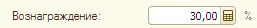</td><td>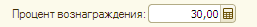</td></tr></tbody></table>

1.2. Единицы измерения следует указывать без скобок:

<table><tbody><tr><td>Хорошо</td><td>Плохо</td></tr>

<tr><td>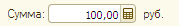</td><td>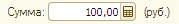</td></tr></tbody></table>

1.3. Если к единице измерения выводится расшифровка, то ее следует располагать в скобках, после единицы измерения.

Например, для срока полезного использования:

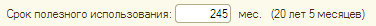

## Для списков

2.1. Единица измерения выводится в колонке с названием "Ед. изм.".

<table><tbody><tr><td>Хорошо</td><td>Плохо</td></tr>

<tr><td> <table><tbody><tr><td> 
Количество
</td><td> 
Ед. изм.
</td></tr>

<tr><td> 
100,000
</td><td> 
кг
</td></tr>

<tr><td> 
5,000
</td><td> 
шт
</td></tr></tbody></table></td><td> <table><tbody><tr><td> 
Количество
</td><td> 
 Ед
</td></tr>

<tr><td> 
100,000
</td><td> 
кг
</td></tr>

<tr><td> 
5,000
</td><td> 
шт
</td></tr></tbody></table> 
 
 
 
<table><tbody><tr><td> 
Количество
</td><td> 
Единица измерения
</td></tr>

<tr><td> 
100,000
</td><td> 
кг
</td></tr>

<tr><td> 
5,000
</td><td> 
шт
</td></tr></tbody></table></td></tr></tbody></table>

Исключение: денежные единицы измерения выводятся в колонке с названием "Валюта".

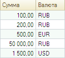

2.2. Если единица измерения для разных значений всегда одинакова, то ее следует выводить в заголовке колонки

<table><tbody><tr><td>Хорошо</td><td>Плохо</td></tr>

<tr><td> <table><tbody><tr><td> 
Сумма, руб.
</td></tr>

<tr><td> 
20 000,00
</td></tr>

<tr><td> 
5 000,00
</td></tr>

<tr><td> 
100,00
</td></tr>

<tr><td> 
1 000,00
</td></tr></tbody></table></td><td> <table><tbody><tr><td> 
Сумма
</td></tr>

<tr><td> 
20 000,00 руб.
</td></tr>

<tr><td> 
5 000,00 руб.
</td></tr>

<tr><td> 
100,00 руб.
</td></tr>

<tr><td> 
1 000,00 руб.
</td></tr></tbody></table></td></tr>

<tr><td> <table><tbody><tr><td> 
Размер, кб.
</td></tr>

<tr><td> 
41
</td></tr>

<tr><td> 
75
</td></tr>

<tr><td> 
34
</td></tr>

<tr><td> 
28
</td></tr></tbody></table></td><td> <table><tbody><tr><td> 
Размер
</td></tr>

<tr><td> 
41 кб.
</td></tr>

<tr><td> 
75 кб.
</td></tr>

<tr><td> 
34 кб.
</td></tr>

<tr><td> 
28 кб.
</td></tr></tbody></table></td></tr></tbody></table>

2.3. Если единица измерения для разных значений отличается, то ее можно выводить как в отдельной колонке, так и в заголовке колонки с количеством (суммой). 

При этом единицу измерения следует выводить сразу после значения, которое она измеряет. 

<table><tbody><tr><td>Хорошо</td><td>Плохо</td></tr>

<tr><td> <table><tbody><tr><td>Наименование</td><td>Количество</td><td>Ед. изм.</td></tr>

<tr><td> 
Папка-вкладыш А4
</td><td> 
100,000
</td><td> 
шт
</td></tr>

<tr><td> 
Клей канцелярский
</td><td> 
5,000
</td><td> 
кг
</td></tr></tbody></table></td><td> <table><tbody><tr><td>Наименование</td><td>Ед. изм.</td><td>Количество</td></tr>

<tr><td> 
Папка-вкладыш А4
</td><td> 
шт
</td><td> 
100,000
</td></tr>

<tr><td> 
Клей канцелярский
</td><td> 
кг
</td><td> 
5,000
</td></tr></tbody></table></td></tr>

<tr><td> <table><tbody><tr><td>Наименование</td><td>Количество </td></tr>

<tr><td> 
Папка-вкладыш А4
</td><td> 
100,000 шт
</td></tr>

<tr><td> 
Клей канцелярский
</td><td> 
5,000 кг
</td></tr></tbody></table></td><td> <table><tbody><tr><td>Наименование</td><td>Количество </td></tr>

<tr><td> 
Папка-вкладыш А4, шт
</td><td> 
100,000
</td></tr>

<tr><td> 
Клей канцелярский, кг
</td><td> 
5,000
</td></tr></tbody></table></td></tr></tbody></table>

Исключение: если одна единица измерения относится к нескольким колонкам, то ее следует располагать до этих колонок.

Например, в документе "Пересчет товаров" две колонки с количеством – по учету и по факту:

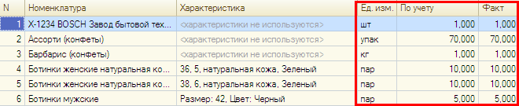
