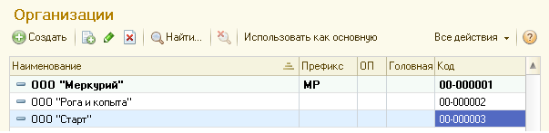
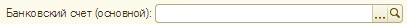
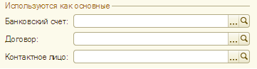

# #std594 Значения по умолчанию

> Область применения: управляемое приложение.
>
> Раздел ИТС: Проектирование интерфейсов для 8.2 / Оформление элементов
>
> Источник: https://its.1c.ru/db/v8std/content/594/hdoc
>
> Проверено по источнику: 2026-10-07

 

Рекомендуется явным образом выделять среди остальных значения, используемые для подстановки в поля по умолчанию.

Для отражения таких значений лучше использовать термин «основной».

## Выделение в списках

- Для выбора в списке основного элемента рекомендуется использовать отдельную команду, расположенную в командной панели списка

- Название для команды выбирается в зависимости от заголовка формы:

    - Использовать как основн*ой*

    - Использовать как основн*ую*

    - Использовать как основн*ое*

**

*Например, для формы «Организация» команда будет называться «Использовать как основную»*

- Для элемента, выбранного основным, используется шрифт "ОсновнойЭлементСписка" (шрифт диалогов и меню, начертание "жирный")

> 

## Выделение в форме

- Если в форме одно поле, используемое для заполнения по умолчанию, то рекомендуется после его заголовка добавлять слово «основной» (основная, основное) в круглых скобка

> 

- Если в форме несколько полей, используемых для заполнения по умолчанию, их следует оформлять в виде группы с заголовком «Используются как основные». В заголовки полей слово «основной» добавлять не рекомендуется.

> 

В случае, если создается и заполняется форма, имеющая подчиненные формы, то при заполнении полей со значениями по умолчанию рекомендуется записывать данные автоматически, не выдавая сообщений пользователю.
