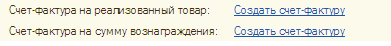
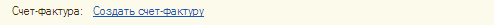
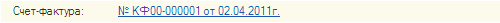
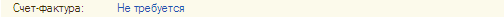
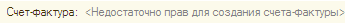

# #std595 Гиперссылка на счет-фактуру

> Область применения: управляемое приложение.
>
> Раздел ИТС: Проектирование интерфейсов для 8.2 / Оформление элементов
>
> Источник: https://its.1c.ru/db/v8std/content/595/hdoc
>
> Проверено по источнику: 2026-10-07

 

В случае, если в форме документа есть гиперссылка на счет-фактуру, то ее рекомендуется оформлять следующим образом:

- Гиперссылка размещается в нижней части формы до группы полей «Ответственный» и «Комментарий»

- Располагается в отдельной строке с выравниванием по левому краю формы

- Перед ссылкой выводится подпись «Счет-фактура». Допускается уточнять в подписи тип счета-фактуры  

    *Например, «Счет-фактура выставленный», «Счет-фактура полученный», «Счет-фактура на сумму вознаграждения»*

- Рекомендуется размещать гиперссылку на всю ширину формы. В случае, если подвал многоколоночный и поле «счет-фактура» относится к колонке, то его следует делать соответствующим ширине колонки

- При наличии в форме нескольких гиперссылок на счета-фактуры следует размещать их друг под другом

## Оформление текста гиперссылки

- Если счет-фактура не указан, рекомендуется выводить текст «Создать счет-фактуру»

- Если счет-фактура указан, то выводится его номер и дата

- Если ввод счета-фактуры не требуется, рекомендуется выводить текст «Не требуется»

- Если для создания нового счета-фактуры требуется записать текущий объект, то рекомендуется по-возможности не выдавать сообщение типа «Документ не записан. Записать?», а автоматически записывать объект.

В ситуации, если у пользователя нет права на создание счета-фактуры, но есть право на ее чтение, рекомендуется следующее оформление:

- Вместо гиперссылки выводится надпись «Недостаточно прав для создания счета-фактуры» в угловых скобках

Для текста надписи используется цвет «ПояснениеОтсутствующейГиперссылки» (128,128,128)

 

