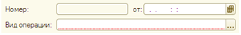
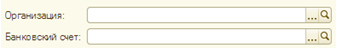
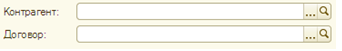
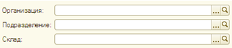
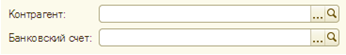
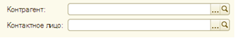
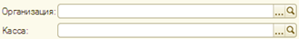
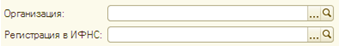

# #std597 Компоновка форм

> Область применения: управляемое приложение.
>
> Раздел ИТС: Проектирование интерфейсов для 8.2 / Формы
>
> Источник: https://its.1c.ru/db/v8std/content/597/hdoc
>
> Проверено по источнику: 2026-10-07

См. также: [Компоновка форм (8.3)](<https://its.1c.ru/db/v8std/content/722/hdoc>)

## 1\. Общие рекомендации

1.1. Один и тот же реквизит в разных формах рекомендуется размещать в одинаковом месте.  

*Например, поле «Контрагент» располагается в левой верхней части всех форм, в которых присутствует.*

1.2. В шапке формы документа размещаются реквизиты, используемые для его правильной регистрации в программе. Сведения, относящиеся к содержательной части документа, итоговые и второстепенные реквизиты в шапке не указываются.

1.3. Шапка документа может состоять из одной, двух или трех колонок. Число и состав колонок определяются в зависимости от количества реквизитов документа. 

## 2\. Оформление шапки, состоящей из двух колонок

2.1. В левой колонке рекомендуется размещать основные сведения о документе, а в правой – второстепенные.

<table><tbody><tr><td style="background-color: #e5f2ff; vertical-align: top"> 
<b>Левая колонка</b>
</td><td style="background-color: #e5f2ff; vertical-align: top"> 
<b>Правая колонка</b>
</td></tr>

<tr><td style="background-color: transparent; vertical-align: top"> 
Важные для заполнения поля
</td><td style="background-color: transparent; vertical-align: top"> 
Вспомогательные, малозначительные поля
</td></tr>

<tr><td style="background-color: transparent; vertical-align: top"> 
Поля, заполняемые пользователем
</td><td style="background-color: transparent; vertical-align: top"> 
Поля, заполняемые автоматически, значение которых требуется только проконтролировать
</td></tr>

<tr><td style="background-color: transparent; vertical-align: top"> 
Обязательные для заполнения поля
</td><td style="background-color: transparent; vertical-align: top"> 
Не обязательные для заполнения поля
</td></tr>

<tr><td style="background-color: transparent; vertical-align: top"> 
Поля, значения которых заполняются по данным, приходящим извне
</td><td style="background-color: transparent; vertical-align: top"> 
Поля, значения которых пользователь устанавливает самостоятельно по внутренним данным
</td></tr></tbody></table>

2.2. Реквизиты рекомендуется распределять по колонкам в следующем порядке:

<table><tbody><tr><td style="background-color: #e5f2ff; vertical-align: top"> 
<b>Левая колонка</b>
</td><td style="background-color: #e5f2ff; vertical-align: top"> 
<b>Правая колонка</b>
</td></tr>

<tr><td style="background-color: transparent; vertical-align: top"> <ol type="1"><li>Номер, дата  </li><li>Вид операции  </li><li>Контрагент  </li><li>Банковский счет (контрагента)  </li><li>Договор  </li><li>Контактное лицо</li></ol></td><td style="background-color: transparent; vertical-align: top"> <ol type="1"><li>Организация  </li><li>Банковский счет (организации)  </li><li>Подразделение  </li><li>Склад  </li><li>Касса  </li><li>Регистрация в ИФНС</li></ol></td></tr></tbody></table>

2.3. При наличии в форме нескольких взаимозависимых полей, их следует располагать последовательно – одно под другим. 

*Например, поле «Подразделение» располагается сразу под полем «Организация»*

2.4. Если в форме есть поле «Вид операции», то под ним следует размещать реквизиты, состав которых зависит от выбора вида операции, за исключением реквизитов, отражаемых в содержательной части формы.

## 3\. Примеры оформления конкретных групп полей

<table><tbody><tr><td style="background-color: #e5f2ff; vertical-align: top"> 
<b>Левая колонка</b>
</td><td style="background-color: #e5f2ff; vertical-align: top"> 
<b>Правая колонка</b>
</td></tr>

<tr><td style="background-color: transparent; vertical-align: top"> 
 
 
Номер, дата + Вид операции
 

</td><td style="background-color: transparent; vertical-align: top"> 
 
 
Организация + Банковский счет (организации)
 

</td></tr>

<tr><td style="background-color: transparent; vertical-align: top"> 
 
 
Контрагент + Договор
 

</td><td style="background-color: transparent; vertical-align: top"> 
 
 
Организация + Подразделение + Склад
 

</td></tr>

<tr><td style="background-color: transparent; vertical-align: top"> 
 
 
Контрагент + Банковский счет (контрагента)
 

</td><td style="background-color: transparent; vertical-align: top"> 
 
 
Организация + Подразделение
 

</td></tr>

<tr><td style="background-color: transparent; vertical-align: top"> 
 
 
Контрагент + Контактное лицо
 

</td><td style="background-color: transparent; vertical-align: top"> 
 
 
Организация + Касса
 

</td></tr>

<tr><td style="background-color: transparent; vertical-align: top; width: 269.45pt" width="359"> 
 
 
 
</td><td style="background-color: transparent; vertical-align: top"> 
 
 
Организация + Регистрация в ИФНС
 

</td></tr></tbody></table>
