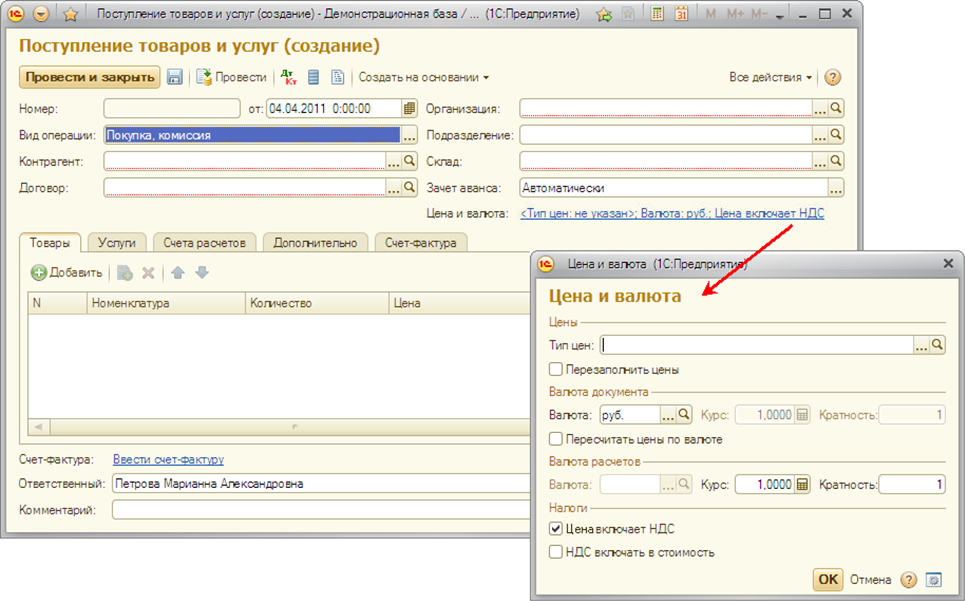
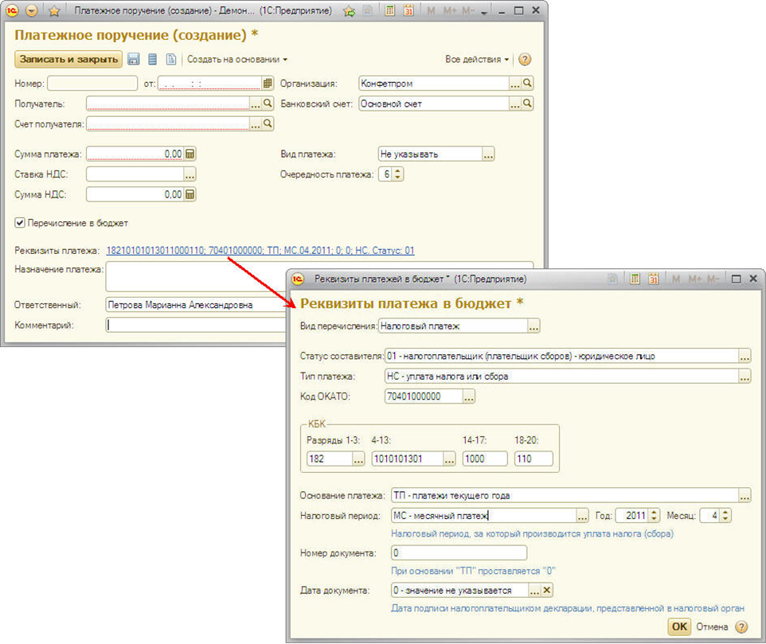
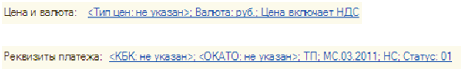

# #std602 Переход к форме с дополнительными реквизитами

> Область применения: управляемое приложение.
>
> Раздел ИТС: Проектирование интерфейсов для 8.2 / Оформление элементов
>
> Источник: https://its.1c.ru/db/v8std/content/602/hdoc
>
> Проверено по источнику: 2026-10-07

См. также: [Компоновка форм (8.3)](<https://its.1c.ru/db/v8std/content/722/hdoc>)

Для оформления перехода к форме, в которую вынесена часть реквизитов из основной формы, рекомендуется использовать гиперссылку.

*Например, для перехода:*

- *к форме «Цена и валюта» из формы «Поступление товаров и услуг»*

- *к форме «Реквизиты платежа в бюджет» из формы «Платежное поручение»*

Перед гиперссылкой выводится подпись, в которой указывается заголовок открываемой формы:

Текст гиперссылки информирует пользователя о том, какие реквизиты можно заполнить в открываемой форме.

## Что указывается в тексте гиперссылки

- Реквизиты, заполняемые в открываемой форме чаще остальных

- Реквизиты, значения которых влияют на порядок заполнения основной формы

- Реквизиты, для которых установлена обязательность заполнения

## Как оформляется текст гиперссылки

- Реквизиты перечисляются через точку с запятой и разделяются пробелом

- Заголовок реквизита выводится первым, далее через двоеточие указывается его значение. Допускается указывать значение реквизита без заголовка, если его смысл понятен из контекста  

    Например, «НС» вместо «Тип платежа: НС»
- Если значение реквизита не заполнено, то вместо него отражается текст «не указан». При этом заголовок реквизита и текст «не указан» отражаются в угловых скобках  

    Например, &lt;Тип цен: не указан&gt;, &lt;КБК: не указан&gt;
- Для реквизита в виде флажка выводится его заголовок, если флаг установлен, и заголовок с частицей «не», если флаг не установлен  

    Например, «Цена включает НДС» (флаг установлен) и «Цена не включает НДС» (флаг не установлен)

См. также: [Выбор: кнопка или гиперссылка](<https://its.1c.ru/db/v8std/content/599/hdoc>)
