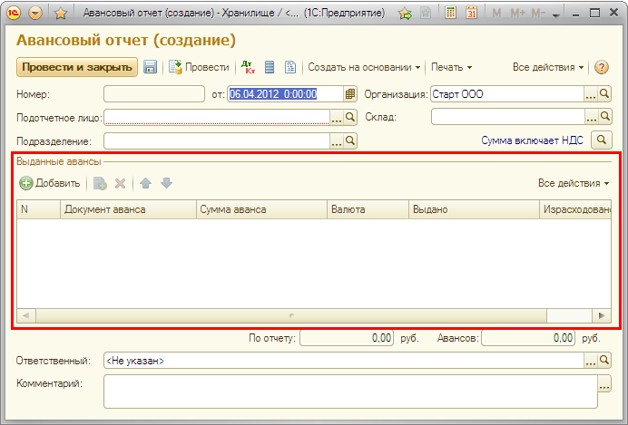
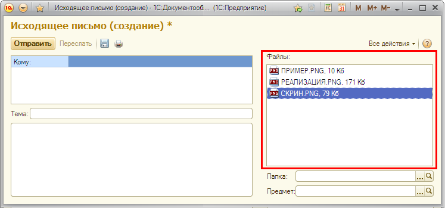
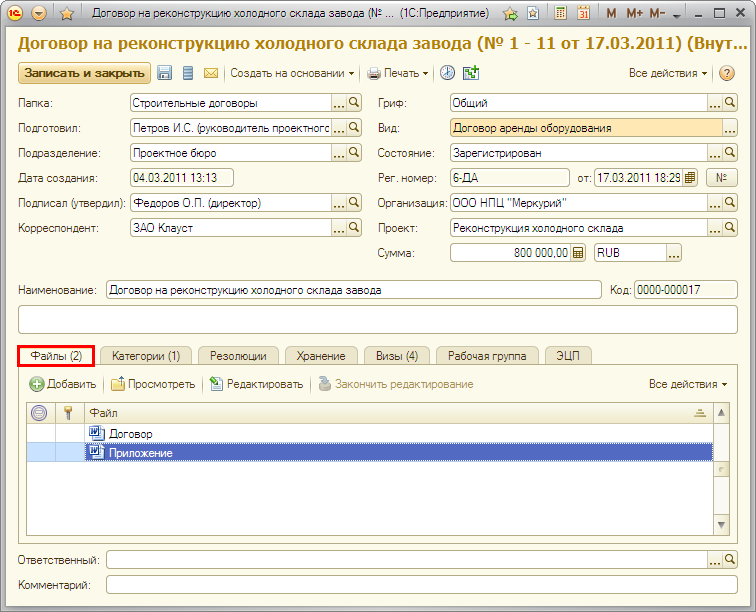
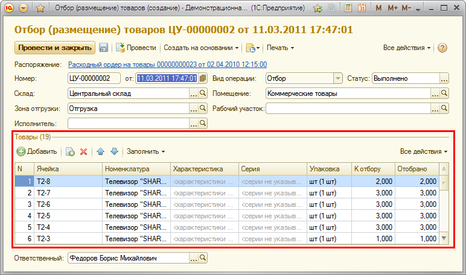
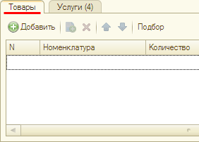
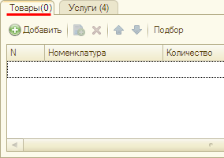
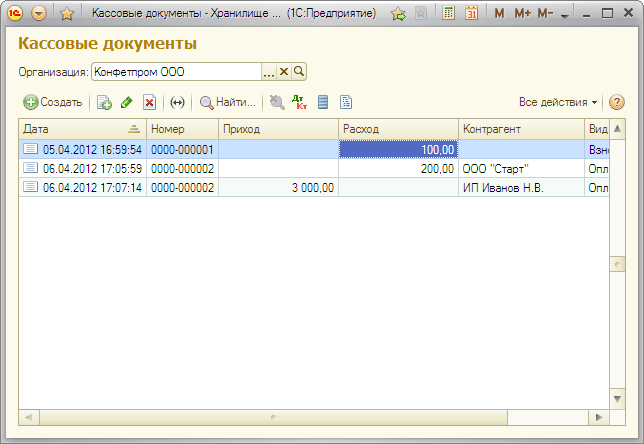
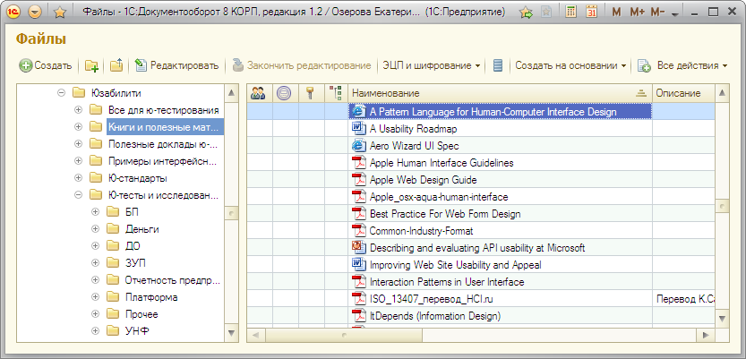
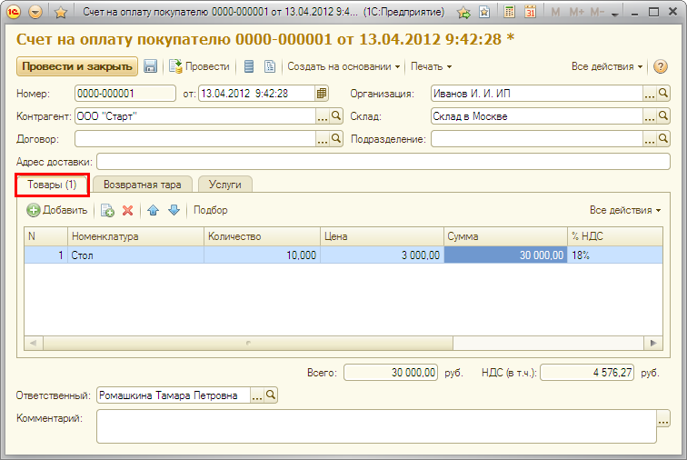

# #std607 Заголовки списков

> Область применения: управляемое приложение.
>
> Раздел ИТС: Проектирование интерфейсов для 8.2 / Оформление форм списков
>
> Источник: https://its.1c.ru/db/v8std/content/607/hdoc
>
> Проверено по источнику: 2026-10-07

## 1\. Оформление заголовка списка

1.1. Если список имеет командную панель, то его заголовок выводится в виде группы с рамкой "линия". 

*Например, список "Выданные авансы":*

1.2. Если список не имеет командной панели, то его заголовок выводится в положении "верх". 

*Например, список "Файлы" в карточке письма:* 

## 2\. Отражение количества элементов в списке

2.1. Количество элементов следует показывать только в тех случаях, когда это уместно и помогает пользователю решить какую-либо задачу.  

*Например, в карточке внутреннего документа количество в заголовке списка файлов показывает, с каким числом файлов нужно ознакомиться пользователю:*

2.2. Если в заголовке конкретного списка принято выводить количество элементов, то это нужно делать во всех формах программы, где этот список используется и решает аналогичные задачи. 

*Например, количество в заголовке списка файлов выводится во всех видах документов: входящих, исходящих, внутренних.*

2.3. Количество элементов в списке выводится после заголовка, в круглых скобках. 

*Например, число товаров в списке "Товары" документа "Отбор (размещение) товаров":* 

2.4. В пустом списке количество элементов выводить не требуется.

<table><tbody><tr><td>Хорошо</td><td>Плохо</td></tr>

<tr><td></td><td></td></tr></tbody></table>

## 3\. Ситуации, в которых заголововок списка не выводится

 

3.1. Если на форме только один список. В качестве заголовка выступает название формы. 

*Например, журнал "Кассовые документы":*

3.2. Если на форме два списка, связанных общих контекстом. При этом назначение списков должно быть интуитивно понятно и не требовать дополнительного пояснения. В качестве общего заголовка выступает название формы. 

*Например, дерево папок файлов и список файлов в папке:* 

3.3. Если список выводится на странице (вкладке). В качестве заголовка выступает название страницы (вкладки). 

*Например, вкладка "Товары" в документе "Счет на оплату покупателю":* 

В остальных случаях заголовок списка рекомендуется показывать. 
