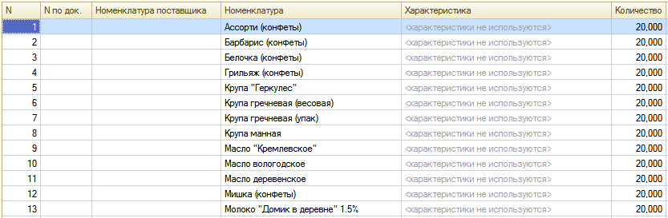

# #std610 Пояснение невозможности заполнения ячеек в табличных частях

> Область применения: управляемое приложение.
>
> Раздел ИТС: Проектирование интерфейсов для 8.2 / Оформление форм списков
>
> Источник: https://its.1c.ru/db/v8std/content/610/hdoc
>
> Проверено по источнику: 2026-10-07

В случае, если ячейка в табличной части не нуждается в заполнении в том или ином состоянии, необходимо сообщать пользователю о причине. 

Текст рекомендуется оформлять так:

- угловые скобки

- цвет текста: «ТекстЗапрещеннойЯчейки» (RGB: 192,192,192)

- с маленькой буквы

*Например, в случае если номенклатура не использует характеристики, в ячейке «Характеристика» выводится сообщение в угловых скобках: &lt;характеристики не используются&gt;*

 
