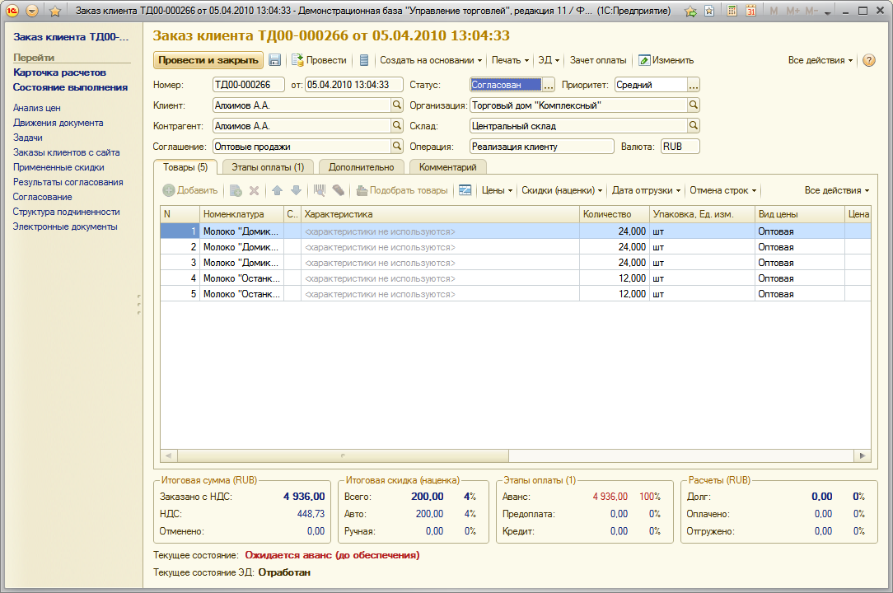
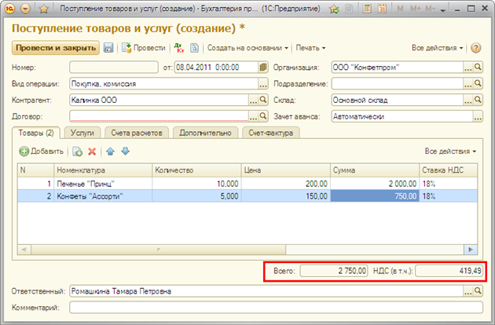
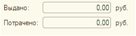
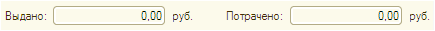

# #std613 Итоги в документах

> Область применения: управляемое приложение.
>
> Раздел ИТС: Проектирование интерфейсов для 8.2 / Оформление элементов
>
> Источник: https://its.1c.ru/db/v8std/content/613/hdoc
>
> Проверено по источнику: 2026-10-07

См. также: [Итоги в документах (8.3)](<https://its.1c.ru/db/v8std/content/718/hdoc>)

Итоги в документах можно размещать несколькими способами:

- в подвале колонок таблиц

- отдельными полями после таблиц

- в специальной области итогов в нижней части формы документа

 

Оформление итогов в подвалах таблиц рекомендуется применять в следующем случае:

- если в таблице нет горизонтальной полосы прокрутки и итоговая колонка всегда видна

- если итог должен быть явным образом визуально связан именно с этой колонкой таблицы

 

В остальных случаях лучше размещать итоговые данные в специальной области итогов в нижней части форм документов.

В области итогов не рекомендуется размещать элементы, не относящиеся к итоговым данным. Их следует располагать до или после области итогов. 

*Например, ссылку на счет-фактуру следует размещать до области итогов, а группу полей «Ответственный» и «Комментарий» - после.*

 

Для оформления области итогов можно использовать следующие способы:

- Объединение итоговых показателей в группы. В этом варианте поля итогов рекомендуется оформлять как надписи 

- Вывод итоговых показателей в отдельных полях ввода

При выборе способа оформления следует руководствоваться следующими критериями:

<table><tbody><tr><td style="background-color: #e5f2ff; vertical-align: top"> 
Объединение в группы
</td><td style="background-color: #e5f2ff; vertical-align: top"> 
Отдельные поля ввода
</td></tr>

<tr><td style="background-color: transparent; vertical-align: top"> 
Возможность копирования итоговых сумм не требуется
</td><td style="background-color: transparent; vertical-align: top"> 
Необходимо предоставить возможность копирования итоговых сумм в буфер обмена
</td></tr>

<tr><td style="background-color: transparent; vertical-align: top"> 
Итоговых показателей много, например, три и более
</td><td style="background-color: transparent; vertical-align: top"> 
Итоговых показателей не много, например один или два
</td></tr></tbody></table>

В итоговых показателях, размещаемых в нижней части формы, отражается сводная информация по содержанию документа.

 

В случае, если в итоговых показателях выводится информация по конкретной таблице, то рекомендуется размещать итоги сразу под ней, оформляя их в виде полей ввода.

## Оформление итогов в группах

 

Итоговая информация - информация, необходимая для понимания документа и принятия решения о дальнейшем действии. Набор итоговой информации определяется для каждого документа в отдельном порядке.

 

*Примеры итоговой информации: Итоговая сумма, Сумма с НДС, Сумма без НДС, Итоговая скидка (автоматическая, ручная).*

 

Итоговая информация отражается в нижней части формы документа

- Оформляется в виде групп с рамками и с отображением заголовка. Заголовок должен кратко и однозначно описывать эту группу полей.

- Если в группу итоговой информации объединены данные с одинаковой валютой или единицей измерения, то ее название выносится в заголовок группы, а не указывается по каждому элементу

- Итоговую информацию необходимо обновлять при внесении изменений в содержание документа, а не только при записи или проведении

- Рекомендуется делать подсказку к итоговым показателям, чтобы она поясняла, откуда взялась та или иная цифра

- Для отображения положительной, нейтральной, непросроченной информации рекомендуется использовать цвет «ИтоговыеПоказателиДокументов» (22,39,121)

- Для отображения негативной, просроченной информации рекомендуется использовать цвет «ПросроченныеДанные» (178,34,34)

- В случае, если группа имеет основное итоговое значение (например, Заказано с НДС), то для него следует использовать шрифт «ОсновноеИтоговоеЗначение» (шрифт диалогов и меню, начертание «жирный») 

    *Например, Сумму с НДС, Итоговый размер скидки и т.п.*

## Оформление итогов отдельными полями ввода

- Итоги оформляются отдельными полями ввода с установленным признаком «Только чтение»

- Выравниваются по правому краю формы.

- В заголовках полей следует выводить текст без слова «итог». Валюту в случае отражения нужно показывать после поля ввода.

 

Если итогов несколько, то их можно разместить в одну или несколько строк. Выбор варианта зависит от компоновки конкретной формы. Можно руководствоваться следующими соображениями:

- Поля, значения которых зависят друг от друга (например, «Всего» и «НДС (в т.ч.)»), рекомендуется всегда располагать на одной строке

- Поля, значения которых требуется визуально сравнивать, лучше располагать друг под другом

- Если размеры формы этого не позволяют, то поля можно размещать в одну строку

