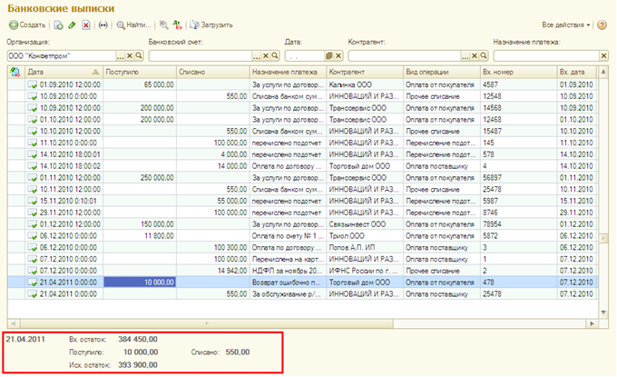

# #std614 Итоги в журналах документов

> Область применения: управляемое приложение.
>
> Раздел ИТС: Проектирование интерфейсов для 8.2 / Оформление элементов
>
> Источник: https://its.1c.ru/db/v8std/content/614/hdoc
>
> Проверено по источнику: 2026-10-07

Итоги в журналах документов (при их наличии) рекомендуется оформлять следующим образом:

- Итоги размещаются в нижней части формы, слева

- Поля итогов оформляются как надписи

- Для выделения значений рекомендуется использовать цвет "ИтогиЖурналаЦвет" (RGB 100,100,100) и шрифт "ИтогиЖурналаШрифт" (шрифт диалогов и меню, начертание "жирный")

*Например, в журнале «Банковские выписки» в качестве итогов оформлены поля, отражающие остатки и обороты по расчетному счету за день.*

 

**
