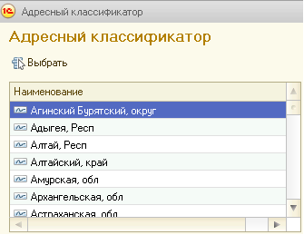
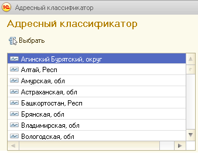

# #std617 Списки с одной колонкой

> Область применения: управляемое приложение.
>
> Раздел ИТС: Проектирование интерфейсов для 8.2 / Оформление форм списков
>
> Источник: https://its.1c.ru/db/v8std/content/617/hdoc
>
> Проверено по источнику: 2026-10-07

- Не рекомендуется делать шапку.

- Если заголовка нет, то визуально пустой список ничем не будет отличаться от многострочного поля ввода. Это нужно учитывать, чтобы не ввести пользователя в заблуждение.

- Не рекомендуется горизонтальная разлиновка и чередование строк.

> *Неправильно:* 
>
>
>
> 
>
>
>
> **
>
>
>
> *Правильно:*
>
>
>
> 
