# #std622 Флажки

> Раздел ИТС: Проектирование интерфейсов для 8.2 / Оформление элементов
>
> Источник: https://its.1c.ru/db/v8std/content/622/hdoc
>
> Проверено по источнику: 2026-10-07

Флажки используются для отражения в формах реквизитов с типом **Булево**. Подписи к флажкам следует оформлять в соответствии с приведенными рекомендациями.

 

1\. Подпись всегда следует располагать справа от флажков:

<table><tbody><tr><td> 
Правильно
</td><td> 
Неправильно
</td></tr>

<tr><td>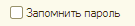</td><td>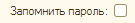</td></tr></tbody></table>

2\. Если к флажку требуется сделать подсказку, то ее следует располагать либо снизу, либо справа от подписи:

<table><tbody><tr><td> 
Правильно
</td><td> 
Неправильно
</td></tr>

<tr><td> 
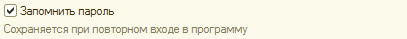
 

</td><td> 
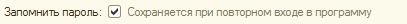
</td></tr></tbody></table>

 

3\. Первая буква подписи флажка должна быть заглавной:

<table><tbody><tr><td> 
Правильно
</td><td> 
Неправильно
</td></tr>

<tr><td>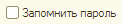</td><td>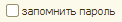</td></tr></tbody></table>

4\. Подписи у флажков следует делать позитивными (не содержащими отрицания)

<table><tbody><tr><td> 
Правильно
</td><td> 
Неправильно
</td></tr>

<tr><td>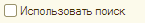</td><td>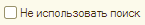</td></tr></tbody></table>

 

Если при этом требуется, чтобы флажок по умолчанию был установлен, у реквизита объекта метаданных следует установить свойство **Значение заполнения** в значение **Истина**.

Подпись, содержащую отрицание, следует применять в исключительных случаях, когда это выглядит естественно или обусловлено историческими причинами.

 

Например, "Не показывать это окно", "Больше не спрашивать", "Недействительный" (для учета неактуальных пользователей).

См. также: [Работа с неактуальными (недействительными объектами](<https://its.1c.ru/db/v8std/content/638/hdoc>))

5\. Текст подписи должен быть понятным и кратким. Не следует делать подпись, состоящую из двух и более предложений.

 

6\. Подпись к флажку определяет только один вариант, второй остается неявным и не сформулированным. Поэтому текст подписи следует подбирать так, чтобы у пользователей не возникало сомнений в том, каким будет второй вариант:

<table><tbody><tr><td> 
Правильно
</td><td> 
Неправильно
</td></tr>

<tr><td> 
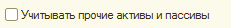
</td><td>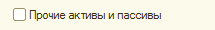</td></tr></tbody></table>

В случае, если такую подпись к флажку подобрать не удается, лучше использовать радиокнопки, у которых указать названия явным образом, например:

<table><tbody><tr><td> 
Правильно
</td><td> 
Неправильно
</td></tr>

<tr><td>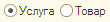</td><td>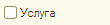</td></tr></tbody></table>

7\. Если на форме присутствует группа флажков, в подписях к которым используется общий текст, то его следует выносить в заголовок группы:

<table><tbody><tr><td> 
Правильно
</td><td> 
Неправильно
</td></tr>

<tr><td>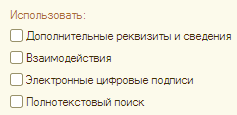</td><td>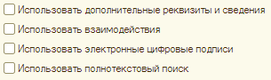</td></tr></tbody></table>
