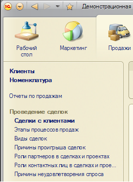

# #std623 Группа команд «Важное»

> Область применения: управляемое приложение.
>
> Раздел ИТС: Проектирование интерфейсов для 8.2 / Панель навигации основного окна
>
> Источник: https://its.1c.ru/db/v8std/content/623/hdoc
>
> Проверено по источнику: 2026-10-07

См. также: [Навигация внутри раздела (8.3)](<https://its.1c.ru/db/v8std/content/714/hdoc>)

«Важное» - команды переходов в ПН, выделенные жирным шрифтом. Могут выступать как отдельными элементами ПН, так и входить в группы.  

- Наличие группы команд «Важное» не является обязательным.

- Использование необходимо в случаях прогнозируемой частотности переходов по той или иной команде. Это позволяет пользователям быстрее ориентироваться в ПН.

- Выделяйте не более 5 важных команд. 

    *При большем количестве команд ПН выглядит громоздко и выделение команд жирным шрифтом действует не так эффективно.*
