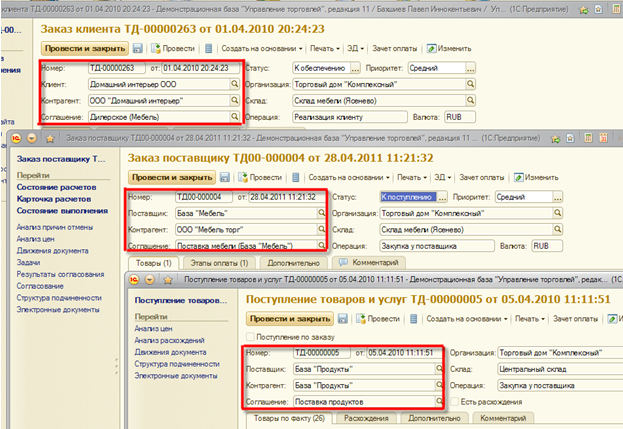

# #std624 Оформление элементов

> Область применения: управляемое приложение.
>
> Раздел ИТС: Проектирование интерфейсов для 8.2 / Оформление элементов
>
> Источник: https://its.1c.ru/db/v8std/content/624/hdoc
>
> Проверено по источнику: 2026-10-07

См. также: [Компоновка форм (8.3)](<https://its.1c.ru/db/v8std/content/722/hdoc>)

Названия одних и тех же объектов, их расположение должны быть одинаковые для всех форм. 

Пример: Номер, дата документа, клиент/поставщик, контрагент, соглашение всегда находятся в одном и том же месте, вне зависимости от документа.  

