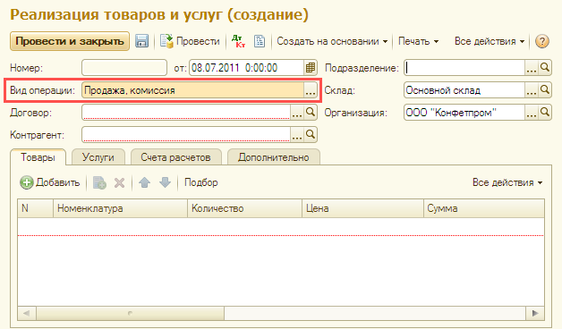
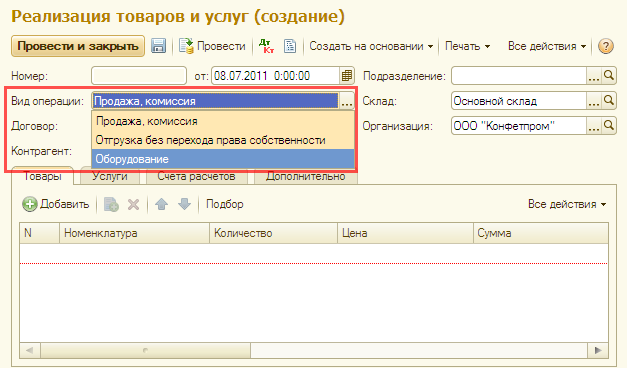

# #std631 Поле, влияющее на состав остальных полей в форме

> Область применения: управляемое приложение.
>
> Раздел ИТС: Проектирование интерфейсов для 8.2 / Оформление элементов
>
> Источник: https://its.1c.ru/db/v8std/content/631/hdoc
>
> Проверено по источнику: 2026-10-07

В случае, если на форме есть поле, выбор значения в котором существенно влияет на состав других элементов формы, необходимо выделять его визуально. 

*Например, Вид операции, Вид документа и т.п.*

Выделение поля требуется для привлечения внимания пользователя, чтобы показать ему, какое именно значение установлено в этом поле, т.к. это может повлиять на работу с формой.

Для выделения поля следует изменить его фон на цвет «ФонУправляющегоПоля» (255,232,179)

 
