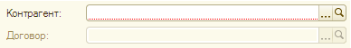

# #std634 Ваимосвязанные поля

> Область применения: управляемое приложение.
>
> Раздел ИТС: Проектирование интерфейсов для 8.2 / Формы
>
> Источник: https://its.1c.ru/db/v8std/content/634/hdoc
>
> Проверено по источнику: 2026-10-07

 

Взаимосвязанные поля – когда заполнение одного поля зависит от значения, выбранного в другом поле.

*Например, заполнение поля «Договор» зависит от того, какой будет выбран «Контрагент»; заполнение поля «Подразделение» - от того, к какой «Организации» оно относится и т.п.*

Пользователю необходимо визуально показать, какое из полей следует заполнить первым. 

Для этого поле, заполнение которого зависит от другого поля, следует оформлять недоступным до того момента, пока не будет заполнено основное поле.

*Например, поле «Договор» следует выделять как недоступное до того момента, пока поле «Контрагент» не будет заполнено.*

