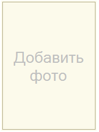
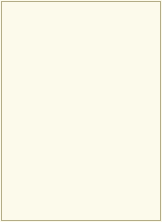

# #std635 Невыбранная картинка

> Область применения: управляемое приложение.
>
> Раздел ИТС: Проектирование интерфейсов для 8.2 / Оформление элементов
>
> Источник: https://its.1c.ru/db/v8std/content/635/hdoc
>
> Проверено по источнику: 2026-10-07

Если в форме есть изображение (поле картинки), которое может быть добавлено пользователем, то его оформление должно сообщать пользователю о своем назначении.

*Например, поле для фотографии в карточке сотрудника, поле для изображения в справочнике номенклатуры и т.п.*

<table><tbody><tr><td style="background-color: transparent; vertical-align: top"> 
Хорошо
</td><td style="background-color: transparent; vertical-align: top"> 
Плохо
</td></tr>

<tr><td style="background-color: transparent; vertical-align: top"> 
 
 

</td><td style="background-color: transparent; vertical-align: top"> 
 
 

</td></tr></tbody></table>

- Как оформлять невыбранную картинку: 

    Обязательно указывать текст невыбранной картинки 

    *Например, «Добавить фото», «Добавить изображение»*
- Для текста невыбранной картинки используется цвет "ТекстНевыбраннойКартинкиЦвет" (RGB 220,220,220) и шрифт "ТекстНевыбраннойКартинкиШрифт" (шрифт диалогов и меню, размер "12")
