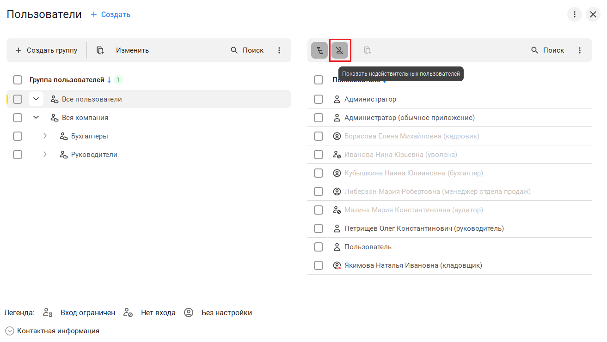

# #std638 Работа с неактуальными (недействительными) объектами

> Область применения: управляемое приложение, мобильное приложение, обычное приложение.
>
> Раздел ИТС: Создание и изменение объектов метаданных / Организация хранения данных
>
> Источник: https://its.1c.ru/db/v8std/content/638/hdoc
>
> Проверено по источнику: 2026-10-07

<a id="1"></a>1\. Данная рекомендация действует для ситуаций, когда какой-либо объект информационной базы перестает быть актуальным – навсегда или на время (сотрудник увольняется или уходит в декретный отпуск, подразделение расформируется и т.д.). При этом удалять этот объект из базы недопустимо, чтобы не нарушать ссылочную целостность: на него должны ссылаться другие ранее созданные объекты. Например, объект типа **Файл** должен содержать в поле **Автор** ссылку на уволившегося сотрудника и после его увольнения.

<a id="2.1"></a>2.1. Для учета неактуальных пользователей у объектов метаданных, для которых должен применяться механизм недействительных объектов, необходимо предусмотреть реквизит типа **Булево** (**Недействителен** или аналогичный), значение по умолчанию **Ложь**.

<a id="2.2"></a>2.2. При использовании в конфигурации **Библиотеки стандартных подсистем** (3.2.2 и выше) с подсистемой **Недействительные объекты**, необязательно добавлять реквизит **Недействителен** в объект метаданных. Вместо этого можно добавить объекты метаданных в состав общего реквизита **Недействителен**. Если реквизит **Недействителен** назван иначе, это нужно указать в процедуре **НедействительныеОбъектыПереопределяемый.ПриПолученииНастроекРаботыСНедействительными**.

<a id="3"></a>3\. В полях ввода рекомендуется скрывать недействительные объекты для выбора с помощью автоподбора и быстрого выбора.

<a id="3.1.1"></a>3.1.1. Для переопределения скрытия / отображения недействительных объектов в местах использования - реквизитах объектов метаданных и полях ввода формы, следует вставлять свойство **ДобавлятьНедействительныеОбъектыВДанныеВыбора** типа **Булево** в Параметры выбора.

<a id="3.1.2"></a>3.1.2. Для скрытия недействительных объектов и обработки свойства **ДобавлятьНедействительныеОбъектыВДанныеВыбора**, в модуле менеджера объекта нужно реализовать обработчик:

```bsl
Процедура ОбработкаПолученияДанныхВыбора(ДанныеВыбора, Параметры, СтандартнаяОбработка)
	Если Параметры.Свойство("ДобавлятьНедействительныеОбъектыВДанныеВыбора") Тогда
    		Параметры.Отбор.Удалить("Недействителен");
 	Иначе
    		Параметры.Отбор.Вставить("Недействителен", Ложь);
  	КонецЕсли;
КонецПроцедуры
```

При использовании обработчика **ОбработкаПолученияДанныхВыбора** для скрытия недействительных объектов рекомендуется отключить историю выбора в свойствах объектов метаданных, для которых применяется механизм недействительных объектов.

> *Подробнее см. пп. 2.1 в* [*История выбора при вводе*](<https://its.1c.ru/db/v8std/content/744/hdoc>)

<a id="3.1.3"></a>3.1.3. Рекомендуется предупреждать пользователя о выборе неактуальных объектов с помощью автоподбора и быстрого выбора в полях ввода, если объект не помечен на удаление. Для этого в обработчике **ОбработкаПолученияДанныхВыбора** элементы списка значений **ДанныеВыбора** должны иметь тип **Структура** с обязательными свойствами: **Значение**, ПометкаУдаления и **Предупреждение**. В свойство Предупреждение необходимо передавать текст предупреждения о выборе недействительных.

```bsl
Процедура ОбработкаПолученияДанныхВыбора(ДанныеВыбора, Параметры, СтандартнаяОбработка)

	Если Не ЗначениеЗаполнено(Параметры.СтрокаПоиска) Тогда
		Возврат;
	КонецЕсли;

	СтандартнаяОбработка = Ложь;

	Запрос = ...
	Выборка = Запрос.Выполнить().Выбрать();
	ДанныеВыбора = Новый СписокЗначений;
	Пока Выборка.Следующий() Цикл
...

		Если Выборка.ПометкаУдаления Или Выборка.Недействителен Тогда
			Элемент = Новый Структура;
			Элемент.Вставить("Значение", Выборка.Ссылка);
			Элемент.Вставить("ПометкаУдаления", Выборка.ПометкаУдаления);
			Если Выборка.ПометкаУдаления Тогда
				ТекстПредупреждения = НСтр("ru = 'Выбранный элемент помечен на удаление.
					|Продолжить?'")
			Иначе
				ТекстПредупреждения = НСтр("ru = 'Выбранный элемент недействителен.
					|Продолжить?'");
			КонецЕсли;
			Элемент.Вставить("Предупреждение", ТекстПредупреждения);
			ДанныеВыбора.Добавить(Элемент, Представление);
		Иначе
			ДанныеВыбора.Добавить(Выборка.Ссылка, Представление);
		КонецЕсли;
	КонецЦикла;

КонецПроцедуры
```

При использовании в конфигурации **Библиотеки стандартных подсистем** (3.2.2 и выше) с подсистемой **Недействительные объекты** следует сделать вызов процедуры **НедействительныеОбъекты.ПриОбработкеПолученияДанныхВыбора**.

```bsl
Процедура ОбработкаПолученияДанныхВыбора(ДанныеВыбора, Параметры, СтандартнаяОбработка)
	НедействительныеОбъекты.ПриОбработкеПолученияДанныхВыбора(
		Метаданные.Справочники.Пользователи, ДанныеВыбора, Параметры, СтандартнаяОбработка);
КонецПроцедуры
```

<a id="3.2"></a>3.2. В формах списка и выбора рекомендуется включать отбор недействительных объектов и добавить команду **Показать недействительные** (или аналогичную) в дополнительное подменю (Еще), которая будет включать / отключать отбор недействительных.

В обработчике формы **ПриСозданииНаСервере** рекомендуется включить отбор недействительных объектов, если в стандартном параметре формы Отбор нет свойства **Недействителен**. В противном случае, настроить пометку команды по значению этого свойства. Для включения / отключения отбора рекомендуется использовать тот же способ, который использует платформа 1С:Предприятия при обработке свойства **Недействителен** в стандартном параметре формы **Отбор** (использовать **ФиксированныеНастройки** компоновщика настроек динамического списка).

При использовании в конфигурации **Библиотеки стандартных подсистем** (3.2.2 и выше) включение отбора и добавление команды выполняются с помощью подсистемы **НедейстительныеОбъекты**.



<a id="4"></a>4\. В формах списка, выбора и элемента необходимо в дополнительное подменю (Еще) добавить команду **Пометить недействительным / Снять пометку**, которая управляет признаком Недействителен, аналогично стандартной команде **Пометить на удаление / Снять пометку**. В форме элемента допустимо вместо команды сделать поле флажка **Недействителен** (или аналогичного).

<a id="5"></a>5\. При установке пометки на удаление, объект также помечается недействительным. При снятии пометки удаления, снятие пометки недействительного не производится.

<a id="6"></a>6\. Для отображения неактуальных объектов в списках рекомендуется использовать элемент стиля **ТекстЗапрещеннойЯчейкиЦвет** (192,192,192).
