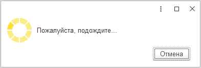

# #std642 Длительные операции на сервере

> Область применения: управляемое приложение.
>
> Раздел ИТС: Разработка пользовательских интерфейсов
>
> Источник: https://its.1c.ru/db/v8std/content/642/hdoc
>
> Проверено по источнику: 2026-10-07

<a id="1"></a>1\. При разработке конфигураций следует избегать длительных вызовов из клиентского кода в серверный. Все длительные серверные вызовы, которые могут выполняться более **8** секунд в обычных сценариях работы пользователя, следует выполнять асинхронно, с помощью фонового задания.

К таким операциям относятся: формирование отчета, групповая обработка объектов, загрузка или выгрузка данных в другое приложение, заполнение больших табличных частей и т.п.

В противном случае такие вызовы могут привести к потере работоспособности приложения или затруднению работы с ним:

- браузер может предложить прекратить длительно выполняющийся сценарий, после чего приложение станет неработоспособным;

- веб сервер может прервать длительное обращение к серверу 1С:Предприятия и вернуть ошибку 504 (шлюз не отвечает);

- в случае длительного выполнения операции, у пользователя нет возможности отменить ее.

<a id="2.1"></a>2.1. Общий подход к асинхронному выполнению длительных серверных операций с помощью фонового задания:

- Код, выполняющий длительную обработку данных, располагается в общем модуле или модуле менеджера объекта\*. Результат своей работы он помещает во временное хранилище;<br>

    *\*Примечание: необходимо использовать процедуру-обертку в общем модуле, которая будет вызывать процедуру модуля менеджера, т.к. фоновые задания могут работать только с процедурами общих модулей. Не требуется при запуске фоновых заданий через общий модуль* **ДлительныеОперации** *конфигурации Библиотеки стандартных подсистем (БСП).*<br>

    <br>
- Для выполнения этого кода на сервере запускается фоновое задание, при этом необходимо ожидать завершения выполнения фонового задания в течение **0.8** сек;

- Если за время ожидания выполнения задания оно не завершилось, то управление возвращается на клиент, и в клиентском коде подключается обработчик ожидания, в котором периодически проверяется состояние фонового задания. При этом интервал опроса задания увеличивается от **1** до **15** секунд с фиксированным коэффициентом **1.4**;

- На время выполнения длительной операции пользователю отображается индикатор; <br>

    при этом для отчетов индикатор выводится в поле табличного документа, используя свойство поля табличного документа **ОтображениеСостояния**:<br>

    <br>

    

    <br>

    <br>

    а для прочих мест – выводится блокирующая форма (**РежимОткрытияОкна** = **БлокироватьОкноВладельца**), на которой размещена декорация с анимированной картинкой и кнопка **«Отмена»**:<br>

    <br>

    

    <br>
- При получении от сервера информации о том, что фоновое задание завершено, полученный результат загружается из временного хранилища и обрабатывается.

<a id="2.2"></a>2.2. Асинхронное формирование отчета требуется только для тех отчетов, которые

- разработаны без использования СКД или с использованием СКД, но с переопределенной процедурой формирования отчета (переопределен обработчик кнопки **«Сформировать»** или в обработчике модуля отчета **ПриКомпоновкеРезультата** устанавливается **СтандартнаяОбработка** = **Ложь**).

- и формирование которых, как правило, занимает длительное время.

Поведение таких отчетов должно быть максимально похожим на поведение отчетов на базе СКД, а именно:

- форму отчета не следует блокировать на время его формирования;

- пользователь может изменить настройки и переформировать отчет, не дожидаясь окончания его формирования;

- при закрытии формы отчета, формирование отчета прерывается.

<a id="3"></a>3\. При использовании в конфигурации **Библиотеки стандартных подсистем** в распоряжении разработчика имеются вспомогательные функции и процедуры общих модулей **ДлительныеОперации**, **ДлительныеОперацииКлиент**, а также процедура **УстановитьСостояниеПоляТабличногоДокумента** общего модуля **ОбщегоНазначенияКлиентСервер**.

Пример выполнения функции в фоновом задании при использовании в конфигурации Библиотеки стандартных подсистем. В модуле менеджера объекта размещена функция, которая выполняет поиск настроек и возвращает их:

```bsl
Функция ОпределитьНастройкиУчетнойЗаписи(АдресЭлектроннойПочты, Пароль) Экспорт
  ...
  Возврат Настройки;
КонецФункции
```

В форме объекта выполняется вызов этой функции в фоновом задании в три этапа:<br>

1\) запуск фонового задания на сервере,<br>

2\) подключение обработчика завершения фонового задания на клиенте,<br>

3\) обработка результата выполнения фонового задания.

```bsl
&НаКлиенте
Процедура НастроитьПараметрыПодключенияАвтоматически()
```

```bsl
  // 1. Запуск фонового задания на сервере.
  ДлительнаяОперация = НачатьПоискНастроекУчетнойЗаписи();

  // 2. Подключение обработчика завершения фонового задания.
  ПараметрыОжидания = ДлительныеОперацииКлиент.ПараметрыОжидания(ЭтотОбъект);
  Оповещение = Новый ОписаниеОповещения("ПриЗавершенииПоискаНастроек", ЭтотОбъект);
  ДлительныеОперацииКлиент.ОжидатьЗавершение(ДлительнаяОперация, Оповещение, ПараметрыОжидания);
```

```bsl
КонецПроцедуры
```

```bsl
&НаСервере
Функция НачатьПоискНастроекУчетнойЗаписи()
```

```bsl
  ПараметрыВыполнения = ДлительныеОперации.ПараметрыВыполненияФункции(УникальныйИдентификатор);
  Возврат ДлительныеОперации.ВыполнитьФункцию(ПараметрыВыполнения,
"Справочники.УчетныеЗаписиЭлектроннойПочты.ОпределитьНастройкиУчетнойЗаписи",
АдресЭлектроннойПочты, Пароль);
```

```bsl
КонецФункции
```

```bsl
// 3. Обработка результата выполнения фонового задания.
```

```bsl
// Параметры:
// Результат - см. ДлительныеОперацииКлиент.НовыйРезультатДлительнойОперации
// ДополнительныеПараметры - Неопределено
//
&НаКлиенте
Процедура ПриЗавершенииПоискаНастроек(Результат, ДополнительныеПараметры) Экспорт
```

```bsl
  Если Результат = Неопределено Тогда // Пользователь отменил задание.
    Возврат;
  КонецЕсли;

  Если Результат.Статус = "Ошибка" Тогда
    СтандартныеПодсистемыКлиент.ВывестиИнформациюОбОшибке(Результат.ИнформацияОбОшибке);
    Возврат;
  КонецЕсли;

  Настройки = ПолучитьИзВременногоХранилища(Результат.АдресРезультата);
  УдалитьИзВременногоХранилища(Результат.АдресРезультата);
  УстановитьНастройкиУчетнойЗаписи(Настройки);
```

```bsl
КонецПроцедуры
```

<table><tbody><tr><td> <p style="text-align: left"><em>Методическая рекомендация (полезный совет)</em></p> <p style="text-align: left">3.1. При каждом выполнении фонового задания его результат помещается во временное хранилище на время жизни формы:</p> <pre data-code-id="code-0012">ПараметрыВыполнения = ДлительныеОперации.ПараметрыВыполненияФункции(УникальныйИдентификатор);&#10;ДлительныеОперации.ВыполнитьФункцию(ПараметрыВыполнения, ПараметрФоновогоЗадания);</pre> <p style="text-align: left">Если длительная операция выполняется пользователем многократно, пока эта форма открыта, то временные хранилища накапливаются, что вызывает рост потребления памяти. Поэтому для уменьшения расхода оперативной памяти в большинстве случаев рекомендуется очищать временное хранилище сразу после получения результата фонового задания:</p> <pre data-code-id="code-0013">Настройки = ПолучитьИзВременногоХранилища(Результат.АдресРезультата);&#10;УдалитьИзВременногоХранилища(Результат.АдресРезультата); // Данные во временном хранилище больше не требуются.</pre> <p style="text-align: left">Если же результат фонового задания требуется сохранять на протяжении нескольких серверных вызовов, то необходимо передавать фиксированный адрес заранее инициализированного временного хранилища:</p> <pre data-code-id="code-0014">&amp;НаСервере&#10;Процедура ПриСозданииНаСервере(Отказ)&#10;  АдресРезультатаФоновогоЗадания = ПоместитьВоВременноеХранилище(Неопределено, УникальныйИдентификатор); // Резервируем адрес временного хранилища&#10;КонецПроцедуры</pre> <pre data-code-id="code-0015">&amp;НаСервере&#10;Функция НачатьПоискНастроекУчетнойЗаписи()&#10;  ПараметрыВыполнения = ДлительныеОперации.ПараметрыВыполненияФункции(УникальныйИдентификатор);&#10;  ПараметрыВыполнения.АдресРезультата = АдресРезультатаФоновогоЗадания; // всегда используем одно и то же временное хранилище</pre> <pre data-code-id="code-0016">  Возврат ДлительныеОперации.ВыполнитьФункцию(ПараметрыВыполнения,&#10;"Справочники.УчетныеЗаписиЭлектроннойПочты.ОпределитьНастройкиУчетнойЗаписи", АдресЭлектроннойПочты, Пароль);&#10;КонецФункции</pre></td></tr></tbody></table>

<a id="4"></a>4\. Если в конфигурации реализуются алгоритмы, инициирующие запуск фоновых заданий или запись данных информационной базы **без участия пользователя** (например, регулярное обновление информации в открытой форме), то в них следует проверять, что в текущем сеансе не установлен монопольный режим. В противном случае, следует блокировать попытки выполнения таких действий. Например:

```bsl
Если МонопольныйРежим() Тогда
  Возврат;
КонецЕсли;
```

```bsl
ФоновыеЗадания.Выполнить("...
```

<a id="5"></a>5\. В некоторых случаях возникает необходимость в выполнении длительных операций, требующих установки монопольного режима доступа к информационной базе. Например:

- Обновление данных ИБ при первом интерактивном запуске программы после обновления конфигурации;

- Удаление объектов, помеченных на удаление;

- Выгрузка данных информационной базы в файл для перехода в сервис;

- Использования монопольного режима для снижения времени выполнения массовых операций по изменению данных;

При этом необходимо сначала устанавливать монопольный режим, а затем выполнять запуск фонового задания, которое реализует саму длительную операцию. В этом случае фоновым заданием будет унаследован монопольный режим, ранее установленный из пользовательского сеанса (см. [документацию к платформе](<https://its.1c.ru/db/v83doc/bookmark/dev/TI000000542>)).

На время выполнения этого фонового задания следует блокировать весь интерфейс приложения, открывая форму ожидания завершения операции в режиме **РежимОткрытияОкна = БлокироватьВесьИнтерфейс.** Блокировать интерфейс приложения требуется потому, что на время выполнения задания полноценная работа пользователя с приложением уже невозможна:

- Если пользователь(\*) попытается записать какой-либо объект, это приведет к ошибке (из-за установленного монопольного режима);

- В ряде случаев могут запускаться фоновые задания в качестве реакции на действия пользователя случае (при поиске в динамическом списке, при вводе по строке, формировании отчетов и пр.), которые также завершатся с ошибкой.<br>

    Кроме того, на самой форме ожидания длительной операции не следует размещать элементы управления, которые могут приводить к запуску таких фоновых заданий. Например: поля ввода, динамические списки и отчеты.

*\* Примечание: ошибки записи также возникают в тех случаях, когда объекты записываются программно, например, из обработчиков ожидания. В них также следует проверять монопольный режим согласно п.4.*

<a id="6"></a>6\. Обеспечение безопасности. Исключение непредусмотренных вызовов процедур и функций с помощью фоновых заданий (и длительных операций БСП).

При передаче параметров для запуска длительных операций требуется предотвратить подмену их значений, если они прямо или косвенно передаются с клиента. Для этого рекомендуется все параметры, которые можно не передавать с клиента, готовить строго на сервере независимо от того, что получено с клиента. Кроме того, имя процедуры или функции, запускаемой в фоне, следует указывать явно, без использования переменных или функций-оберток.

<span style="color: rgb(0,128,0)">Правильно:</span>

См. пример в пункте 3.

<span style="color: rgb(204,0,0)">Неправильно:</span>

```bsl
&НаКлиенте
Процедура НастроитьПараметрыПодключенияАвтоматически()

  ДлительнаяОперация = НачатьПоискНастроекУчетнойЗаписи("Справочники.УчетныеЗаписиЭлектроннойПочты.ОпределитьНастройкиУчетнойЗаписи", ПараметрыВыполнения, АдресЭлектроннойПочты, Пароль);

  …

КонецПроцедуры


&НаСервере

Функция НачатьПоискНастроекУчетнойЗаписи(ИмяПроцедуры, ПараметрыВыполнения, АдресЭлектроннойПочты, Пароль)

  ПараметрыВыполнения = ДлительныеОперации.ПараметрыВыполненияФункции(УникальныйИдентификатор);

  Возврат ДлительныеОперации.ВыполнитьФункцию(ПараметрыВыполнения, ИмяПроцедуры, АдресЭлектроннойПочты, Пароль);
КонецФункции
```

<br>

<a id="6.1"></a>6.1. При следующих вызовах, в параметре имени вызываемой процедуры или функции нужно указывать строку полного имени без использования переменных:

```bsl
ДлительныеОперации.ВыполнитьВФоне("ВариантыОтчетов.СформироватьОтчетВФоне", …);
ДлительныеОперации.ВыполнитьФункцию(…, "КонструкторФормулСлужебный.ЗапуститьПоискВСпискеПолей", …);
ДлительныеОперации.ВыполнитьПроцедуру(…, "ЗащитаПерсональныхДанных.ОбновитьСрокиХраненияПерсональныхДанных", …);
ДлительныеОперации.ВыполнитьФункциюВНесколькоПотоков("РассылкаОтчетов.РезультатФормированияПорцииОтчетов", …);
ДлительныеОперации.ВыполнитьПроцедуруВНесколькоПотоков("КонтрольВеденияУчета.ВыполнитьПроверку", …);
ФоновыеЗадания.Выполнить("УправлениеДоступомСлужебный.ВключитьРегламентноеЗаданиеОбновленияДоступа", …);
РасширенияКонфигурации.ВыполнитьФоновоеЗаданиеСРасширениямиБазыДанных("ОбновлениеКонфигурации.ОписанияНовыхПатчей", …);
РасширенияКонфигурации.ВыполнитьФоновоеЗаданиеБезРасширений("СхемаКонфигурацииСлужебный.ПоместитьВоВременноеХранилищеДвоичныеДанныеСхемы", …);
```

Также допустимо указывать полное имя свойства **ИмяМетода** регламентного задания вместо строки, например:

```bsl
РасширенияКонфигурации.ВыполнитьФоновоеЗаданиеСРасширениямиБазыДанных(
    Метаданные.РегламентныеЗадания.ОбновлениеДоступаНаУровнеЗаписей.ИмяМетода, …);
РасширенияКонфигурации.ВыполнитьФоновоеЗаданиеСРасширениямиБазыДанных(
    Метаданные.РегламентныеЗадания[ИмяЗадания].ИмяМетода, …);
```

<a id="6.2"></a>6.2. При использовании в конфигурации **Библиотеки стандартных подсистем** (БСП).

<a id="6.2.1"></a>6.2.1. Для запуска длительных операций следует использовать методы общего модуля **ДлительныеОперации**.

Для запуска служебных фоновых заданий, например, для программного запуска обработчиков регламентных заданий, в специализированных механизмах многопоточного выполнения и других особых случаях, можно использовать методы платформы, указаные в пункте 6.1, кроме варианта с передачей имени метода через переменную, тогда следует использовать либо функцию **РегламентныеЗаданияСервер**.**ВыполнитьЗадание**, либо функцию **ОбщегоНазначения**.**ВыполнитьФоновоеЗадание**. Нужно иметь в виду, что прикладной контекст сеанса не передается в фоновое задание, как при запуске через методы общего модуля ДлительныеОперации.

<a id="6.2.2"></a>6.2.2. В общих модулях, модулях менеджеров объектов и модулях объектов, которые содержат процедуры или функции для вызова длительных операций или вызова через функцию ОбщегоНазначения.ВыполнитьФоновоеЗадание, требуется добавить следующую экспортную процедуру, в которой перечислить все используемые имена:

```bsl
// См. СтандартныеПодсистемыСервер.ПриОпределенииМетодовРазрешенныхДляВызоваКакПроизвольныйКод
Процедура ПриОпределенииМетодовРазрешенныхДляВызоваКакПроизвольныйКод(Методы) Экспорт
    Методы.Вставить("СформироватьОтчетВФоне", Истина); // Пример для общего модуля ВариантыОтчетов.
КонецПроцедуры
```

Имена нужно перечислить в виде строк без использования переменных и вызовов в другие процедуры и функции.

Можно размесить процедуру в любом месте модуля (например, в конце) и в любой области модуля (в том числе СлужебныеПроцедурыИФункции, СлужебныйПрограммныйИнтерфейс, ПрограммныйИнтерфейс - ДляВызоваИзДругихПодсистем).

Контроль выполняется при запуске фоновых заданий через общий модуль **ДлительныеОперации** и через **ОбщегоНазначения**.**ВыполнитьФоновоеЗадание**. Если процедура или функция не предусмотрена для вызова, тогда будет вызвано исключение.

*Примечание: в будущих версиях БСП 3.1.13 (если будет) и 3.2.2, если в модуле нет процедуры **ПриОпределенииМетодовРазрешенныхДляВызоваКакПроизвольныйКод**, тогда разрешен запуск любой процедуры или функции модуля в фоне, а с версий БСП 3.1.14 (если будет) и 3.2.3 будет вызвано исключение.*

#### См. также

- [Длительные операции на клиенте](<https://its.1c.ru/db/v8std/content/755/hdoc>)

- [Ограничения на использование Выполнить и Вычислить на сервере](<https://its.1c.ru/db/v8std/content/770/hdoc>)

<br>

<br>
