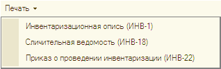
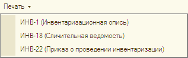

# #std645 Названия печатных форм учетных документов и команд по их выводу на печать

> Область применения: управляемое приложение.
>
> Раздел ИТС: Проектирование интерфейсов для 8.2 / Тексты
>
> Источник: https://its.1c.ru/db/v8std/content/645/hdoc
>
> Проверено по источнику: 2026-10-07

Рекомендации распространяются на формы первичных учетных документов, утвержденные Росстатом (Госкомстатом). 

*Например, первичные документы по учету торговых операций, кассовых операций, материалов, кадров и т.п.*

Как правило, такие учетные документы имеют в названии кодовое обозначение. 

*Например, «ТОРГ-12» для Товарной накладной.*

Стандарт следует применять к названиям печатных форм документов, а также к заголовкам команд по их выводу на печать.

Название печатной формы и заголовок команды по выводу на печать рекомендуется делать одинаковым.

Названия необходимо оформлять единообразно, придерживаясь следующих рекомендаций:

> 1\. Название, по возможности, следует делать кратким 
>
> *Например, «Приказ о приеме (Т-1)» вместо «Приказ (распоряжение) о приеме работника на работу (Т-1)»*
>
>
>
> 2\. В названии можно использовать общепринятые сокращения 
>
> Например, «Акт о приеме-передаче ТМЦ»
>
>
>
> 3\. В название следует включать кодовое обозначение 
>
> Например, «Товарная накладная (ТОРГ-12)», «Накладная на отпуск материалов (М-15)», «Личная карточка (Т-2)»
>
>
>
> Кодовое обозначение следует размещать в конце названия в круглых скобках, чтобы оно не затрудняло поиск нужной команды по первым буквам.
>
>
>
>
>
>
>
> <table><tbody><tr><td> Хорошо</td><td> Плохо</td></tr>
>
> <tr><td></td><td></td></tr></tbody></table>

 

> 4\. Из названия должно быть понятно назначение документа. Не допускается использовать обобщенные и обезличенные словосочетания, а также указание на кодовое обозначение
>
>
>
>
>
>
>
> <table><tbody><tr><td> Хорошо</td><td> Плохо</td></tr>
>
> <tr><td> 
Расчетная ведомость (Т-51)
</td><td> 
Унифицированная форма (Т-51) Расчетная ведомость по форме Т-51 Расчетная ведомость (ф. Т-51)
</td></tr></tbody></table>

 

 

См. также: [Формирование печатных форм](<https://its.1c.ru/db/v8std/content/548/hdoc>)
