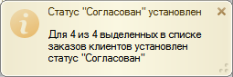
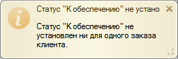
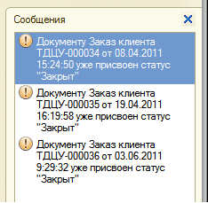
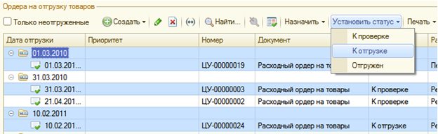
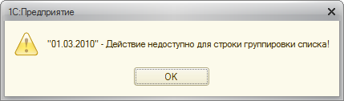

# #std653 Групповые обработки в списках

> Область применения: управляемое приложение.
>
> Раздел ИТС: Проектирование интерфейсов для 8.2 / Оформление форм списков
>
> Источник: https://its.1c.ru/db/v8std/content/653/hdoc
>
> Проверено по источнику: 2026-10-07

Решаемые проблемы:  

• Различные отклики программы на одни и те же действия пользователя 

• Пользователь остается без отклика программы на свое действие

1\. При использовании групповых обработок необходимо сообщать пользователю о количестве удачно выполненных операций.

*Например, при изменении статуса у выделенных заказов клиентов программа сообщает пользователю, что статус был успешно изменен у всех заказов:*

*В случае возникновения ошибок программа сообщает пользователю:*

**

2\. Нельзя оставлять пользователя без отклика в случае возникновении ошибок. В случае, если часть или все объекты групповой обработки выполнены неудачно, необходимо сообщить об этом пользователю.

*Например, пользователь пробует измененить статус у Заказов клиентов, которые находятся в статусе "Закрыт" на статус "Закрыт". Система сообщает пользователю, что документы уже находятся в статусе "Закрыть" и в изменении статуса нет необходимости.* 

3\. Групповые обработки в списках с группировкой списка

При реализации групповых обработок при установленной группировке списка необходимо соблюдать следующие требования: 

• При выделении нескольких строк, в том числе строк группировки, в момент групповой обработки игнорировать строки группировок. Обработка применяется только к выделенным строкам. 

• При выделении только строки группировки и применении групповой обработки выдавать платформенное сообщение: 

