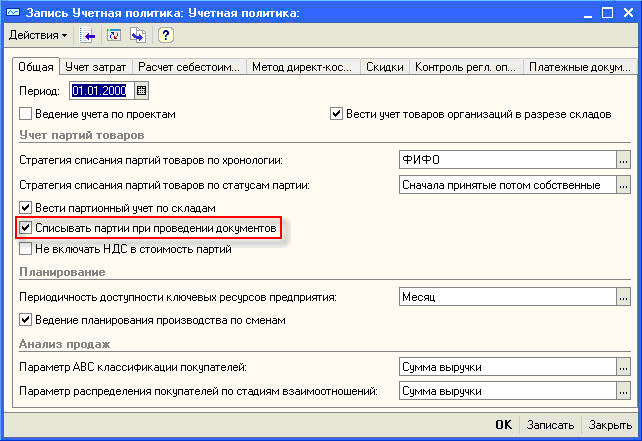

# #std662 Сдвиг границы последовательности документов

> Область применения: управляемое приложение, мобильное приложение, обычное приложение.
>
> Раздел ИТС: Реализация обработки данных / Избыточные блокировки и методы оптимизации
>
> Источник: https://its.1c.ru/db/v8std/content/662/hdoc
>
> Проверено по источнику: 2026-10-07

Не рекомендуется двигать границу последовательности при проведении документов. Это может привести к возникновению ожиданий на блокировках и снижению общей производительности системы. Операцию движения границы последовательности следует вынести из оперативных операций в регламентные, например выполнять регламентной обработкой с заданной частотой.

Граница последовательности по одному набору значений измерений является одним ресурсом. Это означает, что при движении границы последовательности по одному набору значений измерений разные пользователи будут пытаться захватить один и тот же ресурс, то есть будут блокировать друг друга.

### Пример

В системе, построенной на базе УПП версий 1.х, используется учетная политика, предполагающая вычисление себестоимости списываемых товаров в оперативном режиме (непосредственно в момент списания).  

 

Алгоритмы партионного учета в УПП используют последовательность «Партионный учет», имеющую одно измерение: **Организация**.

Для вычисления себестоимости списываемых товаров при проведении расходного документа необходимо переместить границу последовательности для данной организации на момент времени проводимого документа.

Если два пользователя будут одновременно проводить расходные документы по одной организации (что весьма вероятно), то они будут блокировать друг друга. Такое поведение системы не является особенностью реализации последовательностей в **1С:Предприятии**, но продиктовано требованиями самого алгоритма – необходимо знать точную последовательность расположения документов. То есть все конкурирующие по времени (одновременно проводящиеся) документы должны выстроиться друг за другом.

Движение границы последовательности при оперативном проведении документов способно значительно снизить общую производительности системы. В данном случае правильным решением было бы выключение этого флажка, то есть отказ от оперативного расчета себестоимости при проведении документов. Вместо этого следует использовать регламентную обработку, входящую в состав УПП, которая будет вычислять себестоимость с некоторой заданной частотой.

### См. также

- «[Общие сведения об избыточных блокировках](<https://its.1c.ru/db/v8std/content/659/hdoc>)» 
