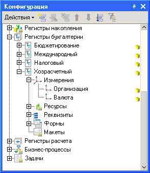
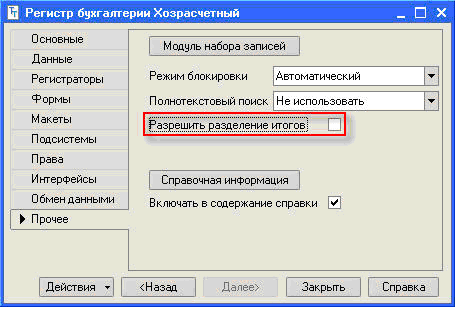
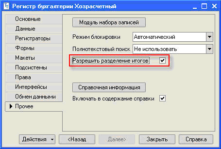
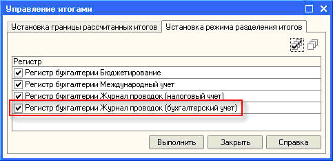

# #std663 Режим разделения итогов для регистров бухгалтерии

> Область применения: управляемое приложение, обычное приложение.
>
> Раздел ИТС: Реализация обработки данных / Избыточные блокировки и методы оптимизации
>
> Источник: https://its.1c.ru/db/v8std/content/663/hdoc
>
> Проверено по источнику: 2026-10-07

1\. Если в системе осуществляется оперативная запись движений по бухгалтерскому регистру в многопользовательском режиме, то рекомендуется включить для данного регистра режим разделения итогов. При включенном режиме разделения итогов пользователи смогут параллельно обновлять таблицу остатков даже в том случае, если у них совпадает период, счет и значения измерений.

В противном случае таблица остатков регистра бухгалтерии может стать узким местом при конкурентной работе большого количества пользователей.

> *См. также* [*Блокирующее чтение остатков в начале транзакции*](<https://its.1c.ru/db/v8std/content/661/hdoc>)

### Пример 1

В конфигурации определен регистр **Хозрасчетный** с измерениями **Организация** и **Валюта**.

 

  

При этом запрещено разделение итогов регистра:

  

  

Предположим, что два пользователя одновременно проводят документы, которые осуществляют движение по данному регистру.  

Пользователи будут блокировать друг друга в том случае, если движения:  

- относятся к одному и тому же периоду;

- относятся к одному и тому же счету;

- имеют одинаковые значения измерений, то есть организацию и валюту.

В реальной жизни одновременное выполнение перечисленных условий является весьма вероятным, поскольку большинство пользователей будет работать в одном периоде, с одним счетом и с одинаковыми значениями измерений (**организация** и **валюта**). Это может привести к возникновению ожиданий на блокировках и снижению общей производительности системы.

Для решения этой проблемы следует включить режим разделения итогов (см. следующий пример).  

### Пример 2

Если для этого же регистра разрешить и включить режим разделения итогов, то ситуация изменится.  

Разрешим режим разделения итогов (в режиме **конфигурирования**):

  

  

Включим режим разделения итогов (в режиме **1С:Предприятия**):

После этого конкурирующие пользователи смогут параллельно записывать движения по регистру даже в том случае, если совпадают период, номер счета и значения всех измерений.  

Однако, если при этом осуществляется [контроль остатков по данному регистру](<https://its.1c.ru/db/v8std/content/661/hdoc>), то эффекта от включения режима разделения не будет.

### См. также

- [Устройство и использование режима разделения итогов регистров](<https://its.1c.ru/db/metod81/content/1393/hdoc>) (статья на ИТС)

- [Эффективное обращение к виртуальной таблице «Остатки» ](<https://its.1c.ru/db/v8std/content/733/hdoc>)
