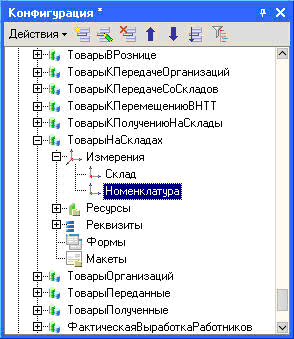

# #std664 Режим разделения итогов для регистров накопления

> Область применения: управляемое приложение, мобильное приложение, обычное приложение.
>
> Раздел ИТС: Реализация обработки данных / Избыточные блокировки и методы оптимизации
>
> Источник: https://its.1c.ru/db/v8std/content/664/hdoc
>
> Проверено по источнику: 2026-10-07

1\. При проектировании регистра накопления следует помнить, что остатки по одному набору измерений хранятся в одном ресурсе регистра. То есть, степень параллельности при работе с регистром фактически зависит от состава его измерений. Состав измерений необходимо подбирать в соответствии с тем, насколько мелко должны быть «нарезаны» остатки, исходя из прикладной функциональности системы.

2\. В том случае, если состав измерений не позволяет обеспечить необходимую параллельность при работе с регистром, рекомендуется использовать режим разделения итогов аналогично [регистрам бухгалтерии](<https://its.1c.ru/db/v8std/content/663/hdoc>).  

Следует учитывать, что режим разделения итогов не обеспечит параллельность при контроле остатков по регистру. Если контроль остатков необходим, то следует перенести его [как можно ближе к концу транзакции](<https://its.1c.ru/db/v8std/content/661/hdoc>).

Рассмотрим в качестве примера регистр накопления **ТоварыНаСкладах** со следующим составом измерений:

### Пример 1

Предположим два пользователя одновременно проводят документы, которые записывают движения в данный регистр накопления. При этом первый пользователь пишет следующий набор записей:

<table><tbody><tr><td>№</td><td>Склад </td><td>Номенклатура </td></tr>

<tr><td>1</td><td>Основной склад</td><td>Кресло-качалка </td></tr>

<tr><td>2</td><td>Основной склад </td><td>Кухонный гарнитур "Тинга-2"</td></tr>

<tr><td>3</td><td>Склад №2</td><td>Мебельный гарнитур "Торэ" </td></tr></tbody></table>

Второй пользователь пишет в этот же регистр следующий набор записей:

<table><tbody><tr><td>№</td><td>Склад </td><td>Номенклатура </td></tr>

<tr><td>1</td><td>Основной склад</td><td>Мебельный гарнитур "Торэ" </td></tr>

<tr><td>2</td><td>Склад №2</td><td>Кресло-качалка</td></tr></tbody></table>

Эти наборы записей не содержат строк, совпадающих по значениям всех измерений, поэтому ожидание на блокировке в данном случае не возникнет.

### Пример 2

Предположим, что второй пользователь записывает следующий набор записей

<table><tbody><tr><td>№</td><td>Склад </td><td>Номенклатура </td></tr>

<tr><td>1</td><td>Основной склад</td><td>Кухонный гарнитур "Тинга-2"</td></tr>

<tr><td>2</td><td>Склад №2</td><td>Кресло-качалка </td></tr>

<tr><td>3</td><td>Оптовый склад</td><td>Спальный гарнитур "Инга-М"</td></tr></tbody></table>

Этот набор записей содержит строку (№1), совпадающую по значениям всех измерений со строкой набора записей первого пользователя (№2).

В этом случае возникнет ожидание на блокировке и один из пользователей будет дожидаться окончания операции другого пользователя, то есть общая производительность системы снизится.

Регистр накопления также поддерживает режим разделения итогов, который позволит в данной ситуации избежать блокировки (см. Пример 3).

### Пример 3

Если для данного регистра накопления включен режим разделения итогов, то будет возможна параллельная запись двух наборов, даже в том случае если они содержат одинаковые (по значениям измерений) строки.

Однако, если при этом используется контроль остатков, то режим разделения итогов не даст положительного эффекта. Иначе говоря, режим разделения итогов для регистра накопления работает аналогично [регистру бухгалтерии](<https://its.1c.ru/db/v8std/content/663/hdoc>). Для снижения влияния этой блокировки на общую производительность системы [нужно перенести контроль остатков как можно ближе к концу транзакции](<https://its.1c.ru/db/v8std/content/661/hdoc>).

### См. также

- [Устройство и использование режима разделения итогов регистров](<https://its.1c.ru/db/metod81/content/1393/hdoc>) (статья на ИТС)

- [Эффективное обращение к виртуальной таблице «Остатки»](<https://its.1c.ru/db/v8std/content/733/hdoc>) 
