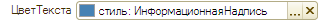
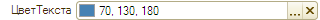
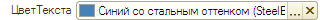
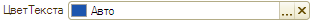
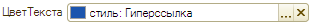
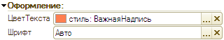
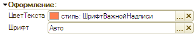

# #std667 Элементы стиля

> Область применения: управляемое приложение.
>
> Раздел ИТС: Проектирование интерфейсов для 8.2
>
> Источник: https://its.1c.ru/db/v8std/content/667/hdoc
>
> Проверено по источнику: 2026-10-07

Для каждого элемента управления оформление по умолчанию задается платформой. Умолчаний следует придерживаться в большинстве случаев — это позволяет обеспечить единообразное оформление всех форм.

В некоторых ситуациях возникает потребность визуально выделить конкретный элемент управления среди других, изменив его оформление по умолчанию.

Для изменения оформления следует использовать элементы стиля, а не задавать конкретные значения непосредственно в элементах управления. Это требуется для того, чтобы аналогичные элементы управления выглядели одинаково во всех формах, где они встречаются.

Виды элементов стиля: 

• Цвет (задается значение RGB) 

• Шрифт (задаются вид, размер и начертание) 

• Рамка (задаются тип и ширина границ) 

1\. Элементы стиля нужно использовать всегда, когда требуется изменить оформление (Цвет, Шрифт, Рамку), установленные по умолчанию.

*Например, информационные надписи среди других надписей можно выделить с помощью цвета. Цвет таких надписей следует задавать в виде элемента стиля "ИнформационнаяНадпись", а не в виде значения RGB или выбора цвета web/windows:*

<table><tbody><tr><td style="background-color: #dcdcdc"> 
Хорошо
</td><td style="background-color: #dcdcdc"> 
Плохо
</td></tr>

<tr><td> 

</td><td> 

 

</td></tr></tbody></table>

2\. Не следует использовать элементы стиля для того, чтобы подменить оформление, которое используется по умолчанию в платформе.

*Например, для гиперссылок нужно использовать цвет, предусмотренный в платформе, а не создавать для него свой элемент стиля с точно таким же цветом:*

<table><tbody><tr><td style="background-color: #dcdcdc"> 
Хорошо
</td><td style="background-color: #dcdcdc"> 
Плохо
</td></tr>

<tr><td> 

</td><td> 

</td></tr></tbody></table>

3\. Каждый элемент стиля следует создавать для применения в конкретной ситуации. Если такой же цвет или шрифт нужно использовать в другой ситуации, то для нее нужно создать отдельный элемент стиля.

*Например, цвет элемента стиля "ФонУправляющегоПоля" следует применять только для фона полей, которые влияют на видимость других полей в форме. Если такой же цвет фона предполагается использовать для поля с другим назначением, то для него нужно создать отдельный элемент стиля.*

4\. Название для элемента стиля следует подбирать таким образом, чтобы в нем отразить назначение элемента стиля.

*Например:*

<table><tbody><tr><td style="background-color: #dcdcdc">Название элемента стиля</td><td style="background-color: #dcdcdc">Назначение</td></tr>

<tr><td>ФонУправляющегоПоля</td><td>Фон поля, которое управляет видимостью других полей</td></tr>

<tr><td>ТекстНевыбраннойКартинки</td><td>Текст, который будет отражается на картинке, пока она не выбрана</td></tr></tbody></table>

5\. Для нескольких элементов стиля, имеющих одинаковое название, но разный вид, рекомендуется включать вид (слова "Цвет", "Шрифт", "Рамка") в название:

*Например: "ТекстНевыбраннойКартинкиЦвет" и "ТекстНевыбраннойКартинкиШрифт".*

При этом вид элемента стиля (Цвет, Шрифт, Рамка) следует указывать после его названия. Это требуется для того, чтобы можно было по первым буквам найти нужный элемент стиля в списке.

*Например:*

<table><tbody><tr><td style="background-color: #dcdcdc"> 
Хорошо
</td><td style="background-color: #dcdcdc"> 
Плохо
</td></tr>

<tr><td> 
ПросроченныеДанныеЦвет ПросроченныеДанныеШрифт
</td><td> 
ЦветПросроченныхДанных ШрифтПросроченныхДанных
</td></tr></tbody></table>

В названии элемента стиля следует указывать только тот вид (Цвет, Шрифт, Рамка), который используется фактически.

*Например, для элемента стиля вида "Цвет" не следует включать в название слово "Шрифт":*

<table><tbody><tr><td style="background-color: #dcdcdc"> 
Хорошо
</td><td style="background-color: #dcdcdc"> 
Плохо
</td></tr>

<tr><td> 
ВажнаяНадпись
 

</td><td> 
ШрифтВажнойНадписи
 

</td></tr></tbody></table>

## Элементы стиля с видом "Цвет"

<table><tbody><tr style="background-color: #dcdcdc"><td> Элемент стиля</td><td> 
 Значение  (RGB)
</td><td> В каком стандарте используется</td></tr>

<tr><td> ПросроченныеДанные </td><td>178,34,34 <table cellspacing="0" style="background-color: #b22222; height: 22px; width: 23px" width="23"><tbody><tr><td></td></tr></tbody></table></td><td> 
 <a href="https://its.1c.ru/db/v8std/content/584/hdoc">Акцентирование внимания на просроченных или критичных состояниях</a> 
 
 <a href="https://its.1c.ru/db/v8std/content/613/hdoc">Итоги в документах</a> 
</td></tr>

<tr><td> ПояснениеОтсутствующейГиперссылки</td><td>128,128,128 <table cellspacing="0" style="background-color: #b22222; height: 22px; width: 23px" width="23"><tbody><tr><td style="background-color: #808080"></td></tr></tbody></table></td><td> <a href="https://its.1c.ru/db/v8std/content/595/hdoc">Гиперссылка на счет-фактуру</a> </td></tr>

<tr><td> ТекстЗапрещеннойЯчейки</td><td>192,192,192 <table cellspacing="0" style="background-color: #b22222; height: 22px; width: 23px" width="23"><tbody><tr><td style="background-color: #c0c0c0"></td></tr></tbody></table></td><td> <a href="https://its.1c.ru/db/v8std/content/610/hdoc">Пояснение невозможности заполнения ячеек в табличных частях</a></td></tr>

<tr><td> ИтоговыеПоказателиДокументов</td><td>22,39,121 <table cellspacing="0" style="background-color: #b22222; height: 22px; width: 23px" width="23"><tbody><tr><td style="background-color: #162779"></td></tr></tbody></table></td><td> <a href="https://its.1c.ru/db/v8std/content/613/hdoc">Итоги в документах</a> </td></tr>

<tr><td> ИтогиЖурналаЦвет</td><td>100,100,100 <table cellspacing="0" style="background-color: #b22222; height: 22px; width: 23px" width="23"><tbody><tr><td style="background-color: #646464"></td></tr></tbody></table></td><td> <a href="https://its.1c.ru/db/v8std/content/614/hdoc">Итоги в журналах документов</a> </td></tr>

<tr><td> ФонУправляющего поля</td><td>255,232,179 <table cellspacing="0" style="background-color: #b22222; height: 22px; width: 23px" width="23"><tbody><tr><td style="background-color: #ffe8b3"></td></tr></tbody></table></td><td> <a href="https://its.1c.ru/db/v8std/content/631/hdoc">Поле, влияющее на состав остальных полей в форме</a> </td></tr>

<tr><td> 
 ТекстНевыбраннойКартинкиЦвет
</td><td> 
220,220,220
 <table cellspacing="0" style="background-color: #b22222; height: 22px; width: 23px" width="23"><tbody><tr><td style="background-color: #dcdcdc"></td></tr></tbody></table></td><td><a href="https://its.1c.ru/db/v8std/content/635/hdoc">Невыбранная картинка</a> </td></tr>

<tr><td> 
 НегативноеСобытие
</td><td> 
178,34,34
 <table cellspacing="0" style="background-color: #b22222; height: 22px; width: 23px" width="23"><tbody><tr><td style="background-color: #b22222"></td></tr></tbody></table></td><td><a href="https://its.1c.ru/db/v8std/content/676/hdoc">Отчеты вида "таблица", "список"</a></td></tr>

<tr><td> 
 ПозитивноеСобытие
</td><td> 
0,128,0
 <table cellspacing="0" style="background-color: #b22222; height: 22px; width: 23px" width="23"><tbody><tr><td style="background-color: #008000"></td></tr></tbody></table></td><td><a href="https://its.1c.ru/db/v8std/content/676/hdoc">Отчеты вида "таблица", "список"</a></td></tr>

<tr><td> 
 НеактуальнаяИнформация
</td><td> 
255,200,200
 <table cellspacing="0" style="background-color: #b22222; height: 22px; width: 23px" width="23"><tbody><tr><td style="background-color: #ffc8c8"></td></tr></tbody></table></td><td><a href="https://its.1c.ru/db/v8std/content/676/hdoc">Отчеты вида "таблица", "список"</a></td></tr>

<tr><td> 
 Диаграмма
</td><td> 
70,130,180
 <table cellspacing="0" style="background-color: #b22222; height: 22px; width: 23px" width="23"><tbody><tr><td style="background-color: #4682b4"></td></tr></tbody></table></td><td><a href="https://its.1c.ru/db/v8std/content/675/hdoc">Отчеты вида "диаграмма"</a></td></tr>

<tr><td> Прогноз</td><td> 
199,21,133
 <table cellspacing="0" style="background-color: #b22222; height: 22px; width: 23px" width="23"><tbody><tr><td style="background-color: #c71585"></td></tr></tbody></table></td><td><a href="https://its.1c.ru/db/v8std/content/675/hdoc">Отчеты вида "диаграмма"</a></td></tr>

<tr><td>ПоясняющийТекст</td><td> 
128,122,89
 <table cellspacing="0" style="background-color: #b22222; height: 22px; width: 23px" width="23"><tbody><tr><td style="background-color: #807a59"></td></tr></tbody></table></td><td><a href="https://its.1c.ru/db/v8std/content/615/hdoc">Рабочее место</a></td></tr></tbody></table>

## Элементы стиля с видом "Шрифт"

<table><tbody><tr><td style="background-color: #dcdcdc">Элемент стиля</td><td style="background-color: #dcdcdc">Значение (шрифт, размер, начертание)</td><td style="background-color: #dcdcdc">В каком стандарте используется</td></tr>

<tr><td>ОсновнойЭлементСписка</td><td>Обычный шрифт текста, начертание: Полужирный</td><td><a href="https://its.1c.ru/db/v8std/content/594/hdoc">Значения по умолчанию</a> </td></tr>

<tr><td>ОсновноеИтоговоеЗначение</td><td>Обычный шрифт текста, начертание: Полужирный</td><td><a href="https://its.1c.ru/db/v8std/content/613/hdoc">Итоги в документах</a> </td></tr>

<tr><td>ИтогиЖурналаШрифт</td><td>Обычный шрифт текста, начертание: Полужирный</td><td><a href="https://its.1c.ru/db/v8std/content/614/hdoc">Итоги в журналах документов</a> </td></tr>

<tr><td>ТекстНевыбраннойКартинкиШрифт</td><td>Обычный шрифт текста, размер: 12</td><td><a href="https://its.1c.ru/db/v8std/content/635/hdoc">Невыбранная картинка</a> </td></tr></tbody></table>
