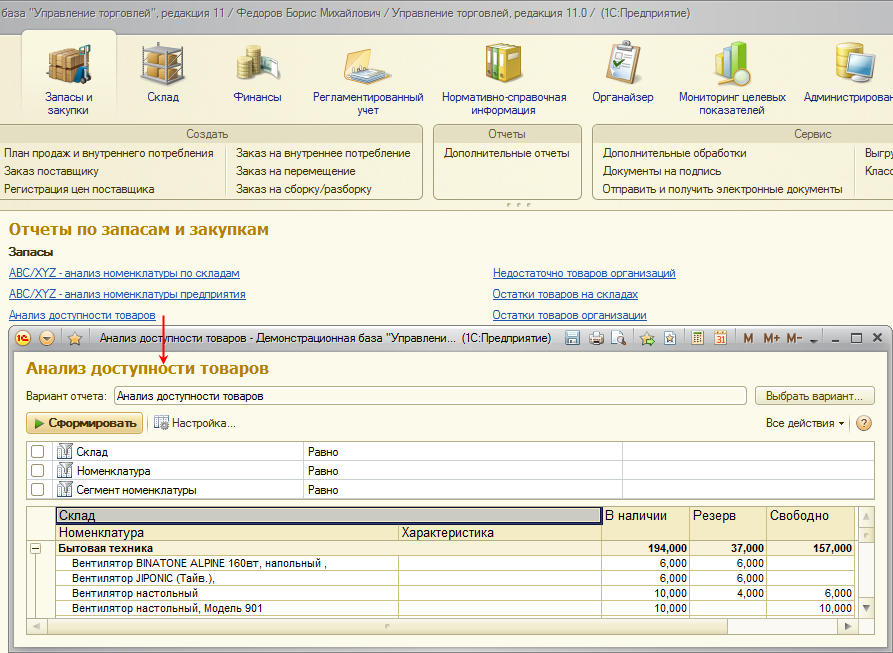
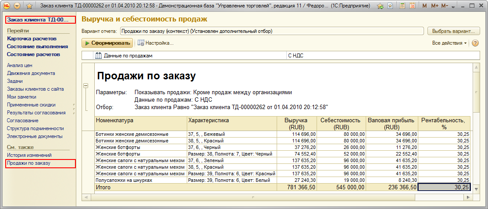

# #std670 Содержание отчета

> Область применения: управляемое приложение.
>
> Раздел ИТС: Проектирование интерфейсов для 8.2 / Отчеты
>
> Источник: https://its.1c.ru/db/v8std/content/670/hdoc
>
> Проверено по источнику: 2026-10-07

## 1\. Показатели отчета

1.1. Отчет может содержать одновременно несколько финансовых или нефинансовых, числовых или качественных показателей. Их состав должен соответствовать назначению отчета (цели анализа).  

1.2. В отчет включаются только те показатели, которые связаны общей целью анализа. 

1.3. В отчетах, реализованных без использования СКД, рекомендуется обеспечивать возможность расшифровки всех выводимых показателей. 

1.4. Отчеты не должны содержать данные, помеченные на удаление. Если такие данные требуется выводить в отчет, то их следует выделять явным образом (см. стандарт «Отчеты вида «таблица», «список» п.3.5). 

## 2\. Валюты

2.1. При включении показателя в отчет следует учитывать ситуации, когда он может принимать значения в разных валютах. Для сравнительного анализа валюта показателя должна быть единой в пределах отчета.  

2.2. Если назначение отчета предполагает анализ какого-либо показателя в различных валютах, то следует одновременно выводить значения показателя как в исходной валюте, так и в приведенной, единой валюте отчета. *Например, в отчете "Анализ расчетов с клиентами", расчеты с клиентами могут производиться в различных валютах. Для оценки объема задолженности по всем клиентам требуется приведение сумм задолженностей к единой валюте, например, к валюте управленческого или регламентированного учета (в зависимости от конфигурации).*

## 3\. Контекстные и неконтестные отчеты

3.1. Отчеты и варианты отчетов могут быть предназначены для разных контекстов работы.

- Под неконтекстным отчетом подразумевается отчет, который запускается из командного интерфейса конфигурации (например, панели отчетов) вне какого-либо контекста для начала или продолжения анализа. Отчет запускается либо со стандартными, либо с сохраненными ранее пользовательскими настройками.

    

- Под контекстным отчетом подразумевается отчет, который запускается из панели навигации какого-либо объекта учета (документа, элемента справочника), то есть при запуске происходит автоматическая настройка отборов/параметров отчета. Отчет в этом случае содержит информацию, имеющую отношение только к выбранному объекту учета.

    

3.2. Если используются варианты отчетов, то пользователь не должен иметь возможность выбирать в списке вариантов отчета контекстные варианты отчета (в том числе в панели отчетов). 

3.3. В контекстных отчетах следует исключать из группировок объект анализа (контекст). 

Например, группировка валовой прибыли по заказам клиентов не требуется, если отчет запущен в контексте определенного заказа клиента. 

3.4. При использовании СКД имя контекстного варианта отчета должно содержать слово "Контекст". 

*Например, "ДвиженияСерийНоменклатуры**Контекст**" отчета "ДвиженияСерийТоваров".* 

 
