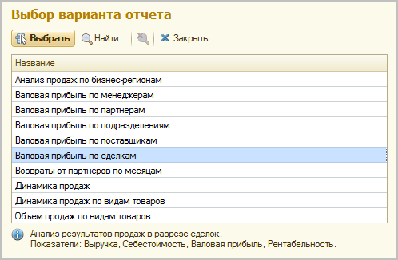

# #std671 Варианты отчетов

> Область применения: управляемое приложение.
>
> Раздел ИТС: Проектирование интерфейсов для 8.2 / Отчеты
>
> Источник: https://its.1c.ru/db/v8std/content/671/hdoc
>
> Проверено по источнику: 2026-10-07

1\. Варианты отчетов следует создавать в случае, когда есть необходимость анализировать один и тот же вид (источник) данных в различных:

- группировках

- сортировках

- отборах

- с разными наборами показателей

 

В этом случае создается отчет с несколькими вариантами отчетов.

Примером источников данных может являться совокупность документов и регистров сведений, которые предназначены для пользователей с одинаковым уровнем прав. Например, отчет "Выручка и себестоимость продаж": 

**

2\. Если вариант отчета является рабочим местом или используется очень часто, то такой вариант лучше оформлять отдельным отчетом. Это упростит его использование.

3\. Если вариант отчета требуется включить в состав различных подсистем одного и того же раздела, то вместо одного варианта отчета следует создать свои варианты отчетов для каждой подсистемы с различными параметрами и отборами.  

*Например, для отчета "Валовая прибыль по поставщикам":* 

<table><tbody><tr><td>Правильно</td><td>Неправильно</td></tr>

<tr><td>Создать два варианта отчета: "Валовая прибыль по поставщикам (опт)" и "Валовая прибыль по поставщикам (розница)" с отборами по оптовым и розничным продажам</td><td>Создать один вариант отчета, который включить в состав подсистем "Продажи/Продажи и возвраты" и "Продажи/Розничные продажи"</td></tr></tbody></table>

4\. При использовании в конфигурации Библиотеки стандартных подсистем следует обязательно заполнять описание варианта отчета. В описании отчета указывается основное назначение, состав анализируемых данных.
