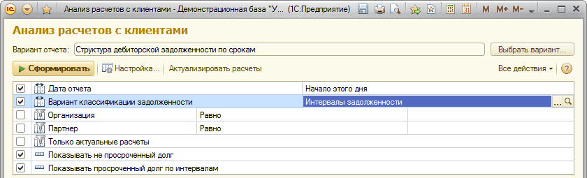
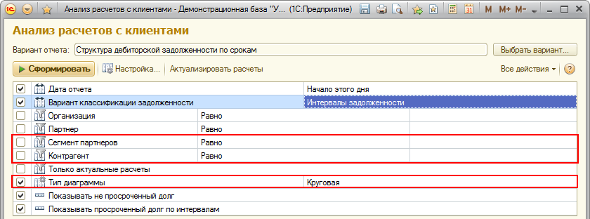
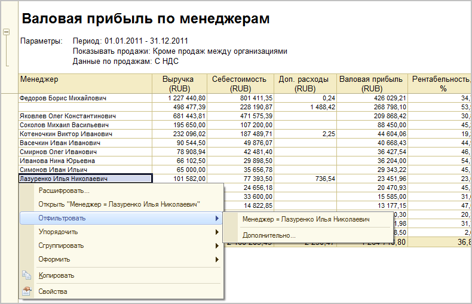
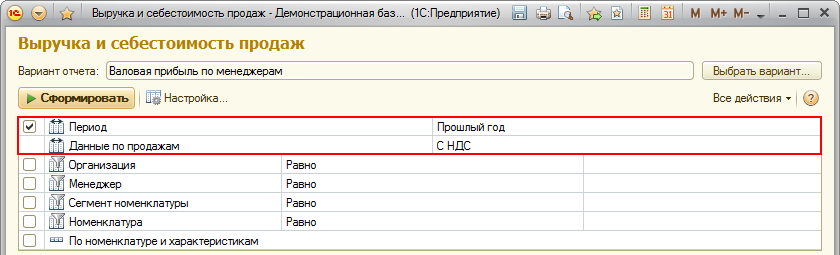
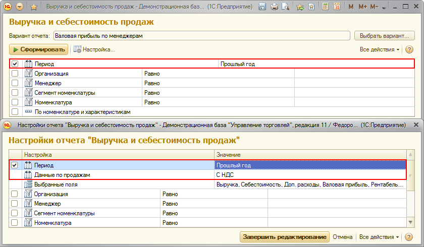
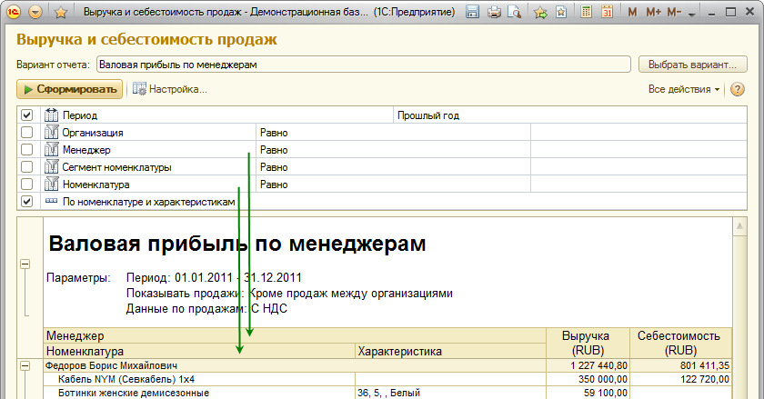
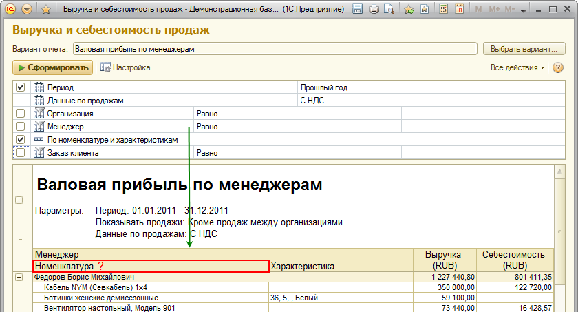
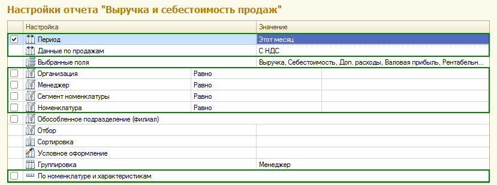

# #std673 Пользовательские настройки

> Область применения: управляемое приложение.
>
> Раздел ИТС: Проектирование интерфейсов для 8.2 / Отчеты
>
> Источник: https://its.1c.ru/db/v8std/content/673/hdoc
>
> Проверено по источнику: 2026-10-07

Для эффективной работы пользователя с отчетом требуется определить состав быстрых и обычных пользовательских настроек. Состав настроек определяется основной целью использования отчета.

## 1\. Общие рекомендации

1.1. Избегайте использования наименований настроек, которые могут быть истолкованы пользователями неоднозначно или быть для них непонятными.

<table><tbody><tr><td>Правильно</td><td>Неправильно</td></tr>

<tr><td>"Оплатить позже"</td><td>«Дата оплаты Меньше или равно …»</td></tr></tbody></table>

1.2. Для параметров, без указания которых запрос системы компоновки данных не выполнится или его выполнение не имеет смысла, следует в настройках взвести флажок «Запрещать незаполненные значения» и установить режим использования «Всегда». 

1.3. Обязательные для заполнения параметры должны заполняться наиболее вероятными значениями.  

*Например, период "Этот месяц" для отчета "Выручка и себестоимость продаж".*

## 2\. Быстрые пользовательские настройки

2.1. Рекомендуется делать не более 5-7 быстрых настроек. 

Правильно:

Неправильно:

2.2. В состав быстрых пользовательских настроек следует включать только частотные настройки:

- Параметры отчета (обязательные и необязательные). Это нужно потому, что контекстное меню отчета не позволяет пользователю "на лету" применять параметры.

> Правильно – все параметры включены в быстрые настройки:
>
>
>
> 
>
>  
>
>
>
> Неправильно – параметр "Данные по продажам" не включен в быстрые настройки: 
>
>
>
> 

- Отборы по соответствующим группировкам. Должны быть добавлены в быстрые пользовательские настройки для наиболее важных группировок отчета.

> Правильно:
>
>
>
> 
>
>
>
>
>
>
>
> Неправильно:
>
>
>
> 

2.3. Если в отчете несколько элементов, например, гистограмма и список, то в быстрых настройках рекомендуется предусмотреть возможность их отключения. 

2.4. В быстрые настройки контекстных отчетов не следует включать отборы по полям, по которым устанавливается отбор через параметры в командах вызова отчета. 

## 3\. Обычные пользовательские настройки

3.1. Для настроек, которые являются нечастотными, лучше устанавливать режим редактирования "Обычный".

3.2. В состав обычных пользовательские настройки следует включать:

- Отборы по реквизитам объектов анализа, которые по умолчанию не выводятся в отчет, если таковые требуются 

    *Например, "Обособленное подразделение (филиал)" - реквизит поля "Организация"*
- Отборы по числовым показателям отчета, если таковые требуются 

    *Например, "Сумма задолженности Больше …" Настройки выбранных полей ("Выбранные поля")*
- Настройки отборов ("Отборы")

- Настройки упорядочивания ("Сортировка")

- Настройки условного оформления ("Условное оформление")

- Настройки группировок ("Группировка") 

*Например, в настройках отчета "Выручка и себестоимость продаж" зеленым выделены быстрые настройки. Остальные настройки – обычные.*

