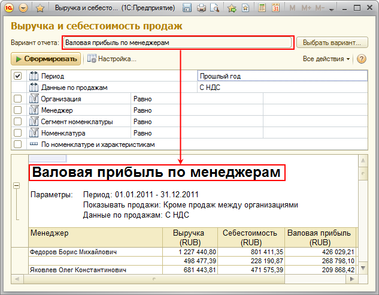
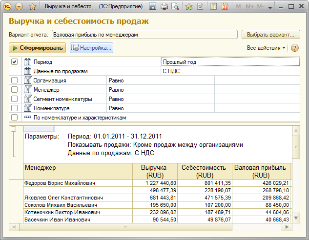

# #std674 Заголовок отчета

> Область применения: управляемое приложение.
>
> Раздел ИТС: Проектирование интерфейсов для 8.2 / Отчеты
>
> Источник: https://its.1c.ru/db/v8std/content/674/hdoc
>
> Проверено по источнику: 2026-10-07

1\. Заголовок отчета должен четко отражать цель анализа и содержание отчета. Заголовок должен быть узнаваемым и понятным.

2\. Если используются варианты отчета, то заголовок каждого варианта всегда должен быть заполнен и соответствовать наименованию варианта отчета. Это необходимо для быстрого поиска отчета в системе по заголовку напечатанного отчета. 

Правильно – в таблице отчета есть заголовок, который соответствует наименованию варианта отчета:

Неправильно – в таблице отчета нет заголовка:

3\. Если используются однотипные варианты отчета с различными группировками, то уточнение по группировке следует писать во множественном числе без использования разделителей (тире, скобок и т.п.), таким образом чтобы все слова названия были согласованы.

*Например:*

<table><tbody><tr><td>Правильно</td><td>Неправильно</td></tr>

<tr><td>Анализ расчетов с клиентами по договорам</td><td>Анализ расчетов с клиентами (по договорам)</td></tr></tbody></table>

В исключительных случаях можно использовать разделители или иные специальные знаки, например, для стандартизованной отчетности.

4\. Запрещается использование названия "Основной" для варианта отчета, т.к. для новичков не понятно, что кроется за этим определением. Лучше давать осмысленные названия. 

*Например, для отчета "Анализ причин проигрыша сделок" варианты могут называться:*

- *Анализ причин проигрыша сделок по партнерам*

- *Анализ причин проигрыша сделок по ответственным*

- Анализ причин проигрыша сделок по причинам 

5\. Следует избегать слова "отчет" в синониме и заголовках отчетов.

6\. Если в отчете несколько элементов (например, гистограмма и список), то для каждого рекомендуется устанавливать заголовок. Общий заголовок отчета в этом случае не обязателен.  
