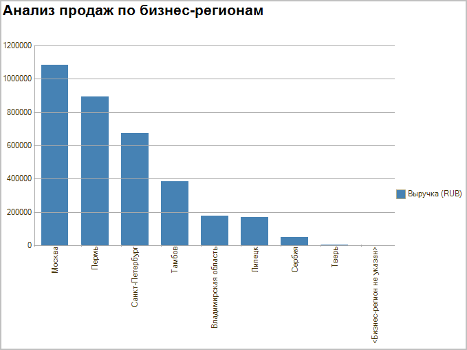
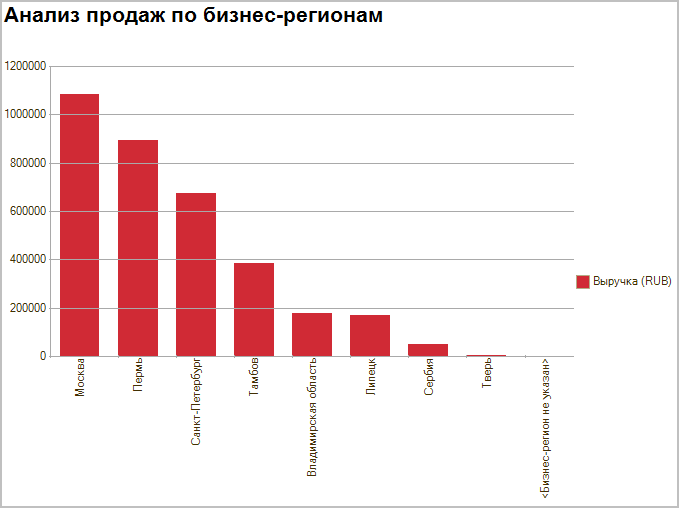

# #std675 Отчеты вида "диаграмма"

> Область применения: управляемое приложение.
>
> Раздел ИТС: Проектирование интерфейсов для 8.2 / Отчеты
>
> Источник: https://its.1c.ru/db/v8std/content/675/hdoc
>
> Проверено по источнику: 2026-10-07

## 1\. Типы диаграмм

Использование диаграмм в отчетах позволяет визуально компактно представить закономерности в данных. Это, в свою очередь, сокращает время, затрачиваемое пользователем на поиск необходимой информации.

> 1.1. Применять диаграммы в отчетах следует лишь в том случае, если объем данных потенциально невелик и диаграммы не будут перегружены. 
>
> 1.2. Для различных целей поиска информации должны использоваться определенные типы диаграмм:

<table><tbody><tr style="background-color: #f5fbf7"><td style="vertical-align: top"> 
<b>Цель поиска</b>
</td><td style="vertical-align: top"> 
<b>Тип диаграммы</b>
</td><td style="vertical-align: top"> 
<b>Сортировка</b>
</td><td style="vertical-align: top"> 
<b>Условие применения</b>
</td></tr>

<tr><td rowspan="3" style="vertical-align: top"> 
Динамика показателей
</td><td style="vertical-align: top"> 
График
 
График по шагам
</td><td style="vertical-align: top"> 
По возрастанию периода
</td><td style="vertical-align: top"> 
Много периодов
 
От 1-й до нескольких серий
</td></tr>

<tr><td style="vertical-align: top"> 
График с областями
 
График с накоплением и областями
 
Нормированные графики
</td><td style="vertical-align: top"> 
По возрастанию периода
</td><td style="vertical-align: top"> 
Много периодов
 
От 2-х серий до нескольких серий
</td></tr>

<tr><td style="vertical-align: top"> 
Вертикальные гистограммы
</td><td style="vertical-align: top"> 
По возрастанию периода
</td><td style="vertical-align: top"> 
Несколько периодов
 
До 3-х серий
</td></tr>

<tr><td rowspan="2" style="vertical-align: top"> 
Распределение величины по значимым диапазонам
</td><td style="vertical-align: top"> 
Вертикальная гистограмма
</td><td style="vertical-align: top"> 
Логический порядок диапазонов
</td><td style="vertical-align: top"> 
Менее 10 диапазонов
</td></tr>

<tr><td style="vertical-align: top"> 
График
</td><td style="vertical-align: top"> 
Логический порядок диапазонов
</td><td style="vertical-align: top"> 
Более 10 диапазонов, непрерывная шкала диапазонов
</td></tr>

<tr><td rowspan="3" style="vertical-align: top"> 
Анализ структуры показателей
</td><td style="vertical-align: top"> 
Круговая диаграмма
</td><td style="vertical-align: top"> 
По важности значений показателя,
 
по периоду
</td><td style="vertical-align: top"> 
Анализ соотношения компонент как частей целого.
 
Количество компонент до 7-10
</td></tr>

<tr><td style="vertical-align: top"> 
Вертикальная гистограмма
</td><td style="vertical-align: top"> 
По убыванию величины показателя
</td><td style="vertical-align: top"> 
Рейтинг.
 
Количество компонент – менее 10
</td></tr>

<tr><td style="vertical-align: top"> 
Горизонтальная диаграмма
</td><td style="vertical-align: top"> 
По возрастанию величины показателя
</td><td style="vertical-align: top"> 
Рейтинг.
 
Количество компонент – более 10
</td></tr></tbody></table>

1.3. Следует избегать объемных диаграмм, так как они искажают информацию, отвлекают от закономерностей, которые можно обнаружить при визуальном анализе.

## 2\. Условное оформление

2.1. Основной цвет для гистограмм и линий графиков динамики – элемент стиля вида цвет "Диаграмма", RGB 70,130,180.

2.2. Основной цвет для прогнозных значений гистограмм и линий графиков динамики – элемент стиля вида цвет "Прогноз", RGB 199,21,133.

2.3. Следует избегать использования оттенков красного и зеленого цветов для отдельных значений (серий) в диаграммах, если значения (серии) не показывают критические (негативные) и позитивные значения.  

Правильно:

Неправильно:

