# #std676 Отчеты вида "таблица", "список"

> Область применения: управляемое приложение.
>
> Раздел ИТС: Проектирование интерфейсов для 8.2 / Отчеты
>
> Источник: https://its.1c.ru/db/v8std/content/676/hdoc
>
> Проверено по источнику: 2026-10-07

## 1\. Структура отчета

Отчет должен максимально соответствовать целям и задачам анализа. Отчет будет хорошим, если глядя на него, пользователю будет понятно:

- для кого он предназначен (должность, роль пользователя)

- на какие вопросы и каким образом можно получить ответы с помощью этого отчета.

1.1. Следует проектировать отчет таким образом, чтобы количество уровней вложенности не превышало 3-х.

1.2. Вложенность группировок должна отражать взаимосвязь объектов анализа – от общего к частному.  

*Например, в отчете "Валовая прибыль по партнерам", видно, какая номенклатура (частное) продана определенному партнеру (общее):*

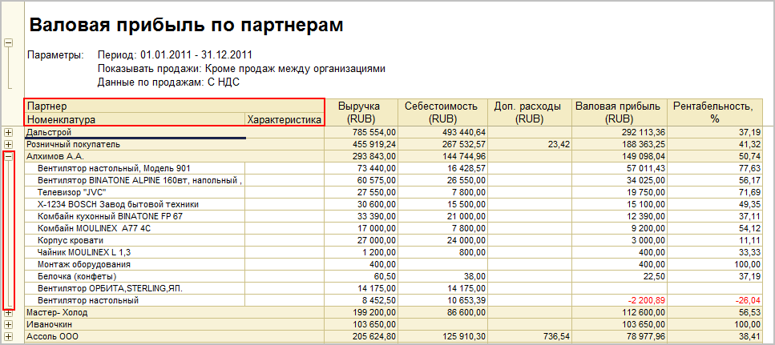

 

1.3. Группировку по периоду рекомендуется располагать в колонках таблицы с упорядочиванием по возрастанию. 

*Например:* 

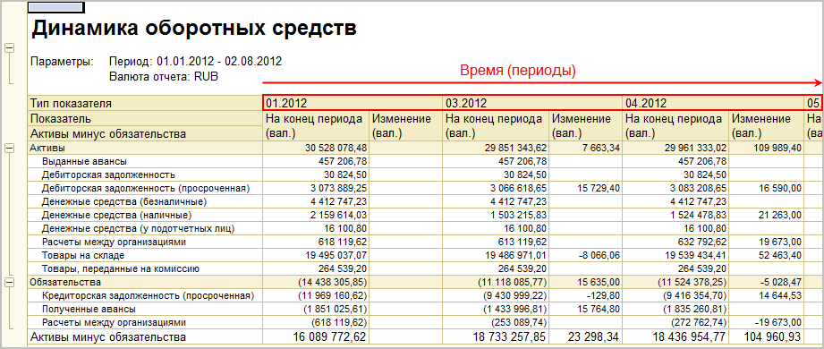

1.4. Дополнительную информацию по группировке следует выводить:

> • вместе с объектом анализа, если информация уточняет свойства объекта. 
>
> *Например, "Характеристика" для объекта "Номенклатура":* 
>
>
>
> 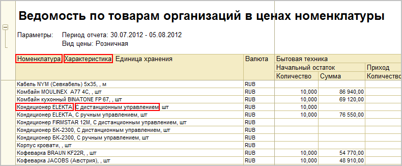
>
>
>
> • в отдельной колонке, если информация, по сути, также является объектом анализа, но группировка по ней невозможна или усложнит восприятие отчета. 
>
> *Например, "Валюта" в отчетах по анализу расчетов с клиентами:* 
>
>
>
> 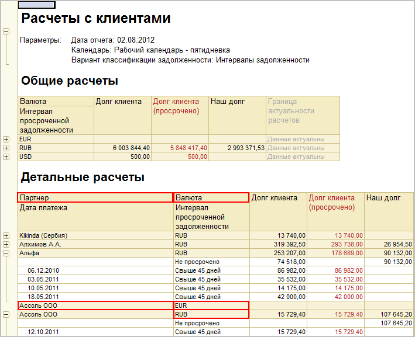

1.5. Показатели отчета следует располагать:

> • в колонках. При этом порядок следования показателей – по важности, слева направо. В отдельных случаях показатели могут располагаться в порядке, отражающем логику вычислений (формулу). 
>
> Например, в отчете "Валовая прибыль по сделкам" показатели следуют в порядке логики вычисления: 
>
>
>
> 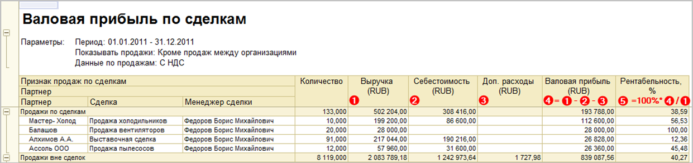
>
>
>
> • в строках, если требуется сравнение нескольких показателей в динамике. 
>
> *Например, в отчете "Динамика оборотных средств":* 
>
>
>
> 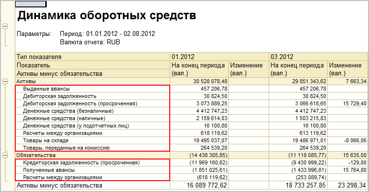

1.6. В отчетах, где данные будут представлены в виде списка, рекомендуется колонку с порядковым номером делать первой.

1.7. Если предполагается печать отчета, то следует оптимизировать его макет под формат А4.

## 2\. Сортировка данных

2.1. Сортировку по умолчанию следует устанавливать исходя из назначения отчета, так, чтобы наверху отображались самые важные для пользователей данные.

Правильно (сортировка по долгу клиента, сравнивать просто):

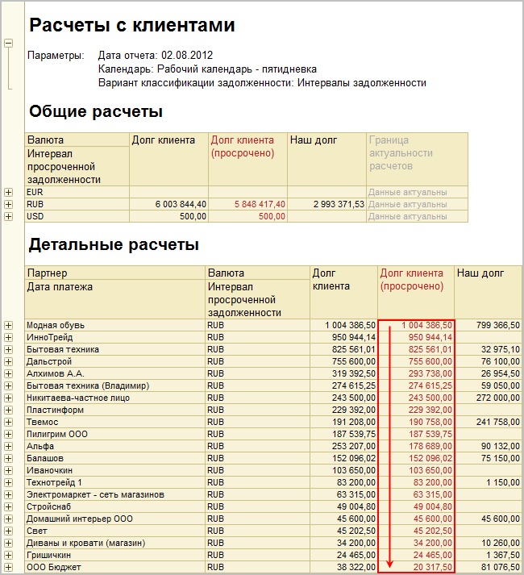

Неправильно (сортировка по алфавиту, сравнивать сложно):

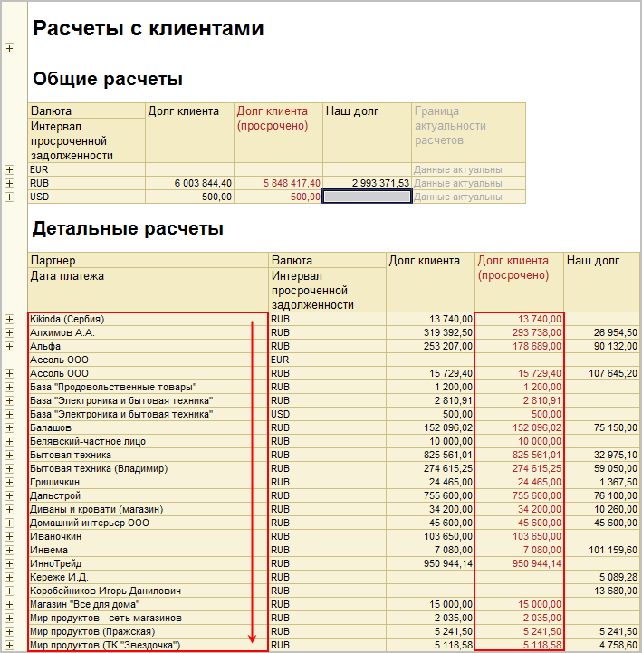

2.2. Сортировку по алфавиту (по возрастанию) следует применять в случае, когда числовые показатели являются дополнительной информацией, а целью анализа является поиск объектов учета по наименованию 

*Например, в отчете "Движения товаров по складам" применена сортировка по наименованию номенклатуры.* 

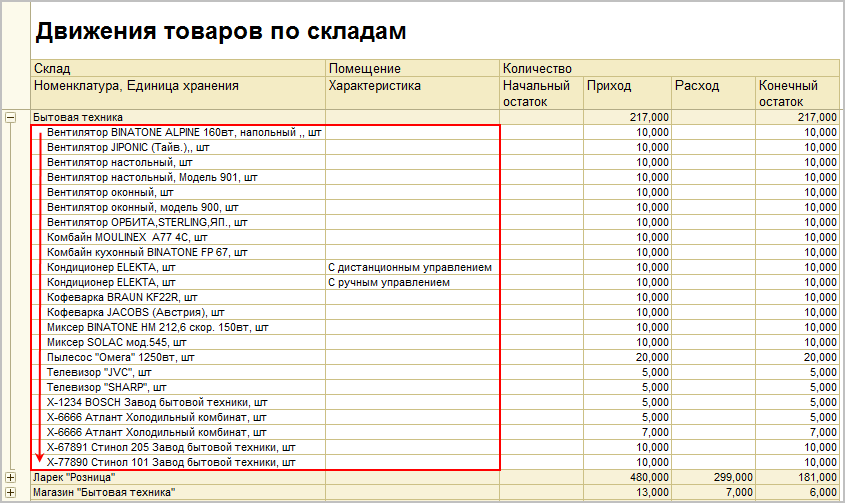

2.3. Сортировку по периоду (по возрастанию) следует применять, когда в отчете производится анализ с учетом периода хозяйственных операций.

2.4. Сортировка в отчетах должна применяться только к видимым объектам анализа (группировкам или показателям). Пользователю должен быть понятен принцип сортировки без дополнительных объяснений. 

## 3\. Условное оформление

Оформление отдельных элементов отчета играет роль индикаторов, благодаря которым пользователь обратит внимание на важные факты. При цветовом оформлении таблиц, списков и диаграмм следует придерживаться следующих правил:  

3.1. *Негативные* факты оформляются красным цветом (элемент стиля "НегативноеСобытие", RGB 178,34,34) 

*Позитивные* факты оформляются зеленым цветом (элемент стиля "ПозитивноеСобытие", RGB 0,128,0) 

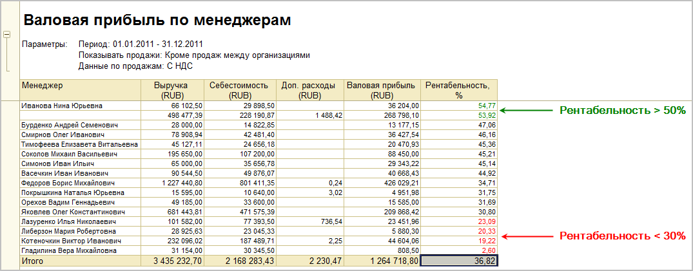

3.2. Для фона ячеек с *неактуальной* информацией используется розовый цвет (элемент стиля "НеактуальнаяИнформация" (RGB 255,200,200)

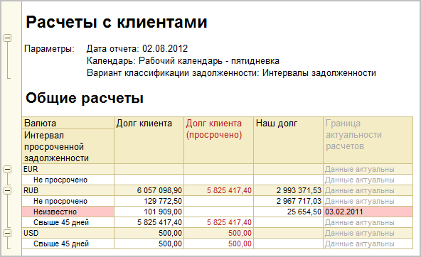

3.3. *Итоговая* информация оформляется жирным шрифтом (элемент стиля вида шрифт "ИтоговаяИнформация", начертание – жирный). 

3.4. Для числовых полей следует включать выделение отрицательных значений в тех случаях, когда отрицательные значения однозначно указывают на ошибку в анализируемых данных или являются негативным фактом. 

3.5. *Помеченные на удаление* данные оформляются шрифтом с зачеркиванием(элемент стиля вида шрифт "ПомеченныеНаУдалениеДанные", начертание – зачеркнутый).

## 4\. Общие итоги

 

Если отображение общих итогов не имеет смысла, то его следует отключать. 

*Например, в отчете "Прайс-лист" для колонки "Цена" общие итоги нужно отключить.* 
