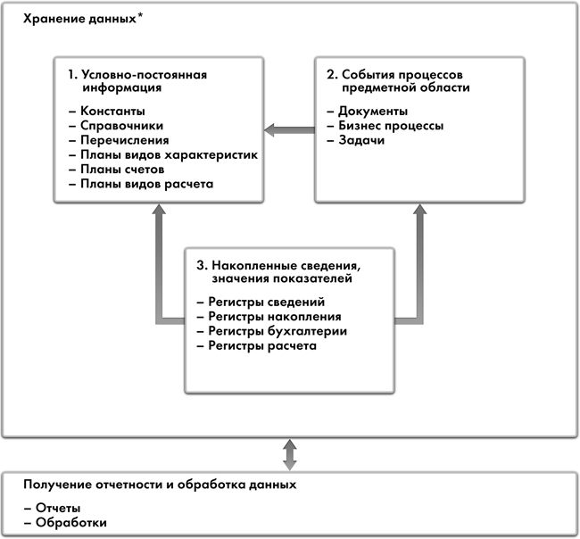

# #std683 Общие сведения об организации хранения данных

> Область применения: управляемое приложение, мобильное приложение, обычное приложение.
>
> Раздел ИТС: Создание и изменение объектов метаданных / Организация хранения данных
>
> Источник: https://its.1c.ru/db/v8std/content/683/hdoc
>
> Проверено по источнику: 2026-10-07

<table><tbody><tr><td> 
<em>Методическая рекомендация (полезный совет)</em>
</td></tr></tbody></table>

1\. При проектировании системы одной из задач является выбор типов объектов метаданых для реализации хранения соответствующих сущностей предметной области. Неправильный выбор типов объектов ведет к неэффективности прикладного решения, невозможности его последующего развития и делает невозможным адаптацию к возможным изменениям состава решаемых задач.

2\. При выборе типа объектов метаданных в общем случае следует руководствоваться следующей схемой прикладного решения:

> *\* Стрелки на схеме обозначают взаимосвязи между данными (взаимные ссылки).*

На схеме выделяются следующие блоки:

1\. **Условно-постоянная информация**. К этой части относится информация, которая вводится один раз, сравнительно редко изменяется и многократно используется. Примером такой информации могут служить различные классификаторы, настройки, перечни, реестры, нормативно-справочная информация и т.п.

2\. Различные **события процессов предметной области**, которые привязаны ко времени и могут порождать при регистрации различные сведения, изменять значения показателей. Пример – документооборот предприятия, ведение учета; регистрация заявок, звонков и т. п.

3\. **Накопленные сведения, значения показателей**, которые характеризуют процессы и текущее состояние прикладной области. В отличие от первых двух частей, эти данные имеют необъектную природу и не являются самостоятельными сущностями с точки зрения прикладной области. Пример – история продаж товара, остатки на складах, текущий бухгалтерский баланс, история изменения курсов валют и т.п.

Отдельно выделяются средства для анализа и обработки данных, отчеты, механизмы, которые опираются на данные всех остальных блоков, но сами данных не содержат.

> *Подробнее о задачах и принципах хранении информации см. в книге «*[*Профессиональная разработка в системе 1С Предприятие 8*](<https://buh.ru/books/detail.php?ID=42696>)*» глава 6.*

2.1. Таким образом, упрощенно, для каждой сущности предметной области необходимо выбрать соответствующий блок по следующей схеме:

- Если необходимо хранить сравнительно редко изменяющуюся информацию, не привязанную ко времени, то это блок условно постоянной информации (1).

- Если необходимо регистрировать события, требующие документально подтверждения с отслеживанием последовательности событий на временной оси, то это блок событий процессов предметной области (2).

- В противном случае сущность должна относиться к блоку сведений и значений показателей (3).

Более подробные критерии выбора того или иного блока: 

<table><tbody><tr><td><strong>Критерий /  блок</strong></td><td><strong>Условно-постоянная информация</strong></td><td><strong>События процессов предметной области</strong></td><td><strong>Накопленные сведения, значения показателей</strong></td></tr>

<tr><td>Основное предназначение</td><td>Необходимо хранить нормативно-справочную информацию, реестры</td><td>Необходимо регистрировать события процессов, обеспечивать документальное подтверждение сведениям</td><td>Необходимо хранить данные, которые характеризуют процессы и текущее состояние прикладной области</td></tr>

<tr><td>Отслеживание изменения состояния</td><td>Не требуется</td><td>Требуется регистрация документа к учету, отмена регистрации учета документа, учет запусков или окончаний процесса, изменения состояния задач, формирование движений</td><td>Не требуется</td></tr>

<tr><td>Иерархия, группировка данных</td><td>Требуется иерархия и группировка, возможно между разными сущностями</td><td>Не требуется</td><td>Не требуется</td></tr>

<tr><td>Ключевые свойства</td><td>Необходимо иметь наименование, код</td><td>Необходимо учитывать дату события, его номер</td><td>Не требуется</td></tr>

<tr><td>Хранение значений дополнительных реквизитов сущности</td><td>Необходимо хранить редко изменяемые реквизиты произвольных данных</td><td>Необходимо хранить ссылки на другие объекты и значения параметров, характеризующие событие</td><td>Необходимо хранить только значения реквизитов для других объектов базы</td></tr>

<tr><td>Нумерация</td><td>Необходимы серии кодов по всем элементам данного типа или в пределах иерархии</td><td>Необходимы серии номеров по всем элементам данного типа или в пределах периода по дате, сквозная нумерация объектов разных типов</td><td>Не требуется</td></tr></tbody></table>

2.2. Затем, необходимо принять решение о конкретном виде типа объекта метаданных внутри выбранного блока:

2.2.1. Для хранения условно-постоянной информации:

<table><tbody><tr><td> <blockquote dir="ltr"> 
<em>Область применения (уточнение): управляемое приложение, обычное приложение.</em>
</blockquote> 
1. Если требуется хранение плана счетов для организации учета по <a href="https://its.1c.ru/db/garant/content/10036812/hdoc/1">принципам двойной записи</a>, то используется специализированный объект метаданных «<a href="https://its.1c.ru/db/v8devgloss/content/28/hdoc/01">План счетов</a>»  2. Если требуется хранение перечня видов расчета для организации <a href="https://its.1c.ru/db/garant/content/12025268/hdoc/1020">учета начислений и удержаний</a>, то используется специализированный объект метаданных «<a href="https://its.1c.ru/db/v8devgloss/content/28/hdoc/03">План видов расчета</a>»  3. Если требуется хранить список характеристик (свойств), причем состав самого списка, тип характеристик, их состав определяются пользователем, то используется объект метаданных «<a href="https://its.1c.ru/db/v8devgloss/content/28/hdoc/02">План видов характеристик</a>»
</td></tr></tbody></table>

4\. Если требуется хранить одиночное значение, которое редактирует пользователь (как правило, это администратор, выполняющий настройки системы), не требующего ссылок из других данных, то используется объект метаданных «[Константа](<https://its.1c.ru/db/v8devgloss/content/26/hdoc>)»  

5\. Если необходимо определить фиксированный список значений не редактируемый пользователем, без каких-либо дополнительных реквизитов, то используется объект метаданных «[Перечисление](<https://its.1c.ru/db/v8devgloss/content/62/hdoc>)»  

6\. В остальных случаях, как правило, используется объект метаданных «[Справочник](<https://its.1c.ru/db/v8devgloss/content/22/hdoc>)»

Более подробные критерии выбора того или иного вида объекта метаданных: 

<table><tbody><tr><td><strong>Критерий /  тип объекта</strong></td><td><strong>Константа</strong></td><td><strong>Перечисление</strong></td><td><strong>План видов  характеристик *</strong></td><td><strong>Справочник</strong></td></tr>

<tr><td>Основное предназначение</td><td>Необходимо хранение одиночных значений, предопределенных данных</td><td>Необходимо хранение списка неизменных представлений без дополнительных их атрибутов</td><td>Необходимо хранение списка сущностей и значений характеристик экземпляров сущности</td><td>Требуется хранение списка объектов и значений их атрибутов </td></tr>

<tr><td>Добавление и редактирование пользователем</td><td>Требуется только изменение значения</td><td>Не требуется</td><td>Требуется добавление, удаление и изменение элементов, редактирование состава и значений характеристик сущности</td><td>Требуется добавление, удаление, изменение элементов</td></tr>

<tr><td>Иерархия, группировка данных</td><td>Не требуется</td><td>Не требуется</td><td>Требуется в пределах одной сущности</td><td>Требуется в пределах одной сущности или между разными сущностями</td></tr>

<tr><td>Хранение значений дополнительных реквизитов сущности</td><td>Не требуется</td><td>Не требуется</td><td>Необходимо хранить произвольные данные для атрибутов сущности</td><td>Необходимо хранить произвольные данные для атрибутов сущности</td></tr>

<tr><td>Хранение списков значений дополнительных реквизитов</td><td>Не требуется</td><td>Не требуется</td><td>Требуется хранение списков наборов значений реквизитов для сущности</td><td>Требуется хранение списков наборов значений реквизитов для сущности</td></tr>

<tr><td>Возможность ввода на основании других объектов</td><td>Не требуется</td><td>Не требуется</td><td>Необходим ввод новых элементов с использованием информации других объектов</td><td>Необходим ввод новых элементов с использованием информации других объектов</td></tr>

<tr><td>Нумерация</td><td>Не требуется</td><td>Не требуется</td><td>Необходимы серии кодов по всем элементам одного типа или в пределах группировки</td><td>Необходимы серии кодов по всем элементам одного типа или в пределах группировки или подчинения</td></tr></tbody></table>

> *\* область применения (уточнение): управляемое приложение, обычное приложение.*

2.2.2. Для хранения событий процессов предметной области:

<table><tbody><tr><td> <blockquote dir="ltr"> 
<em>Область применения (уточнение): управляемое приложение, обычное приложение.</em>
</blockquote> 
1. Если требуется учет одиночных событий, адресованных некоторому исполнителю (пользователю, сотруднику, группе или роли) не требуется формирование движений по результатам события: то используется объект метаданных «<a href="https://its.1c.ru/db/v8devgloss/content/94/hdoc">Задача</a>»  2. Если требуется регистрировать в системе возникновение и ход регулярного процесса, состоящего из последовательности действий (событий), то используется объект метаданных «<a href="https://its.1c.ru/db/v8devgloss/content/42/hdoc">Бизнес-процесс</a>». Для учета событий, действий в рамках процесса используется объект метаданных «<a href="https://its.1c.ru/db/v8devgloss/content/94/hdoc">Задача</a>»
</td></tr></tbody></table>

3\. В остальных случаях, как правило, используется объект метаданных «[Документ](<https://its.1c.ru/db/v8devgloss/content/23/hdoc>)»

Более подробные критерии выбора того или иного вида объекта метаданных: 

<table><tbody><tr><td><strong>Критерий /  тип объекта</strong></td><td><strong>Задача *</strong></td><td><strong>Бизнес-процесс * (с задачами)</strong></td><td><strong>Документ</strong></td></tr>

<tr><td>Основное предназначение</td><td>Необходимо вести учет одиночных событий, адресованных некоторым исполнителям</td><td>Необходимо вести учет последовательности событий, адресованных некоторым исполнителям</td><td>Необходима регистрация событий во времени, генерация вторичных данных, соответствующих этим событиям</td></tr>

<tr><td>Вложенность</td><td>Не требуется</td><td>Требуется учет процессов, вложенных в другие процессы (иерархия задач)</td><td>Не требуется</td></tr>

<tr><td>Объединение в журналы</td><td>Не требуется</td><td>Не требуется</td><td>Необходимо объединение документов разных видов в одном журнале</td></tr>

<tr><td>Состояние объекта</td><td>Требуются состояния «новый», «выполнено»</td><td>Требуются состояния «новый», «в работе», «завершен»</td><td>Требуются состояния «проведен», «не проведен»</td></tr>

<tr><td>Нумерация</td><td>Необходимы серии номеров по всем задачам данного вида или в пределах периода по дате</td><td>Необходимы серии номеров по всем процессам данного вида или в пределах периода по дате, нумерация событий внутри процесса</td><td>Необходимы серии номеров для документов разных видов – сквозные, или в пределах периода по дате</td></tr></tbody></table>

> *\* область применения (уточнение): управляемое приложение, обычное приложение.*

2.2.3. Для хранения накопленных сведений, значений показателей:

<table><tbody><tr><td> <blockquote dir="ltr"> 
<em>Область применения (уточнение): управляемое приложение, обычное приложение.</em>
</blockquote> 
1. Если требуется хранение данных учета с использованием <a href="https://its.1c.ru/db/garant/content/10036812/hdoc/1">принципа двойной записи</a>, то используется специализированный объект метаданных «<a href="https://its.1c.ru/db/v8devgloss/content/20/hdoc/04">Регистр бухгалтерии</a>»  2. Если требуется хранение результатов расчета <a href="https://its.1c.ru/db/garant/content/12025268/hdoc/1020">учета начислений и удержаний</a>, то используется специализированный  объект метаданных «<a href="https://its.1c.ru/db/v8devgloss/content/20/hdoc/05">Регистр расчета</a>»
</td></tr></tbody></table>

3\. Если требуется хранение изменений показателей – приход и расход, получение остатков и оборотов за период, то используется объект метаданных «[Регистр накопления](<https://its.1c.ru/db/v8devgloss/content/151/hdoc>)». 

4\. Во всех остальных случаях используется объект метаданных «[Регистр сведений](<https://its.1c.ru/db/v8devgloss/content/152/hdoc>)».

Более подробные критерии выбора того или иного вида объекта метаданных: 

<table><tbody><tr><td><strong>Критерий /  тип объекта</strong></td><td><strong>Регистр накоплений</strong></td><td><strong>Регистр сведений</strong></td></tr>

<tr><td>Основное предназначение</td><td>Требуется хранение изменений данных - прихода и расхода значений показателей</td><td>Требуется хранение информации в виде наборов записей, регистрация некоторых сведений, значений</td></tr>

<tr><td>Получение данных</td><td>Требуется получение остатков, оборотов данных</td><td>Необходимо получение среза информации на момент времени или текущего значения показателей</td></tr>

<tr><td>Подтверждение происхождения данных</td><td>Требуется обязательная связь с регистрирующим документом</td><td>Связь не обязательна</td></tr></tbody></table>

3\. Пример выбора типов объектов метаданных.  

Пусть некоторая организация занимается периодическим анкетированием. При заполнении анкеты указывается дата анкетирования. В анкете указывается набор вопросов, результатом заполнения анкеты является набор ответов. Сущность «Анкета» привязана к дате, порождает статистику – ответы на вопросы.

Таким образом, имеем:

- Периодическое событие, привязано к дате, порождает значение параметров. Это - второй блок «события предметной области».

- Далее уточняем внутри блока «событий предметной области»: т.к. анкета формирует вторичные данные - результаты ответов на вопросы, то следовательно, это должен быть документ. 
