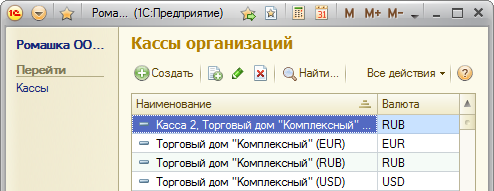
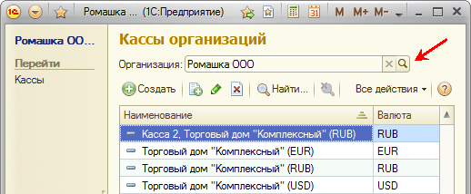
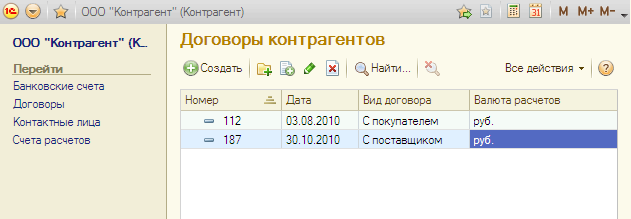

# #std684 Список, открываемый из панели навигации формы объекта

> Область применения: управляемое приложение.
>
> Раздел ИТС: Проектирование интерфейсов для 8.2 / Формы
>
> Источник: https://its.1c.ru/db/v8std/content/684/hdoc
>
> Проверено по источнику: 2026-10-07

1\. Список, открываемый из панели навигации формы объекта, следует отражать с отбором по этому объекту.

*Например, в списке «Договоры» справочника «Контрагент» отражаются договоры только по конкретному контрагенту, например, по ООО «Контрагент»*

2\. В списке не следует выводить название объекта (в виде надписи или поля ввода в режиме "просмотр"), т.к. оно отображается в области системных команд и в панели навигации

<table><tbody><tr><td> Правильно</td><td> Неправильно</td></tr>

<tr><td></td><td></td></tr></tbody></table>

3\. В списке не следует отражать колонку с названием объекта, т.к. для каждой строки это название будет одинаковым.

*Например, в списке «Договоры» справочника «Контрагент» колонка Контрагент не выводится.*

4\. В названии команды, отражаемой в панели навигации, не следует указывать название объекта, т.к. его можно определить из контекста.

<table><tbody><tr><td> Правильно</td><td> Неправильно</td></tr>

<tr><td>Банковские счета</td><td>Банковские счета контрагента</td></tr>

<tr><td>Договоры</td><td>Договоры контрагента</td></tr>

<tr><td>Ответственные лица</td><td>Ответственные лица организаций</td></tr></tbody></table>
