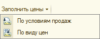
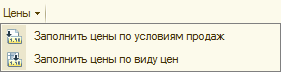
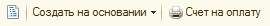
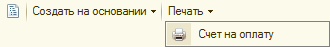

# #std694 Подменю

> Раздел ИТС: Проектирование интерфейсов для 8.2 / Оформление элементов
>
> Источник: https://its.1c.ru/db/v8std/content/694/hdoc
>
> Проверено по источнику: 2026-10-07

1\. При формировании командных панелей однотипные команды рекомендуется объединять в подменю.

2\. Если в подменю есть команды, в заголовках которых присутствует общий текст, то его следует выносить в заголовок подменю:

<table><tbody><tr><td style="background-color: transparent; vertical-align: top"> 
Правильно
</td><td style="background-color: transparent; vertical-align: top"> 
Неправильно
</td></tr>

<tr><td style="background-color: transparent; vertical-align: top"> 
 
 

</td><td style="background-color: transparent; vertical-align: top"> 
 
 

</td></tr></tbody></table>

3\. Подменю не должно содержать одну команду. В этом случае ее следует выносить в командную панель:

<table><tbody><tr><td style="background-color: transparent; vertical-align: top"> 
Правильно
</td><td style="background-color: transparent; vertical-align: top"> 
Неправильно
</td></tr>

<tr><td style="background-color: transparent; vertical-align: top"> 
 
 

</td><td style="background-color: transparent; vertical-align: top"> 
 
 

</td></tr></tbody></table>
